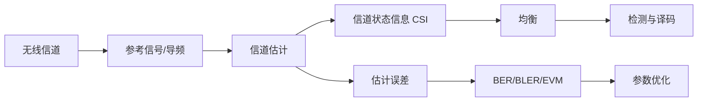
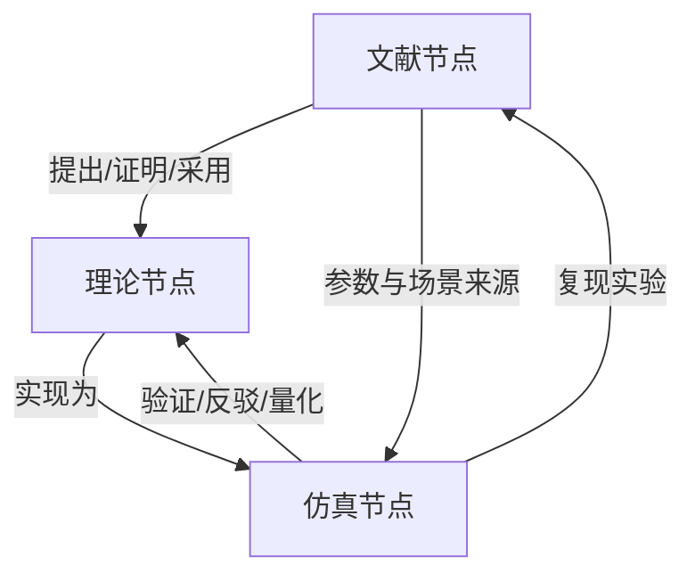

# 5G 信道估计与均衡

> 目标：建立从物理信道、参考信号、估计算法到接收机均衡与仿真验证的可检索知识图谱。

> LTE 对照入口：[[4G LTE 信道估计与均衡]]；LTE 的 CRS/DM-RS、SC-FDMA 和 Turbo/TBCC 链路单独记录。

> 定位应用入口：[[5G 定位与 TDOA｜MOC]]；该专题把资源网格、参考信号和均衡接口接到 PRACH、PDCCH/PDSCH 与多站 UL-TDOA。

## 前置知识路线

正式阅读本知识库前，先从 [[00 5G 信道估计与均衡前置知识]] 开始。建议按照“数学与概率 → 信号处理 → 数字通信 → 移动通信 → 估计与检测 → 仿真验证”的顺序学习。

最低前置要求：

- [[00 5G 信道估计与均衡前置知识#复数与复向量基础]]、[[00 5G 信道估计与均衡前置知识#矩阵论与线性代数]]：理解复信道、矩阵维度、SVD 和条件数。
- [[00 5G 信道估计与均衡前置知识#概率论与随机变量]]、[[00 5G 信道估计与均衡前置知识#随机过程与相关函数]]：理解噪声、协方差、衰落和时频相关性。
- [[00 5G 信道估计与均衡前置知识#傅里叶分析与数字信号处理]]、[[00 5G 信道估计与均衡前置知识#OFDM 与循环前缀]]：理解 FFT、循环卷积和单抽头频域模型。
- [[00 5G 信道估计与均衡前置知识#数字通信与基带模型]]、[[00 5G 信道估计与均衡前置知识#NR 物理层基本概念]]：理解调制、SNR、参考信号和 NR 资源网格。

## 学习路径

1. [[00 5G 信道估计与均衡前置知识]]
2. [[01 5G 物理层与信道模型]]
3. [[02 参考信号与导频设计]]
4. [[03 信道估计基础]]
5. [[04 5G 信道估计算法]]
6. [[05 MIMO 信道估计]]
7. [[06 OFDM 接收与频域均衡]]
8. [[07 信道估计误差与性能分析]]
9. [[08 仿真实验：LS 与 MMSE]]
10. [[09 仿真实验：MIMO 均衡]]
11. [[10 文献阅读卡片]]

## 当前进度

- 理论主线：`01`—`07` 已建立。
- 仿真主线：`08`、`09` 已完成实验设计，尚未运行。
- 文献主线：`10` 已建立卡片模板和证据等级，具体书目信息待补充。

## 建议执行顺序

1. 先用 [[08 仿真实验：LS 与 MMSE]] 验证 SISO、导频和估计器。
2. 再用 [[09 仿真实验：MIMO 均衡]] 验证空间信道和线性均衡。
3. 将实验参数与曲线写回对应页面，再更新 [[07 信道估计误差与性能分析]] 的结论。
4. 用 [[10 文献阅读卡片]] 记录标准条款、论文假设和复现差异。

## 结果状态

| 节点 | 当前状态 | 下一步 |
|---|---|---|
| [[01 5G 物理层与信道模型]]—[[07 信道估计误差与性能分析]] | 理论草稿已建立 | 对照标准和仿真补充证据 |
| [[08 仿真实验：LS 与 MMSE]] | 待验证 | 运行 SISO/OFDM 基线 |
| [[09 仿真实验：MIMO 均衡]] | 待验证 | 运行 ZF/MMSE 与条件数分桶 |
| [[10 文献阅读卡片]] | 模板已建立 | 补充正式书目信息和定位 |

---

# 第一步：设计骨架——专属 MOC（内容地图）

## A. 问题总览



## B. 分层目录

### 1. 信道与系统模型

- [[01 5G 物理层与信道模型]]：OFDM、资源网格、时频选择性、AWGN、TDL/CDL。
- [[05 MIMO 信道估计]]：单用户 MIMO、Massive MIMO、空间相关性、预编码反馈。

### 2. 参考信号与导频

- [[02 参考信号与导频设计]]：DM-RS、CSI-RS、PTRS、SRS、密度、端口与开销。

### 3. 估计理论与算法

- [[03 信道估计基础]]：LS、LMMSE、MAP、插值、统计先验。
- [[04 5G 信道估计算法]]：时域、频域、二维估计，低复杂度实现。
- [[07 信道估计误差与性能分析]]：MSE、NMSE、CRLB、导频污染、相位噪声。

### 4. 均衡与检测

- [[06 OFDM 接收与频域均衡]]：ZF、MMSE、ML、软输出、噪声增强。
- [[09 仿真实验：MIMO 均衡]]：ZF/MMSE 在不同 SNR 和天线配置下的比较。

### 5. 仿真与验证

- [[08 仿真实验：LS 与 MMSE]]：可复现实验、参数、曲线和结论。
- [[09 仿真实验：MIMO 均衡]]：空间复用场景下的接收性能。
- [[10 文献阅读卡片]]：文献结论与代码、公式的对应关系。

## C. 入口问题

- 为什么 OFDM 系统可以把频率选择性信道近似为多个平坦衰落子载波？
- DM-RS 与 CSI-RS 分别服务于哪些接收机任务？
- LS 估计为什么不需要信道统计信息，但在低 SNR 下性能较差？
- LMMSE 为什么通常优于 LS，代价是什么？
- ZF 均衡为什么会放大深衰落子载波上的噪声？
- 估计误差如何传递到 EVM、BER 和 BLER？
- MIMO 场景中信道矩阵的条件数如何影响 ZF 和 MMSE？

---

# 第二步：建立“多维标签体系”（Tags）

标签用于筛选和聚合，不替代笔记之间的语义链接。每篇原子笔记建议使用 4—6 个标签，分别从以下维度选择。

## 1. 领域维度

- `#domain/5G`
- `#domain/NR`
- `#domain/OFDM`
- `#domain/MIMO`
- `#domain/无线通信`

## 2. 主题维度

- `#topic/信道模型`
- `#topic/参考信号`
- `#topic/信道估计`
- `#topic/信道插值`
- `#topic/均衡`
- `#topic/检测`
- `#topic/性能分析`

## 3. 方法维度

- `#method/LS`
- `#method/MMSE`
- `#method/LMMSE`
- `#method/MAP`
- `#method/ZF`
- `#method/ML`
- `#method/二维插值`
- `#method/深度学习`

## 4. 研究对象维度

- `#object/SISO`
- `#object/MIMO`
- `#object/Massive-MIMO`
- `#object/时域`
- `#object/频域`
- `#object/时频域`
- `#object/高速移动`

## 5. 工程环节维度

- `#stage/建模`
- `#stage/导频设计`
- `#stage/接收机`
- `#stage/仿真`
- `#stage/验证`
- `#stage/优化`

## 6. 笔记状态维度

- `#status/待阅读`
- `#status/阅读中`
- `#status/已验证`
- `#status/待补充`
- `#status/evergreen`

## 标签组合示例

```text
#domain/5G #domain/OFDM #topic/信道估计 #method/LS #object/SISO #stage/仿真 #status/已验证
```

## 标签规则

1. 用小写英文或稳定中文词保持同一语义只有一种写法。
2. 标签表达“这篇笔记属于什么集合”，具体概念之间用 `[[内部链接]]` 表达。
3. 算法比较笔记同时标注方法标签，例如 `#method/LS` 与 `#method/MMSE`。
4. 仿真结果必须带 `#status/已验证`，并记录随机种子、版本和关键参数。

---

# 第三步：原子化拆分知识点（图谱的灵魂）

## 原子笔记模板

```markdown
---
title: 概念名称
tags:
  - domain/5G
  - topic/信道估计
  - status/待补充
---

# 概念名称

## 一句话定义

## 解决的问题

## 数学表达

## 关键假设

## 与其他概念的关系

- 前置：
- 对比：
- 后续：

## 证据与出处

- 文献：
- 仿真：

## 待验证问题
```

## 推荐原子知识点

### 系统与信道

- [[OFDM 循环前缀]]：抑制符号间干扰并将线性卷积近似为循环卷积。
- [[频率选择性衰落]]：不同频率分量经历不同复增益。
- [[时变信道]]：信道响应随时间变化，引入多普勒扩展。
- [[TDL 信道模型]]：以抽头延迟线描述功率时延分布。
- [[CDL 信道模型]]：描述簇、角度和空间相关性的 3D 信道模型。

### 参考信号

- [[DM-RS]]：用于解调相关的信道估计。
- [[CSI-RS]]：用于下行信道状态测量、波束管理和反馈。
- [[PTRS]]：跟踪公共相位误差和相位噪声。
- [[SRS]]：用于上行信道探测和链路自适应。
- [[导频开销与估计精度]]：导频密度、资源效率与估计误差之间的权衡。

### 信道估计

- [[LS 信道估计]]：直接用接收导频除以已知导频。
- [[LMMSE 信道估计]]：利用信道与噪声协方差降低均方误差。
- [[二维时频插值]]：从导频位置恢复完整资源网格上的信道响应。
- [[信道估计误差]]：真实信道与估计信道之差。
- [[估计器偏差与方差]]：衡量估计器统计性质的两个维度。

### 均衡与检测

- [[单抽头频域均衡]]：对每个 OFDM 子载波使用一个复系数补偿信道。
- [[ZF 均衡]]：求信道逆以消除理想条件下的符号间干扰。
- [[MMSE 均衡]]：在抑制干扰和避免噪声增强之间折中。
- [[MIMO 信道矩阵条件数]]：衡量空间子信道可分离程度。
- [[软输出检测]]：输出比特对数似然比供信道译码器使用。

### 性能指标

- [[MSE 与 NMSE]]：衡量信道估计误差的绝对和归一化大小。
- [[EVM]]：衡量接收符号相对于理想星座点的误差。
- [[BER 与 BLER]]：分别衡量比特错误率与块错误率。
- [[信道容量与 CSI 质量]]：分析信道信息质量对可达速率的影响。

## 原子化判断标准

一篇笔记只回答一个稳定问题，最好能在 1—3 分钟内读完，并具备明确的“定义—公式—假设—关系—证据”结构。出现以下情况时继续拆分：标题中包含“与”“以及”“流程”和多个算法；正文同时讨论不同输入、输出或评价指标；一条笔记无法被多个主题独立引用。

---

# 第四步：建立“文献-理论-仿真”三位一体图谱

## 三类节点



## 文献阅读卡片模板

```markdown
---
title: 文献｜作者-年份-主题
tags:
  - topic/信道估计
  - stage/阅读
  - status/待阅读
---

# 文献｜作者-年份-主题

## 研究问题

## 场景与假设

## 核心理论

- [[相关原子概念]]

## 算法步骤

1.
2.
3.

## 关键结论

## 可复现参数

- 载波频率：
- 带宽与 SCS：
- 信道模型：
- SNR 范围：
- 天线配置：
- 调制与码率：
- 随机种子：

## 对应仿真

- [[仿真实验名称]]

## 局限与疑问
```

## 理论节点的最小记录

### LS 信道估计

在导频位置 $p$ 已知、接收信号为 $y_p = h_p x_p + n_p$ 时：

$$
\hat{h}_{\mathrm{LS},p} = \frac{y_p}{x_p}
$$

若导频满足 $|x_p|=1$，则估计误差为：

$$
\hat{h}_{\mathrm{LS},p}-h_p = \frac{n_p}{x_p}
$$

LS 的优点是计算简单且不依赖信道统计信息；缺点是噪声直接进入估计结果，需要通过时频插值或平滑恢复非导频位置。

### LMMSE 信道估计

令导频位置的 LS 估计为 $\hat{h}_{\mathrm{LS}}$，信道协方差为 $R_{hh}$，噪声协方差为 $R_{nn}$，则一般形式可写为：

$$
\hat{h}_{\mathrm{LMMSE}}
= R_{hh}\left(R_{hh}+R_{nn}\right)^{-1}\hat{h}_{\mathrm{LS}}
$$

实际系统常使用低秩近似、分解矩阵或简化协方差模型降低复杂度。LMMSE 的性能依赖统计先验，模型失配时收益可能下降。

### OFDM 单抽头均衡

对第 $k$ 个子载波：

$$
Y_k = H_k X_k + N_k
$$

已获得信道估计 $\hat{H}_k$ 时，ZF 均衡为：

$$
\hat{X}_{k,\mathrm{ZF}} = \frac{Y_k}{\hat{H}_k}
$$

带噪声正则化的 MMSE 均衡为：

$$
\hat{X}_{k,\mathrm{MMSE}}
= \frac{\hat{H}_k^*}{|\hat{H}_k|^2 + \sigma_n^2/\sigma_x^2}Y_k
$$

当 $|H_k|$ 很小时，ZF 会显著放大噪声；MMSE 借助噪声与信号功率比缓解这一问题。

### MIMO 线性均衡

对于 $\mathbf{y}=\mathbf{H}\mathbf{x}+\mathbf{n}$：

$$
\hat{\mathbf{x}}_{\mathrm{ZF}}
= (\mathbf{H}^{H}\mathbf{H})^{-1}\mathbf{H}^{H}\mathbf{y}
$$

$$
\hat{\mathbf{x}}_{\mathrm{MMSE}}
= (\mathbf{H}^{H}\mathbf{H}+\sigma_n^2/\sigma_x^2\mathbf{I})^{-1}\mathbf{H}^{H}\mathbf{y}
$$

实现时优先使用 Cholesky、QR 或共轭梯度等线性求解方法，避免显式求逆。

## 仿真节点的统一记录

每个仿真节点至少记录：

- 目的：验证哪个理论结论。
- 输入：信道模型、导频、调制、SNR、天线配置。
- 方法：LS/LMMSE、插值方式、ZF/MMSE。
- 输出：NMSE、EVM、BER、BLER、吞吐量。
- 可复现信息：代码版本、随机种子、运行日期。
- 结论：现象、数量级、与文献的差异。

## 三位一体索引表

| 文献节点 | 理论节点 | 仿真节点 | 需要确认的证据 |
|---|---|---|---|
| [[文献｜3GPP NR 物理层规范]] | [[DM-RS]]、[[CSI-RS]] | [[仿真实验：NR 参考信号映射]] | 资源映射、端口和序列定义 |
| [[文献｜OFDM 信道估计综述]] | [[LS 信道估计]]、[[二维时频插值]] | [[仿真实验：LS 与插值]] | NMSE 随 SNR、导频密度的变化 |
| [[文献｜LMMSE 信道估计研究]] | [[LMMSE 信道估计]] | [[仿真实验：LS 与 MMSE]] | 统计先验、复杂度和 NMSE |
| [[文献｜MIMO 检测综述]] | [[ZF 均衡]]、[[MMSE 均衡]] | [[仿真实验：MIMO 均衡]] | BER 随 SNR、天线相关性的变化 |
| [[文献｜高速移动通信信道估计]] | [[时变信道]]、[[多普勒扩展]] | [[仿真实验：多普勒影响]] | 速度、相干时间与估计误差 |

## 推荐实验顺序

1. AWGN + 单径平坦衰落：验证模型和星座图。
2. TDL 信道 + OFDM：比较无估计、理想 CSI 和 LS 估计。
3. 改变导频间隔：观察二维插值误差。
4. LS 与 LMMSE：绘制 NMSE-SNR 曲线并统计复杂度。
5. SISO ZF 与 MMSE：观察深衰落子载波上的噪声增强。
6. MIMO ZF 与 MMSE：改变天线相关性和信道条件数。
7. 加入多普勒和相位噪声：评估 DM-RS、PTRS 的作用。

## 每次更新笔记的检查清单

- [ ] 新概念是否只有一个核心问题？
- [ ] 是否加入了规范化标签？
- [ ] 是否链接到至少一个前置或后续概念？
- [ ] 理论公式的符号和假设是否明确？
- [ ] 仿真是否记录参数、随机种子和版本？
- [ ] 结论是否区分文献结论与自己的实验观察？
- [ ] 待确认内容是否标记为 `#status/待补充`？
