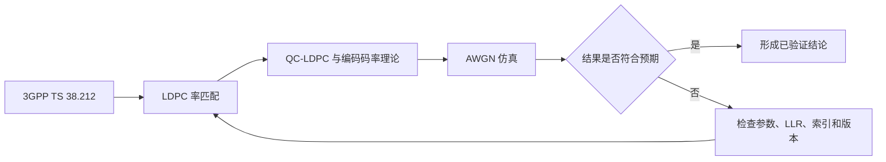

# 5G 信道编译码

> [!abstract] 核心结论
> 5G NR 中，DL-SCH 和 UL-SCH 主要采用 LDPC，BCH 和 DCI 主要采用 Polar，UCI 根据载荷长度与承载方式采用小块码或 Polar。完整链路通常包括 CRC、码块分段、信道编码、率匹配、译码和 CRC 校验。

> 定位应用入口：[[5G 定位与 TDOA｜MOC]]；其中的 PDCCH/DCI 和 DL-SCH/UL-SCH 编译码结果用于资源解析与用户关联，尚不等同于已完成的定位测量。

> LTE 对照入口：[[4G LTE 信道编译码]]；LTE 共享数据采用 Turbo，控制分支采用尾比特卷积码/块码/重复码。

## 知识总览

| 信息类型 | 常见编码方案 | 关键知识点 |
|---|---|---|
| DL-SCH | LDPC | 传输块 CRC、码块分段、基图选择、提升因子、率匹配 |
| UL-SCH | LDPC | LDPC 编码、率匹配、HARQ、软信息译码 |
| BCH | Polar | PBCH 相关编码、CRC、冻结比特、率匹配 |
| DCI | Polar | CRC、Polar 编码、SCL 译码 |
| UCI | 小块码或 Polar | 与载荷长度、PUCCH/PUSCH 传输方式有关 |

## 编码链路

### LDPC 数据链路

```text
Transport Block
    ↓
TB-CRC 附加
    ↓
码块分段与 CB-CRC 附加
    ↓
LDPC 基图选择与提升
    ↓
LDPC 编码
    ↓
率匹配
    ↓
码块级联
    ↓
扰码、调制与物理信道映射
```

### Polar 控制链路

```text
控制信息
    ↓
CRC 附加
    ↓
输入比特交织
    ↓
信息位与冻结位分配
    ↓
Polar 变换
    ↓
率匹配与输出交织
    ↓
扰码、调制与物理信道映射
```

---

# 第一步：设计骨架，专属 MOC

## 1. MOC 入口

### 1.1 基础概念

- [[信道编码基础]]
- [[线性分组码]]
- [[CRC 校验]]
- [[软判决与 LLR]]
- [[编码增益]]
- [[BLER 与 BER]]

#### 1.1.1 编译码链的共同语言

5G NR 的信道编译码可以先抽象为一个带冗余的统计推断问题。设有效信息为 $\mathbf{u}\in\{0,1\}^{K}$，编码器输出码字 $\mathbf{c}=f(\mathbf{u})\in\{0,1\}^{N}$，调制器把编码比特映射为符号 $\mathbf{x}$，经过信道后接收端得到：

$$
\mathbf{y}=\mathcal{H}(\mathbf{x})+\mathbf{n}
$$

其中 $\mathcal{H}(\cdot)$ 可以包含衰落、频率选择性、均衡误差和资源映射影响，$\mathbf{n}$ 表示噪声或未建模干扰。接收机并不直接观察 $\mathbf{c}$，而是依据 $\mathbf{y}$ 形成软信息 $L_i$，再利用码的结构得到 $\hat{\mathbf{u}}$：

$$
L_i=\ln\frac{P(c_i=0\mid y_i)}{P(c_i=1\mid y_i)},
\qquad
\hat{\mathbf{u}}=g(\mathbf{L})
$$

因此，一条链路至少有四类对象：

| 对象 | 数学含义 | 工程问题 |
|---|---|---|
| 信息比特 | $\mathbf{u}$ | 业务数据或控制字段是什么 |
| 合法码字 | $\mathbf{c}$ | 哪些冗余约束可以被译码器利用 |
| 信道观测 | $\mathbf{y}$ | 噪声、衰落和均衡误差如何影响可靠性 |
| 软信息 | $\mathbf{L}$ | 每个比特更像 0 还是 1，以及可信度有多大 |

CRC、LDPC、Polar、率匹配和调制并不是同一层次的“编码算法”：

| 环节 | 核心职责 | 是否主要负责纠错 |
|---|---|---:|
| CRC | 检查候选结果是否可信 | 否，主要是错误检测 |
| LDPC/Polar | 利用码约束恢复信息 | 是 |
| 率匹配 | 把母码适配到给定资源长度 | 否，改变发送比特选择方式 |
| 交织/扰码 | 改变排列或统计特性 | 否 |
| 软解调 | 从符号生成比特可靠性 | 否，但直接影响译码性能 |

#### 1.1.2 信道编码定理与有限码长

对于离散无记忆信道，信道容量定义为：

$$
C=\max_{P_X}I(X;Y),
\qquad
I(X;Y)=H(Y)-H(Y\mid X)
$$

香农信道编码定理可以分成两个方向：

1. **可达性**：当码率 $R<C$ 时，存在一系列码长趋于无穷的编码和译码方案，使块错误率满足 $P_e\to0$。
2. **反定理**：当 $R>C$ 时，不存在能让 $P_e\to0$ 的编码方案；增加译码复杂度也不能突破容量边界。

定理描述的是渐近极限，不是某个 NR 配置的直接性能承诺。实际系统的码长有限，译码迭代次数和 Polar 列表大小有限，还要经过率匹配、量化、信道估计和调制。因此工程上通常观察瀑布区、误码平台、复杂度和吞吐量，而不能只用 $R<C$ 判断一条链路一定可靠。

有限码长下，一个常用的近似形式是：

$$
R^*(n,\epsilon)\approx C-\sqrt{\frac{V}{n}}Q^{-1}(\epsilon)
$$

其中 $n$ 为码长，$\epsilon$ 为目标块错误率，$V$ 为信道色散，$Q^{-1}(\cdot)$ 为高斯 $Q$ 函数的反函数。它说明在相同信道和目标可靠性下，码长越短，实际可用码率通常越低；这也是控制信道短块与数据信道长块采用不同设计的重要理论背景。

#### 1.1.3 码率、资源与性能的统一记账

最基本的名义码率为：

$$
R_{\mathrm{code}}=\frac{K}{N}
$$

但 NR 链路还存在 CRC、填充、码块分段和率匹配，所以至少要区分：

| 名称 | 定义 | 适用场景 |
|---|---|---|
| 名义码率 | $K/N$ | 描述母码的冗余程度 |
| 传输码率 | $K/E$ | 描述本次发送资源中的信息比例 |
| 有效码率 | $K_{\mathrm{info}}/E$ | 把 CRC 等开销排除后的系统比较 |

若每个调制符号承载 $m=\log_2M$ 个编码比特，则忽略导频和控制开销时：

$$
\eta\approx R_{\mathrm{code}}m
$$

这里的 $R$、$K$ 和 $E$ 必须在同一统计边界内定义。把包含 CRC 的 $K$ 与只包含业务数据的 $K_{\mathrm{info}}$ 混用，会导致编码增益、频谱效率和吞吐量比较失真。

#### 1.1.4 六篇基础笔记的阅读关系

```text
信道编码基础
  ↓ 定义冗余、码率、容量与完整链路
线性分组码
  ↓ 给出生成矩阵、校验矩阵、距离与综合
CRC 校验
  ↓ 提供低开销的结果检测与候选筛选
软判决与 LLR
  ↓ 把接收符号转化为译码器可用的可靠性
BLER 与 BER
  ↓ 定义块级和比特级性能统计
编码增益
  ↓ 统一比较编码方案的可靠性与代价
```

阅读这些笔记时，优先追踪三个接口：

1. **长度接口**：每个阶段的比特数量、码块数量和率匹配目标 $E$。
2. **可靠性接口**：调制、均衡、解扰、逆率匹配和译码器之间的 LLR 符号与尺度。
3. **判决接口**：校验方程、CRC、译码状态以及 BER/BLER 的统计边界。

只要这三个接口被明确定义，后续的 LDPC 基图、QC-LDPC 结构、Polar 冻结位和译码算法就能放入同一条可验证的 NR 编码链中。

### 1.2 LDPC 分支

- [[NR-DL-SCH 编码链]]
- [[NR-UL-SCH 编码链]]
- [[LDPC-基图选择]]
- [[LDPC-码块分段]]
- [[LDPC-CB-CRC]]
- [[LDPC-提升因子 Z]]
- [[QC-LDPC 结构]]
- [[LDPC-率匹配]]
- [[LDPC-置信传播译码]]
- [[LDPC-Min-Sum 译码]]
- [[LDPC-译码迭代次数]]

#### 1.2.1 LDPC 分支的统一抽象

NR 的 LDPC 数据链可以抽象为：

$$
\mathbf{a}
\xrightarrow{\mathrm{TB\text{-}CRC}}
\mathbf{b}
\xrightarrow{\mathrm{segmentation}}
\{\mathbf{u}_r\}_{r=0}^{C-1}
\xrightarrow{\mathrm{LDPC}}
\{\mathbf{d}_r\}_{r=0}^{C-1}
\xrightarrow{\mathrm{rate\ matching}}
\{\mathbf{e}_r\}_{r=0}^{C-1}
\xrightarrow{\mathrm{concatenation}}
\mathbf{e}
$$

其中：

| 符号 | 含义 | 说明 |
|---|---|---|
| $A$ | 原始传输块有效比特数 | 不含 TB-CRC |
| $B$ | TB-CRC 后长度 | 通常为 $A+L_{TB}$ |
| $C$ | LDPC 码块数量 | 由 $B$、基图和分段上限决定 |
| $K'$ | 分段后每个 LDPC 输入块的统一长度 | 可能包含 CB-CRC 和 filler |
| $Z$ | 提升因子 | 决定 QC-LDPC 展开尺度 |
| $N$ | 率匹配前母码相关长度 | 具体含义随标准流程定义 |
| $E_r$ | 第 $r$ 个码块的发送长度 | 由总资源和标准分配规则确定 |
| $E$ | 传输块总发送长度 | $E=\sum_rE_r$ |

需要特别区分三类“长度”：

1. **信息长度**：$A$、$B$、码块有效数据和 CB-CRC 后长度。
2. **结构长度**：$K'$、由 $Z$ 决定的变量节点规模和母码长度 $N$。
3. **资源长度**：$E_r$、$E$ 以及调制和层映射所需的编码比特数量。

把 $K'$ 直接当成 $N$，或把 $E$ 当成母码长度，是 LDPC 链中最常见的概念混淆之一。

#### 1.2.2 十一个笔记的依赖关系

```text
NR-DL-SCH / NR-UL-SCH 编码链
          ↓
     TB-CRC 与码块分段
       ↓          ↓
   LDPC-CB-CRC    基图选择
                ↓
            提升因子 Z
                ↓
            QC-LDPC 结构
                ↓
              LDPC 编码
                ↓
              率匹配
                ↓
         逆率匹配与 HARQ 合并
                ↓
            BP / Min-Sum
                ↓
            迭代次数与早停
```

其中 DL-SCH 和 UL-SCH 是两条承载链，结构笔记回答“码是什么”，率匹配笔记回答“哪些母码坐标被发送”，译码笔记回答“如何从软信息恢复合法码字”。三者必须通过 `BG`、`Z`、码块边界、母码坐标和 LLR 顺序连接起来。

#### 1.2.3 LDPC 译码的统一数学接口

对校验矩阵 $\mathbf{H}$，合法码字满足：

$$
\mathbf{H}\mathbf{c}^{T}=\mathbf{0}\pmod 2
$$

率匹配和信道处理后，译码器接收的是母码坐标上的 LLR 向量 $\mathbf{L}^{ch}$。译码器的目标可以写成约束最大似然问题：

$$
\hat{\mathbf{c}}
=\arg\max_{\mathbf{c}\in\mathcal{C}}
\log P(\mathbf{L}^{ch}\mid\mathbf{c}),
\qquad
\mathcal{C}=\{\mathbf{c}:\mathbf{H}\mathbf{c}^{T}=0\}
$$

BP 和 Min-Sum 并不枚举 $|\mathcal{C}|=2^K$ 个码字，而是在 Tanner 图上用局部消息传递近似这一全局推断。因而性能同时取决于：

- 图结构和短环数量。
- LLR 的符号、尺度和未观测位置初始化。
- 率匹配坐标是否正确恢复。
- 更新调度、修正参数和迭代预算。
- CRC 与早停条件是否正确。

#### 1.2.4 结构闭包与调试顺序

一个合法的 LDPC 配置必须形成如下闭包：

$$
(A,B,C,\mathrm{BG},Z,K',N,E_r,\mathrm{RV})
\longrightarrow
\mathrm{发送索引}
\longrightarrow
\mathrm{母码\ LLR}
\longrightarrow
\mathrm{同一\ }\mathbf{H}
$$

建议按以下顺序定位问题：

1. 先检查长度守恒和码块边界。
2. 再检查 BG、$Z$、$\mathbf{H}$ 尺寸和非零块位置。
3. 再检查率匹配索引、RV 和重复 LLR 累加。
4. 再检查 LLR 符号、幅度和 filler 约束。
5. 最后调节 BP/Min-Sum 的迭代次数、归一化或偏移参数。

如果无噪声闭环都不能通过，不应把问题归因于 SNR 或译码迭代次数；如果无噪声闭环通过但 AWGN 性能异常，才进入 LLR 标定、图结构、译码算法和统计规则分析。

#### 1.2.5 标准数值的使用边界

NR LDPC 的基图、移位值、提升因子集合、码块上限、率匹配缓冲区和 RV 起点属于 TS 38.212 的标准参数。不同 Release 或版本的条款、表格和实现接口可能存在差异。笔记中的公式用于解释结构和验证关系，实际编码器应同时记录：

```text
3GPP Release / 规范版本
具体章节、表格或图号
承载类型：DL-SCH 或 UL-SCH
输入 A、CRC 后 B、码块数 C
BG、Z、K'、N、E_r、E、RV
率匹配索引与译码停止规则
```

这样可以把“理论上正确”“符合某个标准版本”和“与某个软件库兼容”区分开。

### 1.3 Polar 分支

- [[NR-BCH 编码链]]
- [[NR-DCI 编码链]]
- [[NR-UCI 编码链]]
- [[Polar-信道极化]]
- [[Polar-可靠性序列]]
- [[Polar-冻结位]]
- [[Polar-CRC 辅助 SCL 译码]]
- [[Polar-SC 译码]]
- [[Polar-SCL 译码]]
- [[Polar-列表大小 L]]
- [[Polar-率匹配]]

#### 1.3.1 Polar 分支的统一记账

Polar 链路可以抽象为：

$$
\mathbf{a}
\xrightarrow{\mathrm{CRC/\,auxiliary\ fields}}
\mathbf{b}
\xrightarrow{\mathrm{information\ mapping}}
\mathbf{u}
\xrightarrow{\mathrm{Polar\ transform}}
\mathbf{x}
\xrightarrow{\mathrm{rate\ matching}}
\mathbf{e}
$$

其中：

| 符号 | 含义 | 注意事项 |
|---|---|---|
| $A$ | 原始有效载荷长度 | BCH、DCI、UCI 的定义不同 |
| $K$ | 放入信息集合的比特数 | 常包含 CRC，不等于纯业务载荷 |
| $N$ | Polar 母码长度 | 通常满足 $N=2^n$，是 SC/SCL 树长度 |
| $E$ | 率匹配后物理发送长度 | 可小于、等于或大于 $N$ |
| $\mathcal{A}$ | 信息集合 | $|\mathcal{A}|=K$ |
| $\mathcal{A}^{c}$ | 冻结集合 | $|\mathcal{A}^{c}|=N-K$ |
| $L$ | SCL 最大活动路径数 | 仅适用于列表译码 |

Polar 的三个长度必须分开：$K$ 决定信息集合维数，$N$ 决定极化母码和译码树，$E$ 决定物理资源中的发送数量。把 $E$ 直接送入 SC/SCL，或把 CRC 长度排除在 $K$ 之外，都会使信息集合和冻结集合错位。

#### 1.3.2 Polar 分支的理论依赖关系

```text
基础信道 W
  ↓ 信道组合与分裂
合成比特信道 W_N^(i)
  ↓ 可靠性度量与排序
信息集合 A / 冻结集合 A^c
  ↓ 输入装载与 Polar 变换
母码字 x，长度 N
  ↓ 率匹配与物理映射
发送序列 e，长度 E
  ↓ 逆率匹配和 LLR 恢复
SC / SCL / CRC-Aided SCL
```

这条链中，可靠性序列决定“哪些位置可承载信息”，冻结位决定“其余位置的已知约束”，率匹配决定“哪些母码坐标被观测”，译码器决定“如何利用 LLR 和冻结约束恢复信息”。它们不是可以任意交换的独立模块。

#### 1.3.3 Polar 编码的线性代数接口

对 $N=2^n$，Polar 编码可写为：

$$
\mathbf{x}=\mathbf{u}\mathbf{G}_N\pmod 2,
\qquad
\mathbf{G}_N=\mathbf{B}_N\mathbf{F}^{\otimes n}
$$

其中 $\mathbf{F}=\begin{bmatrix}1&0\\1&1\end{bmatrix}$，$\mathbf{B}_N$ 表示比特反转或等价排列。冻结约束使输入空间成为维数为 $K$ 的子空间：

$$
\mathcal{U}
=\{\mathbf{u}\in\mathrm{GF}(2)^N:u_i=u_i^f,\ i\in\mathcal{A}^{c}\}
$$

当冻结值全为 0 时，$|\mathcal{U}|=2^K$。因此 Polar 码也属于线性分组码，但它用信息位置和冻结位置构造子码，和 LDPC 的稀疏校验图视角不同。

#### 1.3.4 译码器的统一判决接口

逆率匹配后，译码器得到长度为 $N$ 的 LLR 向量 $\mathbf{L}$。在 SC 中，输出是单一路径：

$$
\hat{\mathbf{u}}_{SC}=g_{SC}(\mathbf{L},\mathcal{A},\mathcal{A}^{c})
$$

在 SCL 中，输出是候选集合及其路径度量：

$$
\mathcal{P}_L
=\{(\hat{\mathbf{u}}^{(\ell)},M_\ell)\}_{\ell=1}^{L'}
,
\qquad L'\le L
$$

CRC-Aided SCL 再从候选中筛选：

$$
\hat{\mathbf{u}}
=\arg\min_{\ell:\,\mathrm{CRC}(\hat{\mathbf{u}}^{(\ell)})=0}M_\ell
$$

若没有候选通过 CRC，应输出明确的失败状态，而不是把未经校验的路径标记为成功。

#### 1.3.5 BCH、DCI、UCI 的接口差异

| 承载 | 主要物理承载 | Polar 分支重点 | 额外判决边界 |
|---|---|---|---|
| BCH | PBCH | 广播载荷、固定物理参数组合、候选假设 | MIB 字段与同步块参数 |
| DCI | PDCCH | 搜索空间、聚合等级、RNTI CRC 掩码 | 候选接受与字段合法性 |
| UCI | PUCCH/PUSCH | 载荷长度分支、Polar/小块码选择、复用 | ACK/NACK、CSI、SR 语义 |

因此不能用一套固定的 $K,N,E$、CRC 或率匹配索引覆盖三类承载。标准实现应在日志中保存 `carrier`、`payload_type`、`CRC_type`、$K$、$N$、$E$、可靠性集合版本和译码判决状态。

#### 1.3.6 Polar 链的结构闭包

一个可复现的 Polar 配置必须满足：

$$
(A,K,N,E,\mathcal{A},\mathcal{A}^{c},\mathrm{CRC},\mathrm{interleaver})
\longrightarrow
\mathrm{母码坐标映射}
\longrightarrow
\mathrm{逆率匹配\ LLR}
\longrightarrow
\mathrm{同一译码树}
$$

推荐的调试顺序是：

1. 先验证 $N$、$K$ 和 $|\mathcal{A}|$。
2. 再验证信息位装载顺序和冻结位值。
3. 再用无率匹配母码验证编码器与 SC/SCL。
4. 再验证 CRC 字段提取和路径筛选。
5. 最后接入率匹配、交织、解扰和物理候选假设。

无噪声母码闭环失败时，增加列表大小或改变 SNR 没有意义；母码闭环通过、率匹配链路失败时，优先检查索引和 LLR 合并，而不是先改变可靠性序列。

### 1.4 3GPP 标准

1.4 不是一份孤立的“标准清单”，而是一组具有明确职责边界的规范接口。对信道编译码而言，可以按下面的层级阅读：

| 层级 | 主要问题 | 规范入口 |
|---|---|---|
| 传播与信道 | 无线信道如何产生时延、多普勒、角度和空间相关性 | TR 38.901 |
| 编码与复用 | CRC、LDPC、Polar、码块分段和率匹配如何处理比特 | TS 38.212 |
| 物理映射与波形 | 编码比特如何扰码、调制、映射到 RE、层、端口和 OFDM | TS 38.211 |
| 控制过程 | 何时监测 PDCCH、生成 DCI/UCI、反馈 HARQ | TS 38.213 |
| 数据过程 | 如何依据资源、MCS、TBS、CSI 和 HARQ 发送数据 | TS 38.214 |

一个标准结论只有在“规范版本、条款定位、输入配置和输出对象”都明确时才可复现。笔记中的公式用于解释结构和构造测试不变量，不能替代目标 Release 的原文表格、流程图和参数限制。

#### 1.4.1 五份规范的接口链

一次 NR 数据或控制传输可以抽象为：

$$
\mathrm{配置}
\xrightarrow{38.213/38.214}
\mathrm{资源与过程参数}
\xrightarrow{38.212}
\mathrm{编码比特}
\xrightarrow{38.211}
\mathrm{资源网格与波形}
\xrightarrow{38.901}
\mathrm{传播观测}
$$

接收端执行相反方向的软信息恢复：

$$
\mathbf{y}
\xrightarrow{\text{同步/FFT/估计/均衡}}
\mathbf{L}_{\mathrm{physical}}
\xrightarrow{38.211}
\mathbf{L}_{\mathrm{coded}}
\xrightarrow{38.212}
\hat{\mathbf{a}}
\xrightarrow{38.213/38.214}
\mathrm{控制或数据状态}
$$

这里的箭头不是简单的函数调用，而是坐标、长度、功率标定和配置状态的交接。任一边界只要丢失索引语义，最终 CRC 失败就不能直接归因于译码算法。

#### 1.4.2 标准接口不变量

对一条具体承载链，建议保存统一配置快照：

$$
\Theta=
(\mathrm{release},\mathrm{carrier},A,K,N,E,
R_{\mathrm{alloc}},Q_m,\nu,\mathrm{RV},
\mathrm{CRC},\mathrm{interleaver},\mathrm{seed})
$$

其中 $R_{\mathrm{alloc}}$ 是资源分配，$Q_m$ 是调制每符号比特数，$\nu$ 是空间层数。一个合格的实现至少应验证：

$$
\begin{aligned}
&\text{长度闭合：}\quad A\longrightarrow K\longrightarrow N\longrightarrow E,\\
&\mathrm{坐标闭合：}\quad
\mathrm{编码坐标}\longrightarrow\mathrm{物理坐标}\longrightarrow\mathrm{LLR 坐标},\\
&\text{资源闭合：}\quad
R_{\mathrm{alloc}}\supseteq R_{\mathrm{data}}\cup R_{\mathrm{reference}},\\
&\mathrm{状态闭合：}\quad
\mathrm{CRC/ACK/NACK/DTX 状态可由同一候选链解释}.
\end{aligned}
$$

“长度正确”只说明数组可以传递，不说明比特顺序、资源位置、LLR 符号和标准过程正确；“最终 BLER 正常”也不能替代中间接口核验。

#### 1.4.3 标准版本与证据等级

标准相关笔记应区分三种陈述：

- **规范事实**：能定位到特定 Release 的章节、表格或流程。
- **理论解释**：由编码理论、OFDM 或统计模型推导出的关系。
- **实现约定**：某个仿真器、软件库或本知识库采用的索引、LLR 符号和数据结构。

三者不能混写成同一层级的“标准规定”。例如 $N=2^n$ 是 Polar 母码的结构事实，而某段程序使用 0-based 索引、正 LLR 支持 0，则属于实现接口约定。标准核验记录至少包含：

```text
Release / 规范版本
章节、表格或图号
承载类型与输入配置
中间向量或参数快照
参考实现和仿真结果
```

版本升级时应重新检查长度计算、CRC 规则、率匹配索引、资源映射和过程时序；不能仅更新标题中的 Release 字样。

#### 1.4.4 推荐的标准化调试顺序

1. 固定版本、承载类型、资源配置和随机种子。
2. 在无噪声、理想同步和已知信道下验证 38.212 的母码闭环。
3. 接入率匹配、扰码和 38.211 调制/资源网格映射，逐位置比较中间向量。
4. 加入 OFDM、TR 38.901 信道、信道估计和均衡，保留理想 CSI 对照。
5. 最后加入 38.213/38.214 的搜索空间、HARQ、MCS、TBS、CSI 和反馈状态。

这种顺序把编码、物理映射、传播和协议状态的误差分开。对于每个失败样本，至少记录失败发生的边界：`coding`、`rate_matching`、`mapping`、`channel_estimation`、`control_process` 或 `data_process`。

- [[3GPP TS 38.212｜Multiplexing and channel coding]]
- [[3GPP TS 38.211｜Physical channels and modulation]]
- [[3GPP TS 38.213｜Physical layer procedures for control]]
- [[3GPP TS 38.214｜Physical layer procedures for data]]
- [[3GPP TR 38.901｜Channel model]]

### 1.5 仿真分支

- [[仿真-无噪声编解码闭环]]
- [[仿真-LDPC-AWGN-BLER]]
- [[仿真-Polar-AWGN-BLER]]
- [[仿真-不同译码迭代次数]]
- [[仿真-不同列表大小]]
- [[仿真-不同码率比较]]
- [[仿真-率匹配正确性验证]]
- [[仿真-LLR 符号验证]]

## 2. 推荐学习主线

```text
信道编码基础
    ↓
CRC 与 LLR
    ↓
LDPC 编码链
    ↓
LDPC 译码算法
    ↓
Polar 编码链
    ↓
Polar 译码算法
    ↓
3GPP 38.212 标准实现
    ↓
AWGN 与 3GPP 信道仿真
    ↓
BLER、BER、复杂度与吞吐量分析
```

> [!tip] MOC 使用原则
> MOC 只负责导航，不承担所有知识细节。具体定义、公式、推导和实验结果放在独立的原子笔记中。

---

# 第二步：建立多维标签体系

标签用于描述笔记的属性，双向链接用于描述知识之间的关系。

## 1. 标签维度

| 维度 | 标签示例 | 用途 |
|---|---|---|
| 领域 | `#domain/5g-nr` | 标识知识所属领域 |
| 协议层 | `#layer/physical-layer` | 区分物理层、MAC 层等 |
| 信道 | `#channel/dl-sch` | 标识具体信道或信息类型 |
| 编码类型 | `#code/ldpc`、`#code/polar` | 区分编码方案 |
| 处理阶段 | `#process/encoding`、`#process/decoding` | 区分编码、译码、率匹配 |
| 理论 | `#theory/graph-code`、`#theory/channel-polarization` | 标识理论基础 |
| 算法 | `#algorithm/bp`、`#algorithm/scl` | 标识具体算法 |
| 证据来源 | `#evidence/3gpp`、`#evidence/paper` | 标识结论来源 |
| 仿真状态 | `#status/seed`、`#status/verified` | 标识知识成熟度 |
| 指标 | `#metric/bler`、`#metric/ber` | 标识实验指标 |

## 2. 标签组合示例

### LDPC 率匹配

```markdown
#code/ldpc
#process/rate-matching
#channel/dl-sch
#evidence/3gpp
#status/learning
```

### Polar CRC 辅助 SCL 译码

```markdown
#code/polar
#process/decoding
#algorithm/scl
#theory/channel-polarization
#channel/dci
```

### LDPC 仿真实验

```markdown
#code/ldpc
#simulation/awgn
#metric/bler
#metric/ber
#status/verified
```

## 3. 标签规则

1. 每篇原子笔记选择 4 至 8 个标签。
2. 标签描述“这篇笔记是什么”，链接描述“它与什么相关”。
3. 同一维度只保留稳定的命名方式，例如统一使用 `#code/ldpc`。
4. 研究结论至少添加一个证据标签，例如 `#evidence/3gpp` 或 `#evidence/simulation`。
5. `#status/verified` 只用于已经通过标准核对或仿真验证的结论。

---

# 第三步：原子化拆分知识点

## 1. 原子笔记的判断标准

一篇原子笔记只回答一个明确问题：

- 什么是 LDPC 基图选择？
- 为什么需要码块分段？
- Polar 冻结位如何确定？
- 率匹配如何改变输出长度？
- SCL 译码中的列表大小有什么影响？
- 为什么译码器使用 LLR？
- 如何验证编码器和译码器的接口正确？

不要把“LDPC 编码”写成一篇包含所有定义、公式、代码和实验结果的超长笔记。

## 2. 推荐命名方式

```text
对象-机制
对象-属性
对象-算法
对象-实验现象
对象-标准约束
```

示例：

- `LDPC-基图选择`
- `LDPC-提升因子 Z`
- `LDPC-码块分段`
- `LDPC-率匹配`
- `LDPC-Min-Sum 译码`
- `Polar-可靠性序列`
- `Polar-冻结位`
- `Polar-CRC 辅助 SCL 译码`
- `译码-LLR 符号约定`
- `仿真-BLER 曲线`
- `仿真-率匹配输出长度`

## 3. 原子笔记模板

```markdown
---
type: atomic
status: seed
tags:
  - domain/5g-nr
  - code/ldpc
  - process/encoding
source:
  - 3GPP TS 38.212
theory:
  - QC-LDPC
simulation:
  - 仿真-LDPC-AWGN-BLER
---

# LDPC-率匹配

## 一句话结论

率匹配根据目标传输长度，从编码后的比特序列中执行打孔、缩短或重复，以适配当前物理信道资源。

## 要解决的问题

- 输入码块长度是多少？
- 目标输出长度是多少？
- 率匹配缓冲区如何构造？
- 如何处理不同的码率和冗余版本？
- 译码端如何恢复对应的软信息？

## 关键定义

记录输入长度、输出长度、码率、冗余版本和缓冲区等变量。

## 标准依据

- [[3GPP TS 38.212｜Multiplexing and channel coding]]
- 记录具体版本、章节和页码。

## 理论联系

- [[QC-LDPC 结构]]
- [[编码码率]]
- [[软判决与 LLR]]

## 仿真验证

- 输入随机信息比特。
- 执行编码和率匹配。
- 检查输出长度是否等于目标长度。
- 在无噪声条件下执行逆率匹配和译码。
- 记录 BLER、BER 和失败样本。

## 关联笔记

- [[LDPC-基图选择]]
- [[LDPC-码块分段]]
- [[LDPC-译码器输入 LLR]]
```

## 4. 原子化后的知识关系

```text
LDPC-码块分段
    ↓
LDPC-基图选择
    ↓
LDPC-提升因子 Z
    ↓
QC-LDPC 结构
    ↓
LDPC-编码
    ↓
LDPC-率匹配
    ↓
LDPC-置信传播译码
    ↓
CRC 校验
```

---

# 第四步：建立“文献-理论-仿真”三位一体图谱

## 1. 三类知识的职责

| 类型 | 要回答的问题 |
|---|---|
| 文献 | 5G NR 标准规定了什么？ |
| 理论 | 为什么采用这种结构或算法？ |
| 仿真 | 自己的实现是否符合预期？ |

一个完整结论至少应同时具备：

```text
标准规定
    +
理论解释
    +
可重复仿真
```

## 2. 三位一体映射表

| 主题 | 文献依据 | 理论基础 | 仿真验证 |
|---|---|---|---|
| LDPC 基图选择 | TS 38.212 | 原型图、码长与码率 | 比较不同基图下的 BLER |
| LDPC 码块分段 | TS 38.212 | 长码分解、CRC 保护 | 检查分段前后长度与 CRC |
| LDPC 率匹配 | TS 38.212 | 打孔、缩短、重复 | 检查输出长度和冗余版本 |
| LDPC 译码 | TS 38.212 及相关实现 | Tanner 图、BP、Min-Sum | 比较迭代次数与 BLER |
| Polar 冻结位 | TS 38.212 | 信道极化、可靠性排序 | 比较不同可靠性序列 |
| Polar SCL 译码 | TS 38.212 及相关论文 | SC、列表搜索、CRC 辅助判决 | 比较列表大小与 BLER |
| LLR 输入 | 38.211、38.212 及接收机实现 | MAP、软判决 | 验证 LLR 符号和幅度 |
| 信道性能 | TR 38.901 | AWGN、衰落信道 | 绘制 BER/BLER 曲线 |

## 3. 推荐的三位一体笔记属性

```yaml
---
type: atomic
topic: LDPC-率匹配
standard:
  - 3GPP TS 38.212
theory:
  - QC-LDPC
  - 编码码率
simulation:
  - 仿真-LDPC-AWGN-BLER
evidence_level: standard-plus-simulation
status: verified
---
```

## 4. 图谱关系



## 5. 仿真记录模板

```markdown
# 仿真-LDPC-AWGN-BLER

## 目标

验证 LDPC 编码与译码链路的基本正确性，并观察不同信噪比下的 BLER。

## 固定参数

| 参数 | 数值 |
|---|---|
| 编码类型 | LDPC |
| 基图 | BG1 或 BG2 |
| 提升因子 | Z = |
| 信息长度 | K = |
| 传输长度 | E = |
| 目标码率 | R = |
| 调制方式 | QPSK |
| 信道 | AWGN |
| 译码算法 | BP 或 Min-Sum |
| 最大迭代次数 | |
| SNR 范围 | |
| 随机种子 | |

## 仿真流程

```text
随机比特
  ↓
CRC 附加
  ↓
LDPC 编码
  ↓
率匹配
  ↓
调制
  ↓
AWGN
  ↓
软解调得到 LLR
  ↓
逆率匹配
  ↓
LDPC 译码
  ↓
CRC 检查
  ↓
统计 BLER 与 BER
```

## 最小验证条件

- 无噪声条件下，译码输出应与输入信息比特一致。
- 率匹配输出长度应等于目标传输长度。
- SNR 增加时，BLER 总体应下降。
- 修改 LLR 符号后，性能应明显恶化，用于验证接收机符号约定。
- 改变译码迭代次数或列表大小时，应记录性能与复杂度变化。

## 结果

| SNR | BLER | BER | 译码失败数 | 平均迭代次数 |
|---|---:|---:|---:|---:|
| | | | | |

## 结论

记录仿真是否支持标准实现和理论预期。
```

## 6. 最终完成标准

- MOC 能够链接到 LDPC、Polar、率匹配、译码算法和仿真笔记。
- 每个原子笔记只讨论一个核心问题。
- 每个重要结论都具备标准、理论和仿真三类关联。
- 所有仿真记录参数、标准版本和随机种子。
- 关键链路通过无噪声编解码闭环验证。
- BLER、BER、复杂度和吞吐量结果能够被重复生成。
