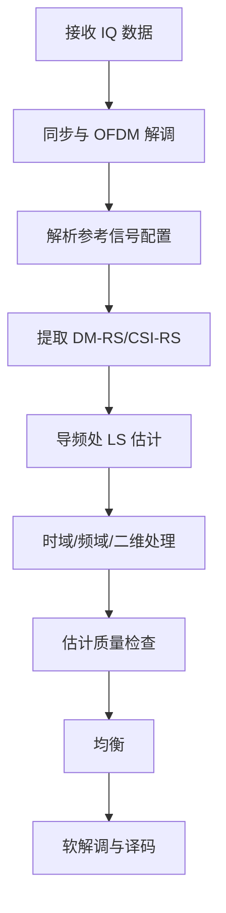

# 04 5G 信道估计算法

## 一句话定义

5G 信道估计算法把参考信号配置、导频观测、信道时频相关性和接收机复杂度约束组合起来，在完整资源网格上生成可用于均衡的 CSI。

## 前置知识

- [[00 5G 信道估计与均衡前置知识#矩阵论与线性代数]]：掌握矩阵维度、线性方程、正则化和数值稳定性。
- [[00 5G 信道估计与均衡前置知识#概率论与随机变量]]、[[00 5G 信道估计与均衡前置知识#随机过程与相关函数]]：理解噪声方差、协方差、时频相关性和 CSI 过期。
- [[00 5G 信道估计与均衡前置知识#傅里叶分析与数字信号处理]]：理解时域/频域变换、插值、滤波和二维估计。
- [[00 5G 信道估计与均衡前置知识#NR 物理层基本概念]]：理解接收机状态中的时隙、BWP、端口、层和参考信号配置。
- [[00 5G 信道估计与均衡前置知识#信道估计]]、[[00 5G 信道估计与均衡前置知识#通信系统仿真]]：理解算法假设、复杂度预算和验证边界。

## 1. NR 接收机中的估计位置



对于解调，重点是获得与当前 PDSCH/PUSCH 传输关联的 DM-RS 信道估计；对于 CSI 测量，重点是依据 CSI-RS 评估多个端口、波束或预编码候选。

一个可部署的估计器可以抽象为：

$$
\widehat{\mathcal{H}},\mathcal{Q}
=\mathcal{E}
\left(\mathbf{Y}_{\mathrm{grid}},
\mathcal{C}_{\mathrm{RS}},
\mathcal{S}_{\mathrm{sync}},
\mathcal{M}_{\mathrm{valid}}
\right)
$$

其中 $\mathbf{Y}_{\mathrm{grid}}$ 是接收资源网格，$\mathcal{C}_{\mathrm{RS}}$ 是参考信号配置，$\mathcal{S}_{\mathrm{sync}}$ 是同步和相位状态，$\mathcal{M}_{\mathrm{valid}}$ 是有效资源掩码；输出 $\widehat{\mathcal{H}}$ 是估计 CSI，$\mathcal{Q}$ 是质量元数据。质量元数据至少应包含有效性、噪声方差、估计时间戳、端口/层维度和过期状态。

## 1.1 接收机状态与数据有效性

实际估计器不是无状态函数，至少需要维护：

- 当前 BWP、时隙、符号和子载波索引。
- 参考信号配置、端口、层和资源掩码。
- 上一次有效的信道估计及其时间戳。
- 噪声方差、协方差版本和估计器模式。
- 同步状态、相位跟踪状态和 CSI 是否过期。

每个 CSI 输出还应带有有效性标志。没有有效 DM-RS、端口映射不一致或同步未锁定时，不应把数值零矩阵当作正常 CSI 送入均衡器。

建议将 CSI 状态划分为：

| 状态 | 含义 | 后续处理 |
|---|---|---|
| `valid` | 配置、序列、同步和估计均通过检查 | 可交给均衡器或反馈模块 |
| `degraded` | 估计存在较大噪声、边界外推或轻微过期 | 降低 LLR 可靠度或限制调度 |
| `stale` | 超过有效时间或创新检验失败 | 只可用于预测/恢复，不应当作当前 CSI |
| `invalid` | 资源、端口或序列无法解析 | 禁止静默使用，触发重置或丢弃 |

这一区分比用全零矩阵表示失败更安全，因为全零信道会被某些均衡器解释为深衰落，而不是“没有估计结果”。

## 2. 基线算法：LS 加插值

### 步骤

1. 根据协议参数确定参考信号资源、端口和序列。
2. 提取接收导频 $Y_p$，重构已知导频 $X_p$。
3. 计算导频位置的 LS 估计：

$$
\hat{H}_{p}=Y_p/X_p
$$

4. 沿频率方向插值。
5. 沿时间方向插值。
6. 将结果限制到数据资源位置并交给均衡器。

若导频位置集合为 $\mathcal{P}$，目标数据位置集合为 $\mathcal{D}$，逐点 LS 阶段可以写成：

$$
\widehat{H}_{\mathrm{LS}}[k_p,m_p]
=\frac{Y[k_p,m_p]}{X_{\mathrm{RS}}[k_p,m_p]},
\qquad (k_p,m_p)\in\mathcal{P}.
$$

随后使用重构算子 $\mathcal{R}$：

$$
\widehat{H}[k,m]
=\mathcal{R}
\left(\widehat{H}_{\mathrm{LS}}|_{\mathcal{P}},
\mathcal{P},(k,m)\right),
\qquad (k,m)\in\mathcal{D}.
$$

因此 LS+插值并不是一个单一操作，而是“导频处观测误差”和“导频到数据的重构误差”的串联。应分别报告二者，否则无法判断提高导频功率或改变导频密度哪个更有效。

### 伪代码

```text
配置 = 解析参考信号和资源掩码
导频观测 = 提取(接收资源网格, 配置.导频位置)
已知导频 = 重构(配置.序列, 配置.端口)
导频估计 = 导频观测 / 已知导频
完整估计 = 重构时频网格(导频估计, 配置.插值规则)
质量信息 = 计算噪声、有效掩码和过期状态
输出 = (完整估计, 质量信息)
```

伪代码中的除法必须是逐资源元素的复数除法；MIMO 多端口场景则需要先完成端口分离，再进行对应维度的重构。

### 选择插值方向

- 先频率后时间：适合频率方向导频更密的配置。
- 先时间后频率：适合时间跟踪更可靠的配置。
- 二维联合插值：可同时利用两方向相关性，但复杂度和边界处理更复杂。

选择方向可以用两个无量纲量辅助判断：

$$
\eta_t=\frac{\Delta t_{\mathrm{RS}}}{T_c},
\qquad
\eta_f=\frac{\Delta f_{\mathrm{RS}}}{B_c}.
$$

其中 $\Delta t_{\mathrm{RS}}$ 是相邻时间导频间隔，$\Delta f_{\mathrm{RS}}$ 是相邻频率导频间隔。若 $\eta_t\gg\eta_f$，时间方向更可能成为主要瓶颈；若 $\eta_f\gg\eta_t$，频率方向更可能成为主要瓶颈。这只是采样尺度诊断，不替代具体信道相关函数和插值器仿真。

## 2.1 导频到完整 CSI 的接口约定

实现中建议把估计过程拆成四个可单测模块：

1. `reference extraction`：输入接收资源网格和配置，输出导频观测及其索引。
2. `pilot estimation`：在导频位置计算 LS/WLS 等直接估计。
3. `grid reconstruction`：将导频估计扩展到数据位置。
4. `quality metadata`：输出噪声方差、有效资源掩码和估计质量信息。

这样可以单独替换插值器而不改变导频提取，也可以用真实信道检查每一个模块的坐标和维度。

模块之间建议固定以下接口：

$$
\mathrm{pilot\_estimate}
=\left(\widehat{\mathbf{H}}_p,
\mathcal{I}_p,
R_{e,p},
\mathrm{valid}_p\right)
$$

$$
\mathrm{grid\_estimate}
=\left(\widehat{\mathbf{H}}_{\mathrm{grid}},
R_{e,\mathrm{grid}},
\mathrm{valid}_{\mathrm{grid}},
t_{\mathrm{estimate}}\right)
$$

其中 $\mathcal{I}_p$ 保存导频位置索引，$R_{e,p}$ 和 $R_{e,\mathrm{grid}}$ 分别表示导频处和重构后的误差信息。若实际系统无法保存完整协方差，至少应保留逐 RE 或逐层的等效误差功率。

## 2.2 导频提取的单元测试

建议构造无噪声、已知信道和单一端口的测试帧，验证：

- 已知导频位置能被完整找回。
- 导频序列重构与发送端完全一致。
- 单位信道下 LS 输出等于已知导频除法结果。
- 端口维度、子载波索引和 OFDM 符号索引没有转置错误。
- 数据、保护带、DC 和参考信号资源掩码互不重叠。

这些测试应先于 BER 测试执行；否则最终曲线异常时难以判断是算法问题还是资源映射问题。

## 2.3 估计器的边界策略

在导频覆盖范围之外或数据资源位于边界时，估计器必须选择一种明确策略：

- 最近导频保持。
- 线性外推。
- 使用上一时刻 CSI。
- 采用统计先验回归到均值。
- 将资源标记为低可靠度并交给后续处理。

不同策略会影响边界 NMSE 和 BLER。禁止使用未定义的数组填充值，因为它会把实现错误伪装成极端信道。

若一维导频位置为 $q_1<q_2$，内部位置 $q\in[q_1,q_2]$ 的线性插值为：

$$
\widehat{h}(q)
=\frac{q_2-q}{q_2-q_1}h(q_1)
+\frac{q-q_1}{q_2-q_1}h(q_2).
$$

当 $q$ 位于区间外时，同一个公式变成外推，系数可能大于 $1$ 或小于 $0$，噪声和模型误差会被放大。因此推荐：

1. 内部资源使用插值。
2. 边界资源使用保持、统计先验或带置信度的外推。
3. 超出有效 BWP 或导频覆盖范围的资源直接标记无效。

边界掩码应进入后续均衡器，而不是只在估计器内部丢弃。这样可以避免均衡器误用未经可靠观测支持的 CSI。

## 3. 低复杂度改进

### 3.1 平滑滤波

在导频估计后对噪声进行低通或 Wiener 平滑。滤波窗口应与信道相干带宽、相干时间匹配，窗口过大可能抹平真实信道变化。

一维局部平滑可以写成：

$$
\widehat{H}_{\mathrm{sm}}[k,m]
=\sum_{q=-Q_f}^{Q_f}a_q
\widehat{H}_{\mathrm{LS}}[k+q,m],
\qquad
\sum_q a_q=1.
$$

系数和为 $1$ 可保持常数信道的无偏性；但当信道在窗口内变化时，平滑输出包含两类误差：噪声方差下降和信道变化造成的偏差增加。矩形移动平均是低成本基线，Wiener 权重则进一步利用信道与噪声功率。

若噪声为白噪声、各输入误差独立且方差为 $\sigma_e^2$，则平滑噪声方差为：

$$
\operatorname{Var}(e_{\mathrm{sm}})
=\sigma_e^2\sum_q|a_q|^2.
$$

但真实信道变化项还会贡献：

$$
b_{\mathrm{sm}}[k,m]
=\sum_q a_qH[k+q,m]-H[k,m].
$$

因此不能只根据 $\sum_q|a_q|^2$ 判断平滑器优劣。

### 3.2 低秩近似

若信道协方差主要由少数特征方向构成，可以保留最大的 $r$ 个特征值：

$$
R_{hh}\approx U_r\Lambda_rU_r^H
$$

这样可以减少 LMMSE 中矩阵乘法和存储量。

若 $R_{hh}=U\Lambda U^H$，保留前 $r$ 个特征方向的投影矩阵为 $U_r$，则可将信道表示为：

$$
\mathbf{h}\approx U_r\boldsymbol{\alpha},
\qquad
\boldsymbol{\alpha}\in\mathbb{C}^{r\times1}.
$$

原始观测变为：

$$
\mathbf{y}\approx\mathbf{X}U_r\boldsymbol{\alpha}+\mathbf{n}.
$$

先估计低维系数：

$$
\widehat{\boldsymbol{\alpha}}
=R_{\alpha\alpha}U_r^H\mathbf{X}^H
\left(\mathbf{X}U_rR_{\alpha\alpha}U_r^H\mathbf{X}^H+R_{nn}\right)^{-1}
\mathbf{y},
$$

再重构 $\widehat{\mathbf{h}}=U_r\widehat{\boldsymbol{\alpha}}$。复杂度从完整参数维度转移到秩 $r$，但会引入截断误差：

$$
E_{\mathrm{trunc}}
=\sum_{i=r+1}^{P}\lambda_i.
$$

若弱特征方向虽然能量小，却对应关键空间层或深衰落补偿方向，盲目降低秩可能使 BLER 增加，不能只按平均能量选 $r$。

### 3.3 分离二维滤波

将二维滤波器近似为时间和频率两个一维滤波器的级联：

$$
W_{2D}\approx W_tW_f
$$

该近似牺牲一部分最优性，换取更适合硬件流水线的实现。

对二维估计误差矩阵 $E[k,m]$，频率和时间方向的级联滤波可写成：

$$
\widehat{H}_{2D}[k,m]
=\sum_{r=-Q_t}^{Q_t}b_r
\left(
\sum_{q=-Q_f}^{Q_f}a_q
\widehat{H}_{\mathrm{LS}}[k+q,m+r]
\right).
$$

当二维相关函数近似可分离时，该结构接近二维 Wiener 滤波；若存在倾斜相关、波束切换或非平稳变化，级联顺序会影响结果：

$$
\mathbf{W}_t\mathbf{W}_f
\neq\mathbf{W}_f\mathbf{W}_t
$$

一般并不成立。实现中应固定顺序、边界处理和无效 RE 的填充规则。

### 3.4 滑动窗口处理

对大带宽或大规模天线系统，可以只在局部时频窗口内更新估计。窗口应覆盖足够的相关范围，并保存跨窗口所需的状态。需要权衡：

- 窗口越大，相关性利用更充分，但延迟和存储增加。
- 窗口越小，适合并行和低延迟，但边界误差更明显。
- 时间窗口若跨越明显信道变化，平滑会引入跟踪偏差。

设当前处理窗口为：

$$
\mathcal{W}_{m,k}
=\{(m+i,k+j):
|i|\leq Q_t, |j|\leq Q_f\}.
$$

局部算法只使用 $\mathcal{W}_{m,k}$ 内的导频和状态。窗口大小应至少覆盖主要相关范围，但实时系统还必须满足：

$$
T_{\mathrm{estimate}}
+T_{\mathrm{buffer}}
\leq T_{\mathrm{deadline}}.
$$

窗口扩大通常增加统计收益、延迟、缓存和边界比例；窗口缩小则相反。算法报告中应同时给出窗口尺寸、有效导频数量和端到端时延。

## 3.5 时变信道跟踪

对时间方向的导频观测，可以使用一阶状态模型：

$$
\mathbf{h}_m=\mathbf{A}\mathbf{h}_{m-1}+\mathbf{w}_m
$$

其中 $\mathbf{A}$ 描述时间相关性，$\mathbf{w}_m$ 是状态创新。卡尔曼滤波或其低复杂度近似可以把历史 CSI 与当前导频观测融合：

$$
\hat{\mathbf{h}}_{m|m}
=\hat{\mathbf{h}}_{m|m-1}
+\mathbf{K}_m(\mathbf{z}_m-\mathbf{C}\hat{\mathbf{h}}_{m|m-1})
$$

当多普勒变化或状态模型不可靠时，跟踪滤波可能产生过期记忆。应设置状态重置、创新异常检测和 CSI 超时机制。

### 3.5.1 预测、更新与创新检验

设导频观测模型为：

$$
\mathbf{z}_m=\mathbf{C}_m\mathbf{h}_m+\mathbf{v}_m,
\qquad
R_v=E[\mathbf{v}_m\mathbf{v}_m^H].
$$

在每个时间位置，跟踪器依次执行：

1. 用上一时刻状态预测当前信道。
2. 计算当前导频与预测观测之间的创新。
3. 根据创新协方差判断当前观测是否可信。
4. 可信时更新状态，不可信时跳过或降低更新权重。

创新为：

$$
\boldsymbol{\nu}_m
=\mathbf{z}_m-\mathbf{C}_m\hat{\mathbf{h}}_{m|m-1},
$$

其协方差为：

$$
S_m
=\mathbf{C}_mP_{m|m-1}\mathbf{C}_m^H+R_v.
$$

可用归一化创新平方作为异常检测量：

$$
\gamma_m
=\boldsymbol{\nu}_m^H S_m^{-1}\boldsymbol{\nu}_m.
$$

在近似复高斯条件下，$\gamma_m$ 的统计范围与观测维度有关。若 $\gamma_m$ 长时间异常偏大，可能是序列、同步、噪声方差或状态模型失配，而不是信道突然“随机变坏”。

一种工程状态机为：

| 条件 | 动作 |
|---|---|
| 导频有效且 $\gamma_m$ 正常 | 正常 Kalman 更新 |
| 导频有效但 $\gamma_m$ 偏大 | 增大 $R_v$ 或降低更新增益 |
| 导频无效/同步失锁 | 只做预测并标记 `degraded` |
| 连续多次创新异常 | 重置状态或回退到 LS 基线 |

跟踪器不能无限期复用旧 CSI；状态重置需要与 CSI 时间戳和有效掩码一起输出。

### 3.5.2 标量相关系数的标定

在一阶标量模型 $h_m=\alpha h_{m-1}+w_m$ 中，若采样间隔为 $\Delta t$，可用真实信道样本估计：

$$
\widehat{\alpha}
=\frac{\sum_{m=1}^{M-1}h_mh_{m-1}^*}
{\sum_{m=1}^{M-1}|h_{m-1}|^2}.
$$

对应的创新功率可估计为：

$$
\widehat{\sigma}_w^2
=\frac{1}{M-1}
\sum_{m=1}^{M-1}
|h_m-\widehat{\alpha}h_{m-1}|^2.
$$

如果直接把一个 SNR 点、一个速度或一个信道模型下估计的 $\alpha$ 固定用于所有场景，跟踪器可能在低速时反应过快，在高速时反应过慢。参数应至少按采样间隔、载频、速度和场景分组验证。

## 4. 频域与时域估计

### 频域估计

直接在 OFDM 资源网格上估计 $H[k,m]$，适合单抽头均衡，易于与现有 FFT 接收链路衔接。

### 时域估计

先将导频观测变换到时域，利用有限时延抽头或稀疏多径假设抑制噪声，再变换回频域。适合有效路径数较少且时延范围已知的场景。

若频域导频估计为 $\hat{H}[k]$，时域响应可由 IFFT 得到：

$$
\hat{h}[n]=\frac{1}{\sqrt{N}}\sum_{k=0}^{N-1}\hat{H}[k]e^{j2\pi kn/N}
$$

时域估计通常还需要一个有效时延窗口。若循环前缀长度为 $N_{\mathrm{CP}}$，可将超出有效时延范围的抽头置零或衰减，但窗口过短会截断真实路径，窗口过长则保留更多噪声。该操作应在不同 RMS 时延扩展下单独验证。

若只在部分子载波上有导频，频域观测到时域响应的变换还包含采样窗：

$$
\widehat{\mathbf{h}}_{\mathrm{td}}
=\mathbf{F}^H\mathbf{M}_{\mathrm{freq}}
\widehat{\mathbf{H}}_p,
$$

其中 $\widehat{\mathbf{H}}_p$ 应理解为按完整 FFT bin 顺序排列、缺失位置已按明确规则填充的频域向量，$\mathbf{M}_{\mathrm{freq}}$ 表示有效子载波、保护带和缺失导频的掩码。非连续或有限带宽采样会导致时延域旁瓣和泄漏，因此不能把 IFFT 后的每个峰直接解释为物理路径。

常见时域处理流程为：

1. 统一频域索引和 FFT 归一化。
2. 对缺失子载波进行明确填充或使用加权最小二乘重构。
3. IFFT 到时延域。
4. 使用 CP、最大时延或能量阈值确定有效抽头。
5. 抑制窗口外噪声并变换回频域。

每一步都会改变噪声相关性，回到频域后不能继续假设各子载波估计误差独立。

## 4.1 时域稀疏估计的适用边界

时域截断或稀疏恢复隐含有效多径数量较少、路径时延稳定或可预测。以下情况会削弱该假设：

- 路径时延落在采样网格之间，产生泄漏。
- 带宽有限，时延分辨率不足。
- 多径数量较多或路径功率分布较平坦。
- 时变信道造成抽头位置或相位快速变化。

因此，稀疏方法需要报告时延网格、最大延迟、稀疏度和是否使用连续时延修正。

### 4.1.1 稀疏恢复模型

设 $\mathbf{y}_p$ 是频域导频观测，$\mathbf{D}_p$ 是导频符号矩阵，$\mathbf{F}_{p,L}$ 是从 $L$ 个时延抽头到导频子载波的部分 DFT 矩阵，则：

$$
\mathbf{y}_p
=\mathbf{D}_p\mathbf{F}_{p,L}\mathbf{h}_{\mathrm{td}}
+\mathbf{n}_p.
$$

若时延域抽头稀疏，可以使用 LASSO 型目标：

$$
\widehat{\mathbf{h}}_{\mathrm{td}}
=\arg\min_{\mathbf{h}}
\left\|\mathbf{y}_p
-\mathbf{D}_p\mathbf{F}_{p,L}\mathbf{h}\right\|_2^2
+\lambda\|\mathbf{h}\|_1.
$$

也可以使用 OMP 等贪心方法逐步选择能量较大的时延字典列。$\ell_1$ 正则倾向于产生稀疏解，但路径落在网格之间时会出现能量分裂；增大字典密度可以降低网格误差，却会增加相关性和计算量。

稀疏方法的收益依赖三个条件：有效路径数较少、有效带宽足以区分相邻时延、导频观测矩阵具有可接受的互相关。若多径密集或信道频率响应并不稀疏，LS+统计插值可能更稳健。

## 5. 基于统计相关性的估计

LMMSE/Wiener 估计需要时间、频率、空间相关矩阵或它们的近似。二维可分离模型常写为：

$$
R_{HH}\approx R_t\otimes R_f
$$

这里默认先按固定的时间优先或频率优先顺序将资源网格向量化，$R_t$ 和 $R_f$ 的 Kronecker 维度必须与该顺序一致；如果索引顺序改变，Kronecker 因子的排列也要随之改变。模型越贴近实际，理论收益越明显；模型失配、噪声功率估计错误或场景变化会降低收益。

对导频位置和目标数据位置，统计估计的核心不是简单寻找“距离最近的导频”，而是计算交叉协方差：

$$
\mathbf{W}_{\mathrm{stat}}
=R_{dp}(R_{pp}+R_{vv})^{-1}.
$$

其中 $R_{dp}$ 描述导频与目标之间的可预测性，$R_{pp}$ 描述导频之间的冗余，$R_{vv}$ 描述观测误差。若两个导频距离较近但相关性因波束切换或非平稳变化而很低，几何近邻规则仍可能产生较大误差。

## 5.1 协方差的估计与更新

协方差可以由信道模型解析得到，也可以由历史导频或真实信道样本估计：

$$
\hat{R}_{hh}=\frac{1}{M}\sum_{i=1}^{M}\mathbf{h}_i\mathbf{h}_i^H
$$

样本数不足时，$\hat{R}_{hh}$ 可能病态或含有较大估计噪声。工程实现可使用对角加载：

$$
\hat{R}_{hh}^{\prime}=\hat{R}_{hh}+\epsilon\mathbf{I}
$$

对角加载改善数值稳定性，但会改变先验模型；应把 $\epsilon$ 作为实验参数记录，而不是隐藏在实现中。

### 协方差更新策略

| 策略 | 优点 | 风险 |
|---|---|---|
| 固定解析模型 | 计算稳定、易复现 | 场景失配 |
| 离线样本协方差 | 可拟合目标场景 | 需要代表性数据 |
| 在线滑动估计 | 可跟踪场景变化 | 样本少时噪声大 |
| 分块/低秩更新 | 复杂度可控 | 丢失细节 |

在线更新时，协方差估计应与当前 CSI 的时间戳绑定，避免把不同 BWP、速度或空间配置下的样本混合。

### 5.2 协方差质量检查

使用样本协方差前至少检查：

$$
\|\hat{R}_{hh}-\hat{R}_{hh}^H\|_F
$$

是否接近零，以及最小特征值是否满足：

$$
\lambda_{\min}(\hat{R}_{hh})\geq0.
$$

若有限样本导致非厄米特或非半正定矩阵，可先做：

$$
\hat{R}_{\mathrm{sym}}
=\frac{1}{2}
\left(\hat{R}_{hh}+\hat{R}_{hh}^H\right),
$$

再将负特征值裁剪为非负值。修正后的矩阵已不再是原始样本协方差，必须记录修正范数和裁剪比例，否则难以解释 LMMSE 性能变化。

### 5.3 统计失配的单参数扫描

为了区分不同先验参数的影响，可固定真实信道和噪声，只扫描估计器使用的：

- 时间相关系数或多普勒参数。
- 频率相关宽度或 RMS 时延扩展。
- 空间相关矩阵和有效秩。
- 噪声/干扰功率。

对每个扫描量同时记录 NMSE、后验误差、BLER 和线性求解条件数。LMMSE 可能在平均 NMSE 上变化不大，却因为错误的空间协方差导致某个弱层的均衡性能明显恶化。

## 6. 神经网络方法的定位

深度学习可学习导频观测到完整信道响应之间的映射，常用于非线性失真、低导频密度或模型难以准确描述的场景。使用时需要单独记录：

- 训练信道分布是否覆盖部署场景。
- 训练和测试 SNR 是否一致。
- 推理延迟、内存和硬件成本。
- 失配场景下的退化方式。

神经网络结果应与 LS、LMMSE 等可解释基线比较，不能只报告单一测试集上的 BER。

神经网络估计器可以抽象为：

$$
\widehat{\mathbf{H}}
=f_{\boldsymbol{\theta}}
\left(\mathbf{Y}_p,
\mathcal{C}_{\mathrm{RS}},
\widehat{\sigma}_n^2\right)
$$

训练目标可以是信道重构损失：

$$
\mathcal{L}_{\mathrm{H}}
=\frac{1}{N}
\sum_{i=1}^{N}
\left\|f_{\boldsymbol{\theta}}(\mathbf{Y}_{p,i})
-\mathbf{H}_i\right\|_2^2,
$$

也可以使用均衡后的符号或软比特损失。但若只优化 BER，网络可能利用特定调制、译码器或信道分布的捷径，未必得到物理上可解释的 CSI。建议同时输出不确定度、有效掩码或残差评分，避免把异常输入静默映射为看似正常的信道。

### 6.1 数据驱动方法的验证边界

数据驱动估计器应至少进行以下拆分：

- 训练 SNR 与未见 SNR。
- 训练信道模型与未见信道模型。
- 匹配导频配置与改变导频配置。
- 训练速度与更高速移动。
- 理想同步与残余硬件失真。

如果只在训练分布内比较 BER，无法说明算法对真实部署场景的鲁棒性。

最低验证矩阵应包含：

| 变化因素 | 训练条件 | 测试条件 | 观察指标 |
|---|---|---|---|
| SNR | 若干离散 SNR | 未见 SNR 或连续区间 | NMSE、BLER |
| 信道模型 | TDL/CDL 子集 | 未见模型或不同参数 | 失配退化 |
| 导频配置 | 固定密度 | 不同密度/端口 | 配置泛化 |
| 移动性 | 低/中速 | 高速或不同多普勒 | CSI 过期鲁棒性 |
| 同步状态 | 理想同步 | 残余频偏/相位噪声 | 失真敏感性 |

网络方法不能替代资源映射和同步校验。序列或索引错误时，首先应返回无效状态，而不是依赖网络“猜测”正确位置。

比较神经网络与传统方法时，至少固定参考信号位置、接收功率、信道实现、随机噪声、输出 CSI 维度、均衡器和译码器。否则网络方法可能仅仅因为使用了不同的输入掩码或后处理规则而获得表面优势。

## 7. 算法选择表

| 场景 | 优先考虑 | 原因 | 风险 |
|---|---|---|---|
| 低复杂度基线 | LS + 线性插值 | 易实现、易复现 | 低 SNR 或快速时变下误差大 |
| 统计稳定场景 | LMMSE/Wiener | 可利用相关性 | 需要协方差和噪声先验 |
| 有限多径 | 时域截断/稀疏估计 | 抑制无效时延样本 | 时延边界失配 |
| 高速移动 | 加密时间导频 + 跟踪滤波 | 降低 CSI 过期 | 参考信号开销增加 |
| 非理想硬件 | 联合信道与相位跟踪 | 建模公共相位误差 | 参数耦合、调试困难 |

## 7.1 算法选择决策

可按以下顺序缩小方案：

1. 先以 LS + 线性插值建立无先验基线。
2. 若误差主要来自噪声且统计稳定，增加 Wiener/LMMSE。
3. 若误差主要来自时变，优先增加时间方向导频或跟踪滤波。
4. 若误差主要来自频率选择性，优化频率导频间隔和二维重构。
5. 若误差主要来自端口污染，先修复资源正交和映射，而不是更换估计器。
6. 只有在模型和基线都验证后，再评估神经网络等复杂方法。

## 7.2 复杂度预算

把每个时隙可用的计算预算记为 $C_{\mathrm{budget}}$，估计器总成本可拆成：

$$
C_{\mathrm{total}}
=C_{\mathrm{extract}}+C_{\mathrm{estimate}}+C_{\mathrm{interpolate}}+C_{\mathrm{metadata}}
$$

比较算法时应同时报告：

- 每个 RE、OFDM 符号和时隙的乘加数。
- 复数乘法、除法和矩阵分解的数量。
- 峰值内存、缓存访问和并行度。
- 首次估计延迟与稳态吞吐量。

满足 NMSE 的算法如果超过时隙处理预算，也不能直接视为可部署方案。

若导频观测数为 $Q$，待估参数维度为 $P$，二维局部窗口包含 $Q_w$ 个有效导频，常见计算量可作如下数量级估计：

| 操作 | 典型量级 | 主要依赖 |
|---|---:|---|
| 逐点 LS | $O(Q)$ | 导频数量 |
| 直接 QR LS | $O(QP^2)$ | 观测数和参数维度 |
| 频域一维插值 | $O(N_{\mathrm{data}})$ | 数据 RE 数量 |
| 二维局部滤波 | $O(N_{\mathrm{data}}Q_w)$ | 窗口大小 |
| 低秩 LMMSE | $O(Qr^2+r^3)$ | 低秩维度 $r$ |
| 完整 LMMSE 求解 | $O(Q^3)$ 或矩阵分解量级 | 观测维度 |
| Kalman 更新 | $O(Q^3+n^2Q)$ 量级 | 观测维度 $Q$、状态维度 $n$ |

这些是结构性估计，实际耗时还受 SIMD、缓存、矩阵稀疏性和并行度影响。报告时应同时给出平均延迟、P99 延迟、峰值内存和每时隙截止时间是否满足。

可以把算法选择写成带约束的多目标问题：

$$
\min_{\mathcal{A}}
\left(
\mathrm{NMSE}(\mathcal{A}),
\mathrm{BLER}(\mathcal{A}),
T(\mathcal{A}),
M(\mathcal{A}),
\eta_{\mathrm{RS}}(\mathcal{A})
\right)
$$

满足：

$$
T(\mathcal{A})\leq T_{\mathrm{deadline}},
\qquad
M(\mathcal{A})\leq M_{\mathrm{budget}}.
$$

因此不存在脱离场景的“最佳估计器”；部署选择应位于性能、延迟、内存和参考信号开销共同决定的 Pareto 前沿上。

## 8. 实现注意事项

- 不要把参考信号所在资源误当作数据资源参与数据检测。
- 明确信道估计的归一化、噪声方差和功率定义。
- 对边界资源采用明确的外推或裁剪策略。
- MIMO 场景中保留端口维度，避免过早求平均。
- 线性代数实现优先使用分解和求解，不显式构造逆矩阵。
- 仿真需分别比较理想 CSI、估计 CSI 和失配 CSI。
- 对矩阵求解设置条件数或最小奇异值诊断，避免数值异常被误归因于信道模型。
- 保存导频位置估计和完整资源网格估计，便于分别统计直接观测与插值误差。
- 估计失败或 CSI 过期时输出状态，不要静默复用旧矩阵。

## 9. 与其他概念的关系

- **输入和坐标约束**：[[01 5G 物理层与信道模型]]定义 FFT、CP、资源网格、端口与层域；[[02 参考信号与导频设计]]把协议配置解析为导频序列、索引集合和端口训练矩阵。本页算法必须保留这些坐标，而不能仅接受一个无语义的二维数组。
- **理论模块**：[[LS 信道估计]]负责导频位置的无先验基线，[[LMMSE 信道估计]]利用统计先验，[[二维时频插值]]或状态跟踪恢复数据 RE。它们的误差、延迟、内存和 CSI 新鲜度均属于算法输出的一部分。
- **信道统计与模型**：[[TDL 信道模型]]、[[频率选择性衰落]]和[[时变信道]]决定时频相关性与窗口尺度；[[CDL 信道模型]]、[[空间相关性]]和[[05 MIMO 信道估计]]扩展为多端口/空间协方差问题。解析协方差、样本协方差和 oracle 协方差必须用不同标签记录。
- **接收机下游**：本页输出的 CSI、误差功率、有效掩码与时间戳进入[[06 OFDM 接收与频域均衡]]。[[MMSE 均衡]]和[[软输出检测]]不能从一个复数 CSI 数组自动推断 LLR 可靠度；估计质量元数据必须明确其来源和有效域。
- **性能与部署**：[[07 信道估计误差与性能分析]]用 NMSE、EVM、BLER 和尾部风险量化收益；部署选择还需满足每时隙延迟、P99 延迟、峰值内存和参考信号开销约束，故不存在脱离场景的通用最佳算法。

## 待验证问题

下列验证均要求保存导频位置估计、完整网格估计、误差质量元数据和实际运行指标；不以单一 NMSE 曲线替代算法接口验证。

| 验证问题 | 对照设计 | 最低记录量 | 判定规则与入口 |
|---|---|---|---|
| 可分顺序插值与二维联合插值 | 高速 TDL 下固定导频、功率、边界策略和计算预算；对比先频率后时间、先时间后频率、二维局部/全局方法 | 数据/边界 NMSE、EVM、BLER、时间与频率窗口、操作数、延迟 | 若任一顺序只在边界差异明显，需将内部与边界资源分开报告；二维方法超过时隙预算不能只按 NMSE 宣称更优。入口：[[二维时频插值]]、[[08 仿真实验：LS 与 MMSE]] |
| 时域截断窗口 | 固定真实时延扩展与导频观测，扫描截断长度、窗函数和分数时延条件 | 时延域能量捕获率、数据 NMSE、偏差、边界频域误差、EVM | 最优窗口应按目标指标、采样率和时延离散化定义；RMS 时延扩展相同的不同 PDP 未必共享同一窗口。入口：[[TDL 信道模型]]、[[仿真实验：不同信道模型]] |
| FFT 尺寸下的 LMMSE 取舍 | 对齐有效带宽、SNR、导频采样尺度和相关长度；扫描 FFT 点数、低秩阶数与预计算策略 | NMSE、矩阵维度、预计算/在线耗时、峰值内存、P99 延迟 | 不可把 FFT 点数变化引起的符号时长、子载波间隔或导频密度变化误归因于 LMMSE 复杂度。入口：[[LMMSE 信道估计]] |
| 样本与解析协方差 | 匹配解析协方差、样本协方差、对角/低秩近似和 LS；扫描训练样本数及训练-测试失配 | 协方差谱、半正定性、NMSE、偏差、更新代价、置信区间 | “改善 LS”应在独立测试实现上判断；训练与测试使用同一信道实现须显式标为 oracle 泄漏。入口：[[LMMSE 信道估计]]、[[08 仿真实验：LS 与 MMSE]] |
| 滑动窗口与边界策略 | 固定总 CSI 年龄预算，扫描时间/频率窗口长度、重叠与边界规则 | CSI 年龄、内部/边界 NMSE、缓存量、延迟、丢弃率 | 窗口变长若降低观测方差但增加过期误差，应报告 Pareto 前沿，不能只取最低平均 NMSE。入口：[[时变信道]]、[[二维时频插值]] |
| 跟踪重置条件 | 与保持上一 CSI、周期重置、创新检验/残差阈值对照；单独注入突变、配置切换和快速移动 | 创新统计、重置次数、过期时长、数据 NMSE、BLER、误报/漏报率 | 重置阈值必须使用训练与评测独立的信道实现选择，避免按同一结果曲线事后调参。入口：[[CSI 反馈]]、[[07 信道估计误差与性能分析]] |
| 质量元数据驱动 LLR 降权 | 对比仅热噪声、逐 RE 估计误差功率、后验协方差、保守上界与 oracle 方差 | 有效增益、后均衡方差、LLR 校准分桶、BER、BLER | 元数据只能在域、时间戳和资源掩码匹配时生效；oracle 误差方差仅作为上界。入口：[[MMSE 均衡]]、[[软输出检测]]、[[仿真-LLR 符号验证]] |
