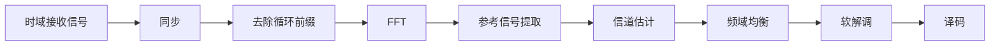

# 06 OFDM 接收与频域均衡

## 一句话定义

OFDM 频域均衡利用每个子载波上的信道估计补偿幅度衰落和相位旋转，再将均衡符号交给软解调和信道译码。

## 前置知识

- [[00 5G 信道估计与均衡前置知识#傅里叶分析与数字信号处理]]、[[00 5G 信道估计与均衡前置知识#OFDM 与循环前缀]]：掌握 FFT、循环卷积、CP、ICI 和单抽头模型。
- [[00 5G 信道估计与均衡前置知识#矩阵论与线性代数]]：掌握共轭转置、线性方程、ZF/MMSE 和噪声协方差。
- [[00 5G 信道估计与均衡前置知识#数字通信与基带模型]]：掌握星座、软解调、LLR、EVM、BER 和译码接口。
- [[00 5G 信道估计与均衡前置知识#检测与均衡]]：理解 SNR/SINR 下的均衡、后均衡噪声、可靠度和理想 CSI 与估计 CSI 的性能差异。

## 1. OFDM 接收链路

循环前缀足够长且同步理想时，线性卷积可近似转换为循环卷积，FFT 后每个子载波近似独立：

$$
Y_k=H_kX_k+N_k
$$

为明确接收机的处理对象，令 $N=N_{\mathrm{FFT}}$，并采用单位酉变换的 DFT 矩阵：

$$
F_{k,n}=\frac{1}{\sqrt{N}}
e^{-j2\pi kn/N},
\qquad
\mathbf{F}^H\mathbf{F}=\mathbf{I}_N.
$$

频域资源列向量和去除 CP 后的时域列向量分别记为：

$$
\mathbf{X}_m=
\begin{bmatrix}X[0,m]&\cdots&X[N-1,m]\end{bmatrix}^{T},
\qquad
\mathbf{x}_m=\mathbf{F}^H\mathbf{X}_m.
$$

发送端在有效符号前复制最后 $N_{\mathrm{CP}}$ 个采样，形成带 CP 向量 $\mathbf{x}_{m,\mathrm{cp}}$。接收端同步后截取长度为 $N$ 的窗口。对长度为 $L_h$ 的静态离散信道：

$$
r_m[n]
=\sum_{\ell=0}^{L_h-1}h[\ell]
x_{m,\mathrm{cp}}[n-\ell]+w_m[n].
$$

当：

$$
N_{\mathrm{CP}}\geq L_h-1
$$

且 FFT 窗口位于有效 CP 保护范围内时，去 CP 后的接收向量可以写成：

$$
\mathbf{r}_m
=\mathbf{C}_h\mathbf{x}_m+\mathbf{w}_m,
$$

其中 $\mathbf{C}_h$ 是由 $h[0],\ldots,h[L_h-1]$ 构成的 $N\times N$ 循环矩阵。于是：

$$
\mathbf{Y}_m
=\mathbf{F}\mathbf{r}_m
=\mathbf{F}\mathbf{C}_h\mathbf{F}^H\mathbf{X}_m
+\mathbf{N}_m
=\mathbf{D}_h\mathbf{X}_m+\mathbf{N}_m,
$$

其中：

$$
\mathbf{D}_h
=\operatorname{diag}(H[0,m],\ldots,H[N-1,m]).
$$

这说明单抽头均衡不是“FFT 后自然出现的经验公式”，而是循环矩阵被 DFT 基底对角化的结果。

### 单抽头频域模型定理

在一个 OFDM 符号内信道保持不变、$N_{\mathrm{CP}}\geq L_h-1$、FFT 窗口未超出 CP 允许范围、采样频率和载波频率已同步的条件下，去除 CP 并执行 DFT 后，信道矩阵为对角矩阵：

$$
\mathbf{F}\mathbf{C}_h\mathbf{F}^H=\mathbf{D}_h.
$$

因此第 $k$ 个子载波只与自身的 $X[k,m]$ 相乘，不产生理想模型中的子载波间干扰。若任一条件失效，频域矩阵一般变为：

$$
\mathbf{Y}_m
=\mathbf{A}_m\mathbf{X}_m+\mathbf{N}_m,
\qquad
\mathbf{A}_m\neq\mathbf{D}_h,
$$

其中 $\mathbf{A}_m$ 的非对角元素表示 ICI 或窗口失配造成的耦合。此时逐子载波除法只能作为近似接收器，不能被解释为精确逆系统。

## 1.1 单抽头模型成立的条件

单抽头频域均衡依赖以下条件：

1. FFT 窗口定位正确。
2. 循环前缀覆盖有效最大时延扩展。
3. 一个 OFDM 符号内信道变化足够慢。
4. 残余频偏和采样频偏已足够小，ICI 可忽略。
5. 资源网格索引、FFT 缩放和有效子载波映射一致。

循环前缀不足会产生符号间干扰，快速时变或频偏会产生子载波间干扰。此时接收模型应写成：

$$
\mathbf{Y}=\mathbf{H}_{\mathrm{ICI}}\mathbf{X}+\mathbf{N}
$$

其中 $\mathbf{H}_{\mathrm{ICI}}$ 不再是对角矩阵，单个 $H_k$ 无法完全描述子载波间耦合。

### 1.1.1 CP 内定时偏移与相位斜率

设 FFT 窗口相对理想位置偏移 $n_0$ 个采样，并且窗口仍处于 CP 允许范围内。循环移位性质给出：

$$
x[(n-n_0)\bmod N]
\xleftrightarrow{\mathrm{DFT}}
X[k]e^{-j2\pi kn_0/N}.
$$

于是接收频域关系变为：

$$
Y[k]
=H[k]X[k]e^{-j2\pi kn_0/N}+N[k].
$$

这种偏移主要表现为随子载波索引线性变化的相位斜率，不一定破坏子载波正交性。如果参考信号和数据处在相同 FFT 窗口约定下，信道估计可能把该相位斜率吸收到 $\widehat{H}[k]$ 中；但跨符号复用 CSI 或切换窗口后，必须重新检查相位参考。

### 1.1.2 超出 CP 的定时偏移

当 FFT 窗口偏移导致部分采样来自相邻 OFDM 符号，循环卷积条件不再成立。此时可以把接收信号分解为：

$$
\mathbf{r}
=\mathbf{C}_h\mathbf{x}
+\mathbf{B}_{\mathrm{ISI}}\mathbf{x}_{\mathrm{prev}}
+\mathbf{B}_{\mathrm{ICI}}\mathbf{x}
+\mathbf{w},
$$

其中 $\mathbf{B}_{\mathrm{ISI}}$ 描述相邻符号泄漏，$\mathbf{B}_{\mathrm{ICI}}$ 描述因窗口不匹配导致的非循环边界项。FFT 后两者一般都不是对角矩阵，因此仅增加导频功率无法消除这类结构化误差。

### 1.1.3 载波频偏和公共相位误差

归一化载波频偏定义为：

$$
\epsilon=\frac{\Delta f_c}{\Delta f}.
$$

在一个 FFT 窗口内，频偏使时域样本乘以：

$$
c[n]=e^{j2\pi\epsilon n/N}.
$$

第 $\ell$ 个发射子载波对第 $k$ 个接收 bin 的耦合系数为：

$$
G_{k,\ell}(\epsilon)
=\frac{1}{N}
\sum_{n=0}^{N-1}
e^{j2\pi(\ell-k+\epsilon)n/N}.
$$

因此：

$$
Y[k]
=\sum_{\ell=0}^{N-1}
G_{k,\ell}(\epsilon)H[\ell]X[\ell]+N[k].
$$

当 $\epsilon=0$ 时，$G_{k,\ell}=\delta[k-\ell]$；当 $\epsilon\neq0$ 时，非对角项通常不为零。频偏主项可表现为公共相位旋转和幅度衰减，PTRS 或相位跟踪可以校正主项，但不能完全消除非对角 ICI。

### 1.1.4 符号内时变信道

若信道冲激响应随有效符号内采样索引变化，时域模型为：

$$
r[n]=\sum_{\ell=0}^{L_h-1}h[n,\ell]x[n-\ell]+w[n].
$$

即使 CP 足够长，时变卷积矩阵也通常不再是循环矩阵。FFT 后可写为：

$$
\mathbf{Y}
=\left(\mathbf{D}_h+\mathbf{E}_{\mathrm{Doppler}}\right)\mathbf{X}
+\mathbf{N},
$$

其中 $\mathbf{E}_{\mathrm{Doppler}}$ 的非对角能量随归一化多普勒扩展增加而增大。可以用：

$$
\eta_{\mathrm{ICI}}
=\frac{\|\mathbf{E}_{\mathrm{Doppler}}\|_F^2}
{\|\mathbf{D}_h\|_F^2}
$$

作为诊断量；当该量不可忽略时，应比较 ICI 感知均衡器与单抽头均衡器，而不是只调节信道估计滤波器。

## 1.2 接收功率和 FFT 归一化

若 FFT 使用不同缩放约定，频域信号和噪声的方差会同时变化。均衡器只要使用一致的 $Y_k$、$\hat{H}_k$ 和 $\sigma_n^2$ 口径即可，但跨实现比较时必须记录：

- IFFT/FFT 是否使用 $1/N$、$1/\sqrt{N}$ 或无归一化。
- 循环前缀是否计入总发射能量。
- 噪声是在时域采样还是频域资源上添加。
- 有效子载波是否重新归一化。

若时域噪声为白噪声：

$$
E[\mathbf{w}\mathbf{w}^H]=\sigma_w^2\mathbf{I}_N,
$$

单位酉 FFT 不改变噪声协方差：

$$
E[\mathbf{N}\mathbf{N}^H]
=\mathbf{F}E[\mathbf{w}\mathbf{w}^H]\mathbf{F}^H
=\sigma_w^2\mathbf{I}_N.
$$

若 FFT 矩阵采用无归一化的 DFT 核，即 $\mathbf{F}_{\mathrm{u}}\mathbf{F}_{\mathrm{u}}^H=N\mathbf{I}_N$，则：

$$
E[\mathbf{N}_{\mathrm{u}}\mathbf{N}_{\mathrm{u}}^H]
=N\sigma_w^2\mathbf{I}_N.
$$

因此，均衡器中的噪声方差必须与 FFT 输出的缩放保持一致。不能将“时域每采样噪声方差”和“频域每 RE 噪声方差”在不同 FFT 约定下直接混用。

若总发射能量包含 CP，而均衡只处理 $N$ 个有效采样，则有用符号与 CP 的时间效率为：

$$
\eta_{\mathrm{CP}}
=\frac{N}{N+N_{\mathrm{CP}}}.
$$

当仿真以整个带 CP 符号的平均功率定义 SNR 时，数据 RE 的实际能量还会受到 $\eta_{\mathrm{CP}}$ 影响；报告结果时应说明 SNR 是按有效符号、带 CP 波形还是有效 RE 定义的。

## 2. 理想 CSI 下的单抽头均衡

若已知真实信道 $H_k$，可以在每个子载波上使用一个复数系数。估计 CSI 时使用 $\hat{H}_k$。

### ZF 均衡

$$
\hat{X}_{k,\mathrm{ZF}}=\frac{Y_k}{\hat{H}_k}
$$

ZF 试图完全消除信道响应，但当 $|\hat{H}_k|$ 很小或估计误差较大时，除法会放大噪声和误差。

### MMSE 均衡

$$
\hat{X}_{k,\mathrm{MMSE}}
=\frac{\hat{H}_k^*}{|\hat{H}_k|^2+\sigma_n^2/\sigma_x^2}Y_k
$$

其中 $\sigma_n^2/\sigma_x^2$ 是噪声功率与符号功率之比。低 SNR 时正则化更强，高 SNR 且信道条件良好时 MMSE 接近 ZF。

## 2.1 SISO MMSE 的推导

令线性均衡器为 $\hat{X}=GY$，最小化：

$$
J(G)=E[|X-GY|^2]
$$

在 $Y=HX+N$、$E[|X|^2]=\sigma_x^2$、$E[|N|^2]=\sigma_n^2$ 且信号与噪声不相关时：

$$
G_{\mathrm{MMSE}}
=\frac{E[XY^*]}{E[|Y|^2]}
=\frac{H^*\sigma_x^2}{|H|^2\sigma_x^2+\sigma_n^2}
$$

除以 $\sigma_x^2$ 后得到前文的正则化形式。这个推导也说明，MMSE 的正则化不是任意常数，而是由信号功率和噪声功率共同决定。

### 2.1.1 误差分解与最小 MSE

对任意复数均衡系数 $G$，输出误差为：

$$
\hat{X}-X=(GH-1)X+GN.
$$

在信号与噪声独立时，均方误差为：

$$
J(G)
=|GH-1|^2\sigma_x^2+|G|^2\sigma_n^2.
$$

第一项是信号增益偏差，第二项是噪声传播。令 $G=G_{\mathrm{MMSE}}$，得到最小 MSE：

$$
J_{\min}
=\frac{\sigma_x^2\sigma_n^2}
{|H|^2\sigma_x^2+\sigma_n^2}.
$$

这说明 MMSE 不追求逐点完全逆信道，而是在信号偏差和噪声增强之间做均方误差最优折中。

### 2.1.2 输出增益与后均衡方差

定义均衡输出的有效信号增益：

$$
a=GH.
$$

则：

$$
\hat{X}=aX+GN,
\qquad
\sigma_{n,\mathrm{out}}^2=|G|^2\sigma_n^2.
$$

如果软解调器知道 $a$，可以先做增益补偿：

$$
\bar{X}=\frac{\hat{X}}{a},
\qquad
\sigma_{\mathrm{eff}}^2
=\frac{|G|^2\sigma_n^2}{|a|^2}.
$$

如果软解调器默认均衡输出已经具有单位增益，则 $a\neq1$ 会表现为额外的幅度和相位失配，不能只把 $|G|^2\sigma_n^2$ 作为 LLR 方差。

ZF 在理想 CSI 下满足 $a=1$，其后均衡噪声方差为：

$$
\sigma_{n,\mathrm{ZF}}^2
=\frac{\sigma_n^2}{|H|^2}.
$$

深衰落 $|H|\to0$ 时该方差发散，这正是 ZF 在深衰落资源上不稳定的根源。

## 2.2 ZF 与 MMSE 的极限关系

对 SISO MMSE：

- 当 $\sigma_n^2/\sigma_x^2\to0$ 时，$G_{\mathrm{MMSE}}\to1/H$，接近 ZF。
- 当 $|H|^2\ll\sigma_n^2/\sigma_x^2$ 时，均衡增益被限制，避免深衰落处的无限放大。
- 当 CSI 错误时，降低噪声正则项并不能修复模型误差。

## 2.3 正则化参数与功率口径

MMSE 中的 $\sigma_n^2/\sigma_x^2$ 必须与均衡输入的归一化一致。常见错误包括：

- 将时域采样噪声方差直接当作频域 RE 噪声方差，却忽略 FFT 缩放。
- 用发送符号功率代替接收端均衡输入的有效功率。
- 在 MIMO 中忽略每层功率与总发射功率的关系。

可以把正则化参数写成 $\alpha$，先单独扫描 $\alpha$ 评估敏感性，再接入噪声方差估计。这样能区分“均衡器公式错误”和“噪声参数失配”。

## 2.4 深衰落与增益裁剪

ZF 的系数 $1/\hat{H}_k$ 在 $|\hat{H}_k|$ 很小时可能产生极大增益。工程上可使用：

- MMSE 正则化。
- 最小信道增益阈值。
- 软可靠度降低而不是无限放大。
- 对异常子载波进行擦除或降低 LLR 权重。

增益裁剪会引入偏差，但可能比噪声无限增强更有利。比较方案时应同时报告被裁剪的子载波比例和 BLER。

以正则化均衡系数：

$$
G_\alpha(H)=\frac{H^*}{|H|^2+\alpha}
$$

为例，其幅度满足：

$$
|G_\alpha(H)|
=\frac{|H|}{|H|^2+\alpha}
\leq\frac{1}{2\sqrt{\alpha}}.
$$

因此 $\alpha>0$ 提供了有限的最大均衡增益。这个界不表示 $\alpha$ 越大越好：过大的正则化会降低深衰落处的噪声放大，却增加信号残差和偏差。工程上应同时记录增益上限、被裁剪比例和软输出性能。

## 3. MIMO 线性均衡

对某个子载波和 OFDM 符号，设接收天线数为 $N_r$、数据层数为 $N_s$：

$$
\mathbf{y}\in\mathbb{C}^{N_r\times1},
\qquad
\mathbf{H}\in\mathbb{C}^{N_r\times N_s},
\qquad
\mathbf{x}\in\mathbb{C}^{N_s\times1}.
$$

接收模型为：

$$
\mathbf{y}=\mathbf{H}\mathbf{x}+\mathbf{n}
$$

当 $N_r\geq N_s$ 且 $\mathbf{H}$ 满列秩时，ZF 才能在无噪声理想条件下唯一恢复所有层。若 $\mathbf{H}$ 欠秩或接近欠秩，任何线性逆都会在弱奇异方向上放大噪声。

ZF：

$$
\hat{\mathbf{x}}_{\mathrm{ZF}}
=(\mathbf{H}^H\mathbf{H})^{-1}\mathbf{H}^H\mathbf{y}
$$

MMSE：

$$
\hat{\mathbf{x}}_{\mathrm{MMSE}}
=\left(\mathbf{H}^H\mathbf{H}+\frac{\sigma_n^2}{\sigma_x^2}\mathbf{I}\right)^{-1}\mathbf{H}^H\mathbf{y}
$$

工程实现使用 QR、Cholesky 或共轭梯度求解线性方程，不显式计算逆矩阵：

$$
\left(\mathbf{H}^H\mathbf{H}+\alpha\mathbf{I}\right)\hat{\mathbf{x}}
=\mathbf{H}^H\mathbf{y}
$$

ZF 形成 Gram 矩阵会放大条件数影响；QR 分解通常具有更好的数值稳定性。对正定的 MMSE 矩阵可以使用 Cholesky 分解，若矩阵规模很大且具有结构，可考虑迭代求解，但必须设置残差阈值并验证迭代误差对 BLER 的影响。

### 统一的线性估计器形式

令：

$$
\mathbf{G}_\alpha
=\left(\mathbf{H}^H\mathbf{H}+\alpha\mathbf{I}_{N_s}\right)^{-1}
\mathbf{H}^H.
$$

当 $\alpha=0$ 且 $\mathbf{H}$ 满列秩时，它是 ZF；当：

$$
\alpha=\frac{\sigma_n^2}{\sigma_x^2}
$$

并且各层独立同分布时，它是常用的 MMSE 形式。输出可以分解为：

$$
\widehat{\mathbf{x}}
=\mathbf{G}_\alpha\mathbf{H}\mathbf{x}
+\mathbf{G}_\alpha\mathbf{n}
=\mathbf{A}_\alpha\mathbf{x}
+\mathbf{n}_{\mathrm{out}},
$$

其中：

$$
\mathbf{A}_\alpha=\mathbf{G}_\alpha\mathbf{H},
\qquad
R_{n,\mathrm{out}}
=\mathbf{G}_\alpha R_{nn}\mathbf{G}_\alpha^H.
$$

ZF 的理想信号矩阵为 $\mathbf{A}_0=\mathbf{I}$；MMSE 通常使 $\mathbf{A}_\alpha$ 的对角元素小于 $1$，并保留一定层间耦合。软解调器需要知道这种增益和协方差，不能只接收一个均衡符号数组。

### SVD 域的模态解释

对信道作 SVD：

$$
\mathbf{H}=\mathbf{U}\mathbf{\Sigma}\mathbf{V}^H,
\qquad
\mathbf{\Sigma}=\operatorname{diag}(\sigma_1,\ldots,\sigma_r).
$$

令 $\widetilde{\mathbf{y}}=\mathbf{U}^H\mathbf{y}$、$\widetilde{\mathbf{x}}=\mathbf{V}^H\mathbf{x}$，则每个空间模态近似满足：

$$
\widetilde{y}_i=\sigma_i\widetilde{x}_i+\widetilde{n}_i.
$$

ZF 模态增益为 $1/\sigma_i$，噪声方差按 $1/\sigma_i^2$ 放大；MMSE 模态增益为：

$$
g_i^{\mathrm{MMSE}}
=\frac{\sigma_i}{\sigma_i^2+\alpha}.
$$

当 $\sigma_i^2\ll\alpha$ 时，MMSE 主动抑制该弱模态，而不是强行恢复它。这会产生信号偏差，却能避免弱模态把噪声传播到全部层。

### MIMO 均衡矩阵的可用性检查

均衡前至少检查：

$$
\operatorname{rank}(\mathbf{H}),
\qquad
\sigma_{\min}(\mathbf{H}),
\qquad
\kappa(\mathbf{H})
=\frac{\sigma_{\max}(\mathbf{H})}{\sigma_{\min}(\mathbf{H})}.
$$

若 $\sigma_{\min}(\mathbf{H})$ 小于数值阈值，不能继续使用无正则化 ZF；若 $\mathbf{H}$ 的估计条件数异常大，还应区分真实空间病态与 CSI 估计错误。可将均衡状态标记为 `valid`、`regularized` 或 `unreliable`，让软解调器相应降低可靠度。

## 3.1 彩色噪声和干扰下的广义 MMSE

若噪声或干扰协方差为 $R_{nn}$ 而不是标量白噪声，线性 MMSE 均衡器为：

$$
\mathbf{G}_{\mathrm{MMSE}}
=R_{xx}\mathbf{H}^H
\left(\mathbf{H}R_{xx}\mathbf{H}^H+R_{nn}\right)^{-1}
$$

当 $R_{xx}=\sigma_x^2\mathbf{I}$、$R_{nn}=\sigma_n^2\mathbf{I}$ 时退化为常用形式。若存在导频污染、邻区干扰或 ICI，使用标量噪声方差可能低估某些空间或频率方向的干扰。

如果 $R_{nn}$ 为正定矩阵，广义 MMSE 也可写成白化后的形式。令 $R_{nn}=\mathbf{L}\mathbf{L}^H$，则：

$$
\mathbf{G}_{\mathrm{MMSE}}
=R_{xx}\mathbf{H}^H\mathbf{L}^{-H}
\left(
\mathbf{L}^{-1}\mathbf{H}R_{xx}
\mathbf{H}^H\mathbf{L}^{-H}+\mathbf{I}
\right)^{-1}\mathbf{L}^{-1}.
$$

这说明“先白化再做白噪声 MMSE”和直接使用 $R_{nn}$ 的广义 MMSE 在精确协方差下是等价的；数值差异主要来自协方差估计、分解误差和正则化实现。

当信号和噪声为联合复高斯，且 $R_{xx}$、$R_{nn}$ 为正定矩阵时，观测后的后验误差协方差还可以写成：

$$
R_{x|y}
=R_{xx}
-R_{xx}\mathbf{H}^H
\left(\mathbf{H}R_{xx}\mathbf{H}^H+R_{nn}\right)^{-1}
\mathbf{H}R_{xx}
$$

或等价地写为：

$$
R_{x|y}
=\left(R_{xx}^{-1}
+\mathbf{H}^HR_{nn}^{-1}\mathbf{H}\right)^{-1}.
$$

其对角元素描述各层的后验不确定度，适合为软解调器提供层级可靠度；它不是简单的接收噪声方差，也不能在不同均衡器之间无条件复用。

## 3.2 白化处理

若 $R_{nn}=\mathbf{L}\mathbf{L}^H$，可以先白化：

$$
\mathbf{y}'=\mathbf{L}^{-1}\mathbf{y},
\quad \mathbf{H}'=\mathbf{L}^{-1}\mathbf{H}
$$

再对 $\mathbf{y}'=\mathbf{H}'\mathbf{x}+\mathbf{n}'$ 执行白噪声假设下的均衡。白化矩阵的估计误差会影响均衡稳定性，应和信道估计误差分开测试。

若 $R_{nn}$ 只有半正定而非正定，可以对其特征值做对角加载：

$$
R_{nn,\delta}=R_{nn}+\delta\mathbf{I},
\qquad \delta>0.
$$

对角加载使 Cholesky 分解和白化更稳定，但会改变实际干扰模型。$\delta$ 应作为已记录的数值稳定参数，而不是隐藏在实现中的常数。

## 3.3 正则化参数的选择

正则化参数 $\alpha$ 可以来自：

- 理论噪声方差与符号功率。
- 导频空闲资源的噪声估计。
- 接收信号和信道估计的在线估计。
- 按子载波、层或用户使用的自适应估计。

若 $\alpha$ 偏小，均衡器更接近 ZF，容易噪声增强；若 $\alpha$ 偏大，残余干扰和信号偏差增加。扫描 $\alpha$ 时应保持 CSI 和真实信道不变，并同时观察 BER、BLER、EVM 和 LLR 校准。

## 3.4 ICI 感知的块均衡

当频偏、相位噪声、符号内时变或超出 CP 的定时偏移造成明显 ICI 时，可在一个局部频域窗口内联合处理多个子载波：

$$
\mathbf{y}_{\mathcal{K}}
=\mathbf{A}_{\mathcal{K}}
\mathbf{x}_{\mathcal{K}}
+\mathbf{v}_{\mathcal{K}},
$$

其中 $\mathcal{K}$ 是选定的 $K_b$ 个子载波集合，$\mathbf{A}_{\mathcal{K}}$ 是包含对角信道增益和 ICI 耦合的局部频域矩阵。若只保留距离主对角线不超过 $B$ 的耦合，可以使用带状近似：

$$
\mathbf{A}_{\mathcal{K}}^{(B)}[k,\ell]
=
\begin{cases}
\mathbf{A}_{\mathcal{K}}[k,\ell],&|k-\ell|\leq B,\\
0,&|k-\ell|>B.
\end{cases}
$$

被截断的非对角项形成残余 ICI：

$$
\mathbf{q}_{\mathrm{ICI}}
=\left(\mathbf{A}_{\mathcal{K}}
-\mathbf{A}_{\mathcal{K}}^{(B)}\right)
\mathbf{x}_{\mathcal{K}}.
$$

若残余项与数据近似不相关，可以把它的协方差加入干扰模型：

$$
R_{\mathrm{ICI,res}}
\approx
\left(\mathbf{A}_{\mathcal{K}}
-\mathbf{A}_{\mathcal{K}}^{(B)}\right)
R_{xx}
\left(\mathbf{A}_{\mathcal{K}}
-\mathbf{A}_{\mathcal{K}}^{(B)}\right)^H.
$$

在该窗口内，广义 MMSE 均衡器为：

$$
\mathbf{G}_{\mathrm{block}}
=R_{xx}\left(\mathbf{A}_{\mathcal{K}}^{(B)}\right)^H
\left(
\mathbf{A}_{\mathcal{K}}^{(B)}R_{xx}
\left(\mathbf{A}_{\mathcal{K}}^{(B)}\right)^H
+R_{vv}
+R_{\mathrm{ICI,res}}
\right)^{-1}.
$$

当 $B=0$ 时，它退化为逐子载波均衡；$B$ 增大可以解释更多 ICI，但矩阵分解和缓存开销也随窗口增大。工程上应扫描 $B$，同时报告 ICI 残差、均衡复杂度和 BLER，而不是只比较一个理论最优点。

其中 $R_{vv}$ 表示窗口内的热噪声和其他未被显式建模的残差协方差；若 ICI 已全部由 $\mathbf{A}_{\mathcal{K}}^{(B)}$ 建模，则不应在 $R_{vv}$ 中重复计入同一部分能量。

若 ICI 主要来自相邻子载波，局部窗口可以采用重叠方式处理。窗口边界外的子载波应作为已知导频、已检测符号或额外干扰处理；直接把边界外信号设为零会产生额外的模型偏差。

## 4. 软输出与 LLR

硬判决只输出离散符号，软输出则向译码器提供每个比特的置信度。对比特 $b_i$，对数似然比定义为：

$$
\mathrm{LLR}(b_i)=\log\frac{P(b_i=1|y)}{P(b_i=0|y)}
$$

均衡器输出的等效噪声方差会影响 LLR 的可靠性。若忽略噪声增强，可能产生过度自信的错误 LLR，降低译码性能。

对线性均衡器，可以近似记录每个层或子载波的后均衡噪声协方差。以线性矩阵 $\mathbf{G}$ 为例：

$$
\hat{\mathbf{x}}=\mathbf{G}\mathbf{y}
$$

噪声部分的协方差为：

$$
R_{n,\mathrm{out}}=\mathbf{G}R_{nn}\mathbf{G}^H
$$

白噪声情况下 $R_{nn}=\sigma_n^2\mathbf{I}$，才有 $R_{n,\mathrm{out}}=\sigma_n^2\mathbf{G}\mathbf{G}^H$。

如果把所有层使用同一个标量噪声方差，可能导致 LLR 标定错误，尤其在 MIMO 条件数差异明显的子载波上。

### 后均衡有效 SINR

由：

$$
\widehat{\mathbf{x}}
=\mathbf{A}\mathbf{x}+\mathbf{n}_{\mathrm{out}}
$$

可将第 $i$ 层写成：

$$
\widehat{x}_i
=A_{i,i}x_i
+\sum_{j\neq i}A_{i,j}x_j
+n_{\mathrm{out},i}.
$$

当各层符号独立、功率为 $\sigma_{x,j}^2$，且层间干扰与噪声近似不相关时，第 $i$ 层的有效 SINR 为：

$$
\gamma_i
=\frac{|A_{i,i}|^2\sigma_{x,i}^2}
{\sum_{j\neq i}|A_{i,j}|^2\sigma_{x,j}^2
+[R_{n,\mathrm{out}}]_{i,i}}.
$$

若先进行单层增益补偿 $\bar{x}_i=\widehat{x}_i/A_{i,i}$，则等效噪声方差为：

$$
\sigma_{\mathrm{eff},i}^2
=\frac{
\sum_{j\neq i}|A_{i,j}|^2\sigma_{x,j}^2
+[R_{n,\mathrm{out}}]_{i,i}}
{|A_{i,i}|^2}.
$$

这个方差包含层间残差和线性均衡器输出噪声，通常比只计算 $[R_{n,\mathrm{out}}]_{i,i}$ 更适合 LLR 标定。若层间干扰明显相关，标量近似会失真，应保留完整协方差或使用联合检测。

## 4.1 近似 LLR

对均衡后的符号 $\hat{x}$ 和等效噪声方差 $\sigma_{\mathrm{eff}}^2$，常用近似 LLR 为：

$$
\mathrm{LLR}(b_i)
\approx\frac{1}{\sigma_{\mathrm{eff}}^2}
\left(\min_{x\in\mathcal{X}_{b_i=0}}|\hat{x}-x|^2
-\min_{x\in\mathcal{X}_{b_i=1}}|\hat{x}-x|^2\right)
$$

其中 $\mathcal{X}_{b_i=0}$ 和 $\mathcal{X}_{b_i=1}$ 是星座中第 $i$ 个比特分别取 0 和 1 的集合。LLR 符号方向必须与译码器约定一致，正负号相反会导致链路看似有合理星座图但 BLER 接近随机。

若增益补偿后的观测满足复高斯近似：

$$
\bar{x}=x+v,
\qquad
v\sim\mathcal{CN}(0,\sigma_{\mathrm{eff}}^2),
$$

则第 $i$ 个比特的精确星座求和 LLR 为：

$$
\mathrm{LLR}(b_i)
=\log\frac{
\sum_{x\in\mathcal{X}_{b_i=1}}
\exp\left(-\frac{|\bar{x}-x|^2}{\sigma_{\mathrm{eff}}^2}\right)}
{\sum_{x\in\mathcal{X}_{b_i=0}}
\exp\left(-\frac{|\bar{x}-x|^2}{\sigma_{\mathrm{eff}}^2}\right)}.
$$

最大对数近似用每个集合中的最小欧氏距离替代对数和指数，得到前述 max-log LLR。若实现使用“每个实维噪声方差”而不是复噪声方差，指数中的分母和 LLR 缩放会相差一个因子；仿真中应固定 $\mathcal{CN}(0,\sigma^2)$ 的方差定义。

LLR 还可以用有效 SINR 检查尺度：对单位功率 QPSK，$\gamma_i$ 增大时，LLR 绝对值的中位数通常应增大；若星座图变清晰但 LLR 绝对值反而异常变小，优先检查增益补偿和噪声方差口径。

## 4.2 软信息的可靠度检查

建议检查：

- LLR 的符号错误率。
- LLR 绝对值分布是否随 SNR 增大而合理扩大。
- 估计 CSI 与理想 CSI 下的 LLR 直方图。
- 译码器输入是否发生饱和或溢出。

量化 LLR 时还应记录位宽、缩放系数和饱和阈值。

## 5. 信道估计误差下的等效模型

令：

$$
\hat{H}=H+\tilde{H}
$$

ZF 使用估计信道时：

$$
\hat{X}=\frac{HX+N}{H+\tilde{H}}
$$

估计误差会使均衡器产生残余幅相误差。该误差通常不能简单看成独立 AWGN，尤其在时间、频率或空间上具有相关性时。

在仿真中应区分两种输入：

- 真实接收信号使用真实 $H$，均衡器使用 $\hat{H}$：测量 CSI 误差影响。
- 发送和接收链路都使用同一个估计模型：可能把信道生成误差和估计误差混在一起。

第一种设置更适合单独评估估计器到均衡器的误差传递。

## 5.1 估计误差作为等效干扰

MIMO 情况下，使用 $\hat{\mathbf{H}}=\mathbf{H}+\tilde{\mathbf{H}}$ 时：

$$
\mathbf{y}=\hat{\mathbf{H}}\mathbf{x}
-\tilde{\mathbf{H}}\mathbf{x}+\mathbf{n}
$$

相对于均衡器而言，$-\tilde{\mathbf{H}}\mathbf{x}$ 是与发送符号相关的等效干扰。只有在额外独立性假设下，才可以把它近似为白噪声并加入 $R_{nn}$；否则应使用估计误差协方差或直接蒙特卡洛评估。

### 5.1.1 SISO 估计误差的精确分解

对 $\widehat{H}=H+\widetilde{H}$，ZF 输出可以严格写成：

$$
\widehat{X}_{\mathrm{ZF}}
=\frac{HX+N}{H+\widetilde{H}}
=X+\frac{N-\widetilde{H}X}{H+\widetilde{H}}.
$$

第二项同时包含噪声和与符号相关的 CSI 残差。若进一步假设 $N$、$\widetilde{H}$ 和 $X$ 近似独立、零均值，且使用条件近似 $|H+\widetilde{H}|\approx|\widehat{H}|$，则可用：

$$
\sigma_{\mathrm{res}}^2
\approx
\frac{\sigma_n^2
+\sigma_{\widetilde{H}}^2\sigma_x^2}
{|\widehat{H}|^2}
$$

估计 ZF 输出残差方差。深衰落时，热噪声项和 CSI 误差项都会被同一个小信道增益放大。

对任意使用 $\widehat{H}$ 的线性系数 $G$，有：

$$
\widehat{X}
=G\widehat{H}X
+G\left(N-\widetilde{H}X\right).
$$

因此输出信号增益为 $a=G\widehat{H}$，增益补偿后的近似残差方差为：

$$
\sigma_{\mathrm{eff}}^2
\approx
\frac{|G|^2
\left(\sigma_n^2
+\sigma_{\widetilde{H}}^2\sigma_x^2\right)}
{|a|^2}.
$$

该式只在独立性近似下成立；当估计误差有偏、与信道或导频污染相关时，应保留交叉项或直接用真实误差样本计算 LLR 校准。

### 5.1.2 MIMO 估计误差协方差

令均衡器使用 $\widehat{\mathbf{H}}=\mathbf{H}+\widetilde{\mathbf{H}}$，接收模型可重写为：

$$
\mathbf{y}
=\widehat{\mathbf{H}}\mathbf{x}
+\mathbf{u},
\qquad
\mathbf{u}=\mathbf{n}-\widetilde{\mathbf{H}}\mathbf{x}.
$$

若 $\widetilde{\mathbf{H}}$ 与 $\mathbf{x}$、$\mathbf{n}$ 近似独立且误差零均值，则：

$$
R_{uu}
\approx R_{nn}
+E\left[
\widetilde{\mathbf{H}}R_{xx}
\widetilde{\mathbf{H}}^H
\right].
$$

使用线性均衡矩阵 $\mathbf{G}$ 后，接收端误差协方差传播为：

$$
R_{u,\mathrm{out}}
=\mathbf{G}R_{uu}\mathbf{G}^H.
$$

如果同时存在 ICI、导频污染或硬件残差，可以在独立性近似下写成：

$$
R_{uu}
\approx R_{nn}
+R_{\mathrm{CSI}}
+R_{\mathrm{ICI}}
+R_{\mathrm{HW}}.
$$

这些项通常是空间相关的；将其压缩为一个标量只适用于需要低复杂度近似、且方向性误差不会显著影响检测的场景。

## 6. 均衡器选择

| 条件 | ZF | MMSE |
|---|---|---|
| 高 SNR、信道条件良好 | 性能可接近理想干扰消除 | 接近 ZF |
| 低 SNR | 容易噪声增强 | 通常更稳健 |
| 深衰落子载波 | 风险较高 | 正则化抑制放大 |
| 信道矩阵病态 | 数值不稳定 | 通常更稳定 |
| 需要软输出 | 需准确估计等效噪声 | 可结合后验方差 |

## 6.1 线性均衡不是最优检测

ZF/MMSE 都是线性检测器，复杂度低且适合大规模系统，但在高阶调制、强空间相关或低 SNR 条件下，非线性检测可能有更高性能。比较线性均衡时应明确目标是：

- 作为低复杂度接收机的工程基线。
- 作为近似最优检测器的性能上限对照。
- 作为软输出译码链路的一部分。

不能把 ZF 或 MMSE 的性能直接解释为所有 MIMO 检测器的理论上限。

## 6.2 何时需要非线性检测

当空间层数接近有效秩、星座阶数较高或信道矩阵病态时，线性均衡后的层间干扰可能仍然显著。可用 SIC、树搜索或消息传递等非线性方法作为扩展对照，但必须单独记录复杂度和软输出定义。

## 7. 均衡前的检查

- 信道估计和接收符号的子载波索引必须一致。
- 数据资源、DM-RS、保护带和 DC 子载波不能混用。
- 噪声方差估计应与 FFT、功率归一化保持一致。
- 需要区分理想 CSI、导频估计 CSI 和过期 CSI。
- 对深衰落子载波应观察增益裁剪或 MMSE 正则化的影响。
- 检查均衡矩阵与参考信号估计的端口/层顺序一致。
- 记录线性求解残差、最小奇异值和异常增益比例。
- 检查 LLR 符号、缩放、位宽和饱和情况。
- 对 ICI、导频污染和彩色干扰场景，不要默认使用白噪声标量模型。

## 7.1 均衡器输入输出接口

均衡器不应只接收一个未标注的信道矩阵。对每个子载波、OFDM 符号或 ICI 块，至少需要：

| 输入或输出 | 内容 |
|---|---|
| `rx` | FFT 后的接收资源或局部频域观测 |
| `channel` | 端口域或层域 CSI，以及天线/层顺序 |
| `noise_cov` | 热噪声、干扰或等效残差协方差 |
| `signal_cov` | 层功率或符号协方差 |
| `resource_mask` | 数据、参考信号、DC、保护带和无效资源掩码 |
| `status` | CSI 有效性、同步状态、是否正则化或是否过期 |
| `soft_output` | 均衡符号、有效增益、后均衡方差和 LLR 缩放信息 |

可以把线性均衡器抽象为：

$$
\left(\widehat{\mathbf{x}},
\mathbf{A},
R_{\mathrm{out}},
q\right)
=\mathcal{E}
\left(\mathbf{y},\widehat{\mathbf{H}},R_{vv},R_{xx},\mathcal{M}\right),
$$

其中 $\mathbf{A}$ 是等效信号增益矩阵，$R_{\mathrm{out}}$ 是输出残差协方差，$q$ 是质量和状态元数据，$\mathcal{M}$ 是资源掩码。若实现只输出 $\widehat{\mathbf{x}}$，软解调器只能猜测增益和噪声方差，容易导致 LLR 过度自信。

对端口域 CSI 和层域 CSI，应明确转换关系：

$$
\widehat{\mathbf{H}}_{\mathrm{eff}}
=\widehat{\mathbf{H}}_{\mathrm{port}}\mathbf{W}
$$

或说明参考信号已经直接产生 $\widehat{\mathbf{H}}_{\mathrm{eff}}$。均衡器禁止在域信息不明时重复乘以预编码矩阵。

### 7.1.1 无效资源和异常信道处理

均衡器遇到以下情况时应输出状态而不是静默生成数值：

- CSI 无效、过期或与当前资源索引不一致。
- $|\widehat{H}_k|$ 低于 SISO 增益阈值。
- MIMO $\sigma_{\min}(\widehat{\mathbf{H}})$ 过小。
- ICI 块矩阵的条件数超过限制。
- 白化协方差不是正定且对角加载超过允许范围。

对应资源可以被标记为低可靠度、擦除或使用保守的 MMSE，而不应写入未定义的零矩阵。全零均衡输出可能被译码器误解为可靠的深衰落符号。

## 7.2 分层验证基线

建议按以下顺序冻结和替换接收链路：

1. 无噪声、单径、理想同步、理想 CSI，验证 FFT/IFFT 和资源索引。
2. 静态多径、CP 足够长、理想 CSI，验证逐子载波单抽头均衡。
3. 加入 AWGN，扫描 ZF、MMSE 和正则化参数，验证后均衡噪声方差。
4. 使用导频估计 CSI，比较导频位置和数据位置的均衡误差。
5. 使用 MIMO 条件数可控的信道，验证层间干扰、后均衡 SINR 和 LLR。
6. 分别加入 CP 不足、CP 内定时偏移、频偏、采样频偏和相位噪声。
7. 在非对角频域信道下比较单抽头和 ICI 块均衡。
8. 最后接入编码、译码、LLR 量化和 BLER 统计。

每一级都应保存中间量：FFT 输出、导频位置 CSI、均衡增益、奇异值、输出协方差、LLR 和线性求解残差。这样可以将波形、信道估计、均衡和译码问题分开定位。

## 8. 与其他概念的关系

- **单抽头模型边界**：[[OFDM 循环前缀]]、同步和符号内准静态条件共同使频域矩阵近似对角。[[单抽头频域均衡]]在该条件下逐子载波处理；CP 不足、窗口越界、频偏、相位噪声和快速时变会产生非对角 ICI/ISI，不能通过仅改进标量 CSI 完全修复。
- **CSI 输入与误差**：[[LS 信道估计]]、[[LMMSE 信道估计]]和[[二维时频插值]]需要为每个数据 RE 提供同域、同时间戳的 CSI。[[信道估计误差]]、边界外推和 CSI 老化应进入有效干扰/可靠度模型，导频位置 NMSE 不能代表实际均衡输入质量。
- **线性检测选择**：[[ZF 均衡]]追求零迫，受深衰落和[[MIMO 信道矩阵条件数]]的小奇异值影响显著；[[MMSE 均衡]]使用信号、噪声与干扰协方差折中。两者在高 SNR、良好条件数和理想 CSI 下可接近，但不构成无条件等价。
- **空间接口**：[[05 MIMO 信道估计]]中的端口域 CSI 只有经正确预编码转换后才是均衡器需要的层域等效 CSI。若端口、层、天线或预编码域不明，重复乘以 $\mathbf{W}$ 与漏乘 $\mathbf{W}$ 都会造成结构化检测错误。
- **软信息与性能**：[[软输出检测]]应接收均衡输出、有效增益、逐 RE/逐层输出协方差和状态，而不是只接收硬判决；[[EVM]]、[[BLER 与 BER]]与[[07 信道估计误差与性能分析]]分别覆盖符号、译码和误差归因层级。

## 待验证问题

全部对照应固定真实接收波形、调制、编码、数据比特和信道实现，只替换均衡器使用的 $\hat{\mathbf{H}}$、协方差或求解器；否则无法分离信道变化与检测器差异。

| 验证问题 | 对照设计 | 最低记录量 | 判定规则与入口 |
|---|---|---|---|
| ZF 与 MMSE 随 SNR 的差距 | 共同使用理想 CSI 与同一组估计 CSI；按 SNR、条件数和调制阶数分桶 | 后均衡 SINR/方差、EVM、BER、BLER、最差层性能 | 高 SNR 下差距缩小应只在良好条件数和近似正确 CSI 情况下解释；否则检查病态子载波与 CSI 误差。入口：[[ZF 均衡]]、[[MMSE 均衡]]、[[09 仿真实验：MIMO 均衡]] |
| CSI 误差与正则化不足 | 固定真实 $\mathbf{H}$ 与噪声，独立扫描 NMSE、误差偏差/相关性和正则化参数 | 有效干扰协方差、每层 SINR、EVM、LLR 校准、BLER | “正则化不足”应对应可观测的后均衡方差或误差项失配，而不是只用平均 NMSE 门限定义。入口：[[信道估计误差]]、[[MMSE 均衡]] |
| 噪声方差失配对 LLR | 比较真实热噪声、固定错误方差、逐 RE 后均衡方差、包含 CSI 误差的保守方差 | $E[L\mid b=0]$、$E[L\mid b=1]$、LLR 分桶误码率、BLER、饱和率 | 硬判决正常但 BLER 变差时优先归因于 LLR 尺度/方差接口；每种方差须说明是可估计量还是 oracle。入口：[[软输出检测]]、[[仿真-LLR 符号验证]] |
| 求解器的性能-数值稳定性 | QR、Cholesky、SVD/迭代法在相同容限、条件数分桶和异常处理策略下比较 | 求解残差、迭代数、失败率、每符号/P99 延迟、EVM、BLER | 若求解残差超过容限或正定条件不满足，应输出状态；不能用静默回退结果混入曲线。入口：[[09 仿真实验：MIMO 均衡]] |
| 逐 RE 后均衡方差的 LLR 收益 | 同一均衡输出下对比固定方差、逐子载波/逐层方差和保守 CSI 误差方差 | 有效增益、方差、LLR 校准、译码迭代/路径负载、BLER | 只有 LLR 可靠度分桶与 BLER 同时改善时，才能认为方差接口带来稳定收益。入口：[[软输出检测]]、[[仿真-LLR 符号验证]] |
| 彩色干扰下的等价性 | 用同一正定 $R_{vv}$ 比较先白化再 MMSE 与直接广义 MMSE；另测试协方差估计误差 | 白化残差、输出符号差、输出协方差、EVM、BLER | 精确协方差与数值稳定求解下两者应在数值误差范围内一致；偏离时检查白化矩阵、维度、正定性和求解容限。入口：[[MMSE 均衡]] |
| 高阶调制下的主导误差 | 对 QPSK、16-QAM 及更高阶 QAM 采用析因设计，独立扫描正则化失配与 CSI 误差 | 星座 EVM、每比特位置 LLR 校准、BER、BLER、条件数 | 使用效应量与交互项说明主导因素，不以单个曲线交叉点作结论；深衰落与错误方差口径须单独标记。入口：[[EVM]]、[[07 信道估计误差与性能分析]] |
