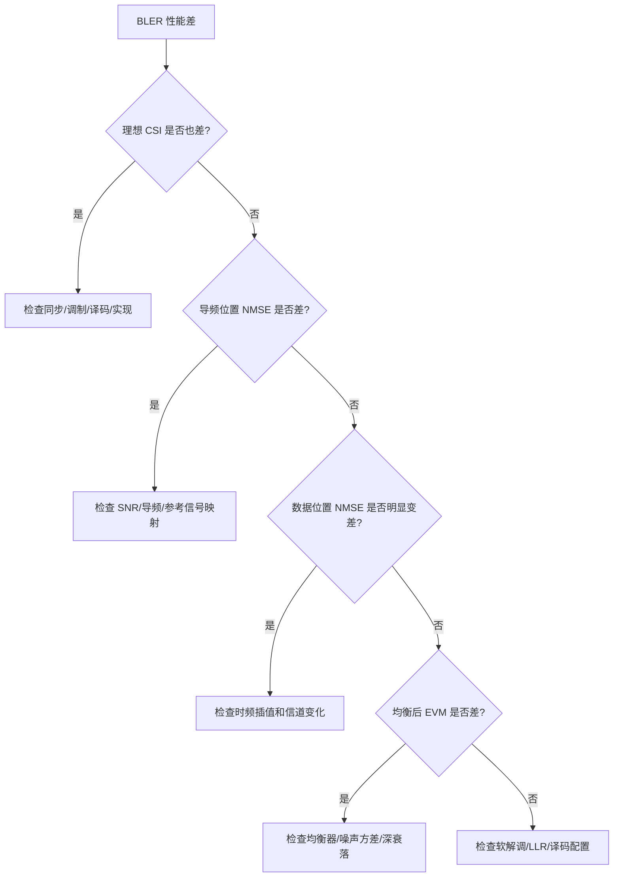

# 07 信道估计误差与性能分析

## 一句话定义
信道估计性能分析研究估计信道与真实信道之间的差异如何由导频、噪声、时变、硬件失真和算法失配引起，并进一步传递到均衡、解调、译码和吞吐量。

## 前置知识

- [[00 5G 信道估计与均衡前置知识#概率论与随机变量]]：掌握期望、方差、协方差、MSE、NMSE 和置信区间。
- [[00 5G 信道估计与均衡前置知识#随机过程与相关函数]]：理解误差的时间、频率和空间相关性，以及非平稳和 CSI 过期。
- [[00 5G 信道估计与均衡前置知识#数字通信与基带模型]]：区分 EVM、BER、BLER、吞吐量、SNR 和 SINR。
- [[00 5G 信道估计与均衡前置知识#信道估计]]、[[00 5G 信道估计与均衡前置知识#检测与均衡]]：理解误差传播到均衡器和软判决的路径。
- [[00 5G 信道估计与均衡前置知识#通信系统仿真]]：掌握蒙特卡洛平均、错误计数、停止条件和统计不确定性。

## 1. 误差定义

真实信道和估计信道分别记为 $H$ 与 $\hat{H}$，估计误差为：

$$
\tilde{H}=\hat{H}-H
$$
MIMO 场景使用矩阵形式：

$$
\tilde{\mathbf{H}}=\hat{\mathbf{H}}-\mathbf{H}
$$
误差可以是复数幅度误差、相位误差，也可以具有时间、频率、空间相关性。只看一个平均标量可能掩盖深衰落子载波、边界资源或某些天线端口上的局部问题。

误差统计必须绑定估计对象和条件变量。常见条件包括 SNR、导频位置、子载波、OFDM 符号、空间端口、信道实现和 CSI 延迟。可写成条件误差协方差：

$$
R_{e\mid c}
=E\left[
\widetilde{\mathbf{h}}\widetilde{\mathbf{h}}^H
\mid c
\right],
$$

其中 $c$ 可以是某个子载波的信道增益区间、条件数区间或速度区间。无条件平均满足全概率分解：

$$
R_e=E_c\left[R_{e\mid c}\right]
 +E_c\left[
\mu_{e\mid c}\mu_{e\mid c}^H
\right],
\qquad
\mu_{e\mid c}=E[\widetilde{\mathbf{h}}\mid c].
$$

因此，整体误差既包含每个条件内的随机方差，也包含不同条件均值变化造成的误差。只报告整体 NMSE 时，无法判断误差来自噪声、系统偏差还是少量异常场景。

对 MIMO 矩阵，逐元素误差向量可按列堆叠：

$$
\widetilde{\mathbf{h}}=\operatorname{vec}(\widetilde{\mathbf{H}}),
\qquad
R_e=E[\widetilde{\mathbf{h}}\widetilde{\mathbf{h}}^H].
$$

$R_e$ 的对角元素描述各天线对或端口对的误差功率，非对角元素描述误差在空间、时间或频率上的相关性。

### MSE

标量信道的均方误差为：

$$
\mathrm{MSE}=E\left[|\hat{h}-h|^2\right]
$$

向量信道的平均 MSE 可写为：

$$
\mathrm{MSE}=E\left[\|\hat{\mathbf{h}}-\mathbf{h}\|_2^2\right]
$$

若 $\mathbf{h}\in\mathbb{C}^{P\times1}$，更便于不同维度比较的每参数 MSE 为：

$$
\mathrm{MSE}_{\mathrm{per\,param}}
=\frac{1}{P}\operatorname{tr}(R_e).
$$

对矩阵信道也可写成：

$$
\mathrm{MSE}_{\mathbf{H}}
=E\left[\|\hat{\mathbf{H}}-\mathbf{H}\|_F^2\right]
=\operatorname{tr}(R_e).
$$

若关心某个加权空间方向而不是所有元素等权，可使用半正定权矩阵 $\mathbf{Q}$：

$$
\mathrm{MSE}_{\mathbf{Q}}
=E\left[
\widetilde{\mathbf{h}}^H\mathbf{Q}\widetilde{\mathbf{h}}
\right]
=\operatorname{tr}(\mathbf{Q}R_e).
$$

例如，$\mathbf{Q}$ 可以强调当前预编码使用的空间子空间。该指标更贴近端到端性能，但必须报告权矩阵来源，避免通过事后选择有利方向夸大算法收益。

### NMSE

归一化均方误差为：

$$
\mathrm{NMSE}
=\frac{E\left[\|\hat{\mathbf{h}}-\mathbf{h}\|_2^2\right]}
{E\left[\|\mathbf{h}\|_2^2\right]}
$$

报告时常使用 dB：

$$
\mathrm{NMSE}_{\mathrm{dB}}=10\log_{10}(\mathrm{NMSE})
$$

必须说明平均范围：是只在导频位置统计，还是在所有数据资源位置统计；是对单个帧平均，还是跨信道实现和 SNR 平均。

在有限样本仿真中，推荐使用样本比值：

$$
\widehat{\mathrm{NMSE}}
=\frac{
\sum_{q=1}^{Q}\|\hat{\mathbf{h}}_q-\mathbf{h}_q\|_2^2
}{
\sum_{q=1}^{Q}\|\mathbf{h}_q\|_2^2
},
$$

而不是先对每个样本计算比值再简单平均。后者会让能量接近零的深衰落样本获得过大权重，导致曲线与链路实际影响不一致。若需要描述深衰落相对误差，应单独报告按信道能量分桶的指标。

## 2.1 复数误差的幅度与相位

复信道误差可以分解为幅度和相位两部分。若真实信道不接近零，可定义：

$$
e_A=|\hat{H}|-|H|,
\quad e_\phi=\angle(\hat{H}H^*)
$$

在深衰落位置，相位误差可能不稳定，不能脱离幅度单独解释。建议同时绘制误差幅度分布、相位误差分布和按信道增益分桶的 NMSE。

对小误差 $\tilde{H}$，若 $H\neq0$，相对复误差近似为：

$$
\frac{\hat{H}-H}{H}
=\frac{\tilde{H}}{H}.
$$

其幅度近似描述相对幅度误差，虚部在相位误差较小时近似为相位偏差：

$$
\angle(\hat{H}H^*)
\approx
\operatorname{Im}\left(\frac{\tilde{H}}{H}\right).
$$

当 $|H|$ 很小时，$\tilde{H}/H$ 会数值发散；因此相对误差适合用于非深衰落区域，不应替代绝对误差和加权 MSE。

## 2.2 平均值与尾部风险

平均 NMSE 可能掩盖少量但非常严重的估计失败。对链路级指标，建议追加：

- 误差的 50、90、99 百分位数。
- 最差子载波或最差空间层的误差。
- 超过增益/相位阈值的资源比例。
- 按时隙、用户或信道实现统计的 BLER。

还可以定义误差超限概率：

$$
P_{\mathrm{out}}(\epsilon_0)
=P\left(
\frac{\|\tilde{\mathbf{h}}\|_2^2}
{\|\mathbf{h}\|_2^2}
>\epsilon_0
\right).
$$

该概率比均值更适合描述“少数严重失败是否会触发整块错误”。对于 MIMO，可将事件改为最小奇异值低于阈值、波束增益损失超过阈值或某个层的后均衡 SINR 低于门限。

这类尾部指标对于 HARQ、调度和高阶调制更有解释力。

## 2.3 SNR 斜率与误差地板

在平坦衰落、单位能量导频和无插值误差的 LS 基线中，估计误差方差通常与噪声功率成正比：

$$
\mathrm{NMSE}_{\mathrm{LS}}
\approx
\frac{\sigma_n^2}{E_p\sigma_h^2},
$$

其中 $E_p$ 是导频能量，$\sigma_h^2$ 是信道平均功率。若 SNR 定义为 $\sigma_h^2/\sigma_n^2$，则：

$$
\mathrm{NMSE}_{\mathrm{LS}}
\propto
\frac{1}{E_p\,\mathrm{SNR}}.
$$

因此在双对数坐标中，观测噪声主导的 LS 曲线通常随 SNR 增大而下降；具体斜率还会受到导频功率、FFT 归一化和信道功率定义影响。

若同时存在插值、时变、同步或结构化污染误差，可以用一阶误差预算表示：

$$
\mathrm{MSE}_{\mathrm{total}}
\approx
\frac{a}{\mathrm{SNR}}+b,
$$

其中 $a$ 表示噪声传播项，$b$ 表示与 SNR 不同步下降的误差地板。$b$ 可能来自模型失配、CSI 老化、边界外推、残余 ICI 或导频污染。提高 SNR 后曲线趋于平台，并不一定表示估计器数值实现错误，应先冻结各误差源分别检查。

若误差源之间相关，严格预算还应包含交叉协方差：

$$
R_{e,\mathrm{total}}
=\sum_iR_{e_i}
+\sum_{i\neq j}E[e_i e_j^H].
$$

将总 MSE 直接写成各项 MSE 之和，只在交叉项可以忽略时成立。

## 3. 偏差、方差与误差分解

对估计器：

$$
\mathrm{MSE}=\mathrm{Bias}^2+\mathrm{Variance}
$$

在复数或向量场景中，该式对应各分量误差能量的偏差和方差分解。

- 噪声较大时，方差通常占主要部分。
- 导频污染、模型失配和系统性相位偏差会形成偏差。
- 平滑窗口过大可能降低方差，但引入跟踪偏差。
- 增加导频密度通常能降低插值误差，但会增加资源开销。

对标量复信道，设估计偏差为：

$$
b=E[\hat{h}-h].
$$

则：

$$
E[|\hat{h}-h|^2]
=|b|^2+E\left[|\hat{h}-E[\hat{h}]|^2\right].
$$

向量形式为：

$$
R_e=R_{e,\mathrm{var}}+\mathbf{b}\mathbf{b}^H,
\qquad
\mathbf{b}=E[\hat{\mathbf{h}}-\mathbf{h}].
$$

其中 $R_{e,\mathrm{var}}$ 是去除平均偏差后的协方差。迹分解为：

$$
\operatorname{tr}(R_e)
=\operatorname{tr}(R_{e,\mathrm{var}})
+\|\mathbf{b}\|_2^2.
$$

这给出了一个直接的诊断规则：增加平均次数后若方差下降而 NMSE 出现平台，平台通常由偏差主导；若窗口缩短后 NMSE 上升但时变场景 BLER 改善，说明原有平滑器牺牲了跟踪偏差来换取方差。

还应区分条件偏差和全局偏差：

$$
\mathbf{b}(c)=E[\hat{\mathbf{h}}-\mathbf{h}\mid c].
$$

导频污染、边界外推和协方差失配可能只在某些速度、角度或空间方向下产生偏差，全局平均会把它稀释。

## 3.1 误差的相关性

两个估计器可能具有相同 NMSE，但误差相关性不同。定义时频误差相关函数：

$$
R_e(\Delta k,\Delta m)
=E[\tilde{H}[k,m]\tilde{H}^*[k+\Delta k,m+\Delta m]]
$$

相关误差会在均衡和译码中形成连续的失真，而不是可被独立噪声平均掉的随机误差。比较算法时应至少观察误差在时间、频率和空间方向上的相关长度。

定义归一化误差相关系数：

$$
\rho_e(\Delta k,\Delta m)
=\frac{R_e(\Delta k,\Delta m)}{R_e(0,0)}.
$$

若 $|\rho_e|$ 在较大距离上仍然很高，误差会以连续频带、连续时间符号或连续空间方向的形式出现。对一个平均窗口 $W$ 的误差平均：

$$
\bar{e}=\frac{1}{W}\sum_{q=1}^{W}e_q,
$$

其方差为：

$$
\operatorname{Var}(\bar{e})
=\frac{1}{W^2}
\sum_{q=1}^{W}\sum_{r=1}^{W}R_e(q-r).
$$

当误差独立时，方差大致按 $1/W$ 下降；当误差高度相关时，下降速度明显变慢，甚至存在由偏差决定的误差地板。这解释了为什么简单增加导频重复次数不能有效消除结构化污染。

对 MIMO 误差，可以在空间协方差的特征基中观察误差能量：

$$
R_e=U_e\Lambda_eU_e^H.
$$

若少数特征值占据大部分误差能量，逐元素 NMSE 可能看起来适中，但某个预编码或均衡方向会受到集中损害。推荐报告误差能量集中度：

$$
\eta_{e,r}
=\frac{\sum_{i=1}^{r}\lambda_{e,i}}
{\sum_i\lambda_{e,i}},
$$

其中 $\lambda_{e,i}$ 按降序排列。

## 4. CRLB 的作用

在确定性未知信道、观测模型为：

$$
\mathbf{y}=\mathbf{X}\mathbf{h}+\mathbf{n},
\quad \mathbf{n}\sim\mathcal{CN}(\mathbf{0},\sigma_n^2\mathbf{I})
$$

且 $\mathbf{X}$ 已知时，满足适当正则条件的无偏估计器协方差下界可写为：

$$
\mathrm{Cov}(\hat{\mathbf{h}})
\succeq \sigma_n^2(\mathbf{X}^H\mathbf{X})^{-1}
$$

CRLB 用于回答“在给定导频和噪声条件下，估计误差理论上能低到什么程度”。它不是任意场景的实际可达性能：有偏估计、随机信道先验、插值和模型失配需要使用相应的扩展分析。

使用 CRLB 时要明确参数是确定性未知量还是随机量，以及导频矩阵是否包含所有观测。若把插值后的数据位置也当作独立观测，可能错误地低估理论下界。

### 4.1 复数线性观测的 Fisher 信息

对确定性未知复参数 $\mathbf{h}$ 和：

$$
\mathbf{y}=\mathbf{X}\mathbf{h}+\mathbf{n},
\qquad
\mathbf{n}\sim\mathcal{CN}(\mathbf{0},R_{nn}),
$$

若 $R_{nn}$ 已知且与 $\mathbf{h}$ 无关，复参数的 Fisher 信息矩阵为：

$$
J(\mathbf{h})
=\mathbf{X}^HR_{nn}^{-1}\mathbf{X}.
$$

对无偏估计器：

$$
\operatorname{Cov}(\hat{\mathbf{h}})
\succeq J(\mathbf{h})^{-1}.
$$

当 $R_{nn}=\sigma_n^2\mathbf{I}$ 时，恢复原有形式：

$$
J(\mathbf{h})^{-1}
=\sigma_n^2(\mathbf{X}^H\mathbf{X})^{-1}.
$$

这说明彩色噪声下的最优导频设计应考虑 $R_{nn}^{-1}$ 加权后的几何，而不是只让 $\mathbf{X}^H\mathbf{X}$ 接近单位阵。

### 4.2 随机信道先验与 Bayesian 下界

当 $\mathbf{h}$ 是随机参数并且已知先验协方差 $R_{hh}$ 时，CRLB 的确定性参数解释不再完整。在线性高斯模型下，LMMSE 后验误差协方差为：

$$
R_{e,\mathrm{post}}
=\left(
R_{hh}^{-1}
+\mathbf{X}^HR_{nn}^{-1}\mathbf{X}
\right)^{-1}.
$$

它同时体现先验信息和观测信息：低 SNR 时先验项影响更大，高 SNR 或高导频能量时观测项占主导。不能用确定性 CRLB 直接评价使用先验的 LMMSE，并把低于 CRLB 的结果判为错误。

## 5. 误差来源

### 5.1 观测噪声

导频接收模型为：

$$
Y_p=H_pX_p+N_p
$$

噪声功率越高，LS 导频估计的误差方差越大。

若单个导频满足 $Y_p=H_pX_p+N_p$，且 $X_p\neq0$，LS 估计为：

$$
\hat{H}_p=\frac{Y_p}{X_p}
=H_p+\frac{N_p}{X_p}.
$$

在 $N_p\sim\mathcal{CN}(0,\sigma_n^2)$ 时：

$$
E[\hat{H}_p-H_p]=0,
\qquad
E\left[|\hat{H}_p-H_p|^2\right]
=\frac{\sigma_n^2}{|X_p|^2}.
$$

这给出直接的功率缩放关系：相同噪声方差下，导频能量提高一倍，单点 LS 误差方差降低一半；但总发射功率和资源受限时，不能把导频功率提升视为没有代价。

### 5.2 导频稀疏与插值

导频只覆盖资源网格的部分位置。若信道在相邻导频之间变化剧烈，线性插值无法恢复快速起伏，导致数据位置的估计误差高于导频位置。

将导频位置和数据位置的真实信道分别记为 $\mathbf{h}_p$、$\mathbf{h}_d$，导频观测为：

$$
\mathbf{z}_p=\mathbf{h}_p+\mathbf{v}_p,
$$

任意线性重构器可表示为：

$$
\hat{\mathbf{h}}_d=\mathbf{W}\mathbf{z}_p.
$$

误差为：

$$
\hat{\mathbf{h}}_d-\mathbf{h}_d
=\left(\mathbf{W}\mathbf{h}_p-\mathbf{h}_d\right)
+\mathbf{W}\mathbf{v}_p.
$$

第一项是几何采样和模型造成的插值偏差，第二项是导频观测噪声传播。若已知协方差 $R_{dp}$、$R_{pp}$ 和 $R_{vv}$，线性 MMSE 重构权重为：

$$
\mathbf{W}_{\mathrm{LMMSE}}
=R_{dp}\left(R_{pp}+R_{vv}\right)^{-1},
$$

对应误差协方差：

$$
R_{e,d}
=R_{dd}
-R_{dp}\left(R_{pp}+R_{vv}\right)^{-1}R_{pd}.
$$

这说明导频到数据的距离本身不是充分条件；相同几何间隔下，频率相关性、时间相关性和观测噪声不同，插值误差也会不同。

对线性插值，若两个导频位置为 $q_1<q_2$，目标位置为 $q$，权重为：

$$
\hat{h}(q)=a(q)h(q_1)+[1-a(q)]h(q_2),
\qquad
a(q)=\frac{q_2-q}{q_2-q_1}.
$$

其偏差由真实信道曲率决定；若信道在区间内近似线性，偏差较小，若存在快速频率起伏或深衰落，线性插值会产生明显模型误差。

### 5.3 多普勒和 CSI 过期

发送参考信号与使用 CSI 之间存在时间间隔。高速移动时，信道相关性下降，旧估计不再代表当前信道。可用归一化时间相关函数描述这种退化：

$$
\rho_t(\Delta t)=E[h(t)h^*(t+\Delta t)]/E[|h(t)|^2]
$$

$|\rho_t|$ 越小，直接复用旧 CSI 的风险越高。

一种常用的一阶 Gauss-Markov 老化模型为：

$$
h_{t+1}=\rho_t h_t+\sqrt{1-|\rho_t|^2}u_t,
\qquad
u_t\sim\mathcal{CN}(0,\sigma_h^2).
$$

若使用 $t$ 时刻的估计 $\hat{h}_t$ 预测 $t+\Delta$ 时刻信道，最简单的线性预测为：

$$
\hat{h}_{t+\Delta\mid t}
=\rho_t(\Delta)\hat{h}_t.
$$

在理想旧 CSI、平稳方差 $\sigma_h^2$ 和相关系数为 $\rho_t(\Delta)$ 时，纯 CSI 老化误差的均方值近似为：

$$
E\left[|h_{t+\Delta}-h_t|^2\right]
=2\sigma_h^2\left(1-\operatorname{Re}\rho_t(\Delta)\right).
$$

若旧 CSI 本身带有误差 $e_t$，即 $\hat{h}_t=h_t+e_t$，则使用旧估计造成的误差还包含：

$$
h_{t+\Delta}-\hat{h}_t
=\left(h_{t+\Delta}-h_t\right)-e_t.
$$

这两部分可能相关，不能简单假设总 MSE 永远等于两者方差相加；应在实验中分别冻结旧 CSI 误差和时间老化误差。

### 5.3.1 反馈和处理延迟

CSI 延迟可分为：

- 参考信号到估计完成的处理延迟。
- 估计到调度/预编码使用的等待时间。
- 反馈链路传输和量化延迟。

总延迟决定使用时刻与观测时刻的间隔。实验中应固定或扫描总延迟，而不是只报告终端速度。

可将总 CSI 年龄写为：

$$
\Delta t_{\mathrm{age}}
=\Delta t_{\mathrm{RS\to est}}
+\Delta t_{\mathrm{proc}}
+\Delta t_{\mathrm{feedback}}
+\Delta t_{\mathrm{sched}}.
$$

如果采用基于 $t$ 时刻 CSI 的预编码 $\widehat{\mathbf{W}}[t]$，数据实际经历的层域信道为：

$$
\mathbf{H}_{\mathrm{eff}}[t+\Delta t_{\mathrm{age}}]
=\mathbf{H}[t+\Delta t_{\mathrm{age}}]
\widehat{\mathbf{W}}[t].
$$

因此“本地估计 NMSE 很低”并不等价于“发送时刻的预编码 CSI 很准确”。反馈仿真应把本地估计、压缩量化和时间老化分别作为可控因素。

### 5.4 频率偏移与相位噪声

残余载波频偏会产生子载波间干扰，公共相位误差会使整组子载波出现随符号变化的相位旋转。单纯估计静态 $H[k]$ 不能完整解释这些时变失真，需要结合同步、PTRS 或联合跟踪。

若残余频偏和相位噪声在一个 OFDM 符号内近似产生耦合矩阵 $\mathbf{C}$，接收频域模型可写成：

$$
\mathbf{y}=\mathbf{C}\mathbf{D}_h\mathbf{x}+\mathbf{n},
$$

其中 $\mathbf{D}_h$ 是对角信道矩阵，$\mathbf{C}$ 的非对角元素对应 ICI。只用导频估计对角元素，相当于把：

$$
\left(\mathbf{C}-\operatorname{diag}(\mathbf{C})\right)
\mathbf{D}_h\mathbf{x}
$$

当作未建模干扰。该干扰与数据相关，不能无条件等价为白噪声。

### 5.5 参考信号干扰

非正交端口、邻区干扰、导频污染和资源映射错误会使观测包含结构化干扰：

$$
Y_p=H_pX_p+I_p+N_p
$$

此时增加平均次数未必能消除误差，因为 $I_p$ 可能不是零均值独立噪声。

若用 $X_p$ 做逐点 LS：

$$
\hat{H}_p
=H_p+\frac{I_p}{X_p}+\frac{N_p}{X_p}.
$$

当 $E[I_p\mid H_p]\neq0$ 或 $I_p$ 与目标导频相关时，估计具有条件偏差：

$$
b_{\mathrm{pilot}}
=E\left[\frac{I_p}{X_p}\middle|H_p\right].
$$

如果污染源序列已知，可把其加入联合观测矩阵；如果污染源未知，应报告污染功率、序列交叉相关和空间/时延可分离性，而不能仅通过调大 $\sigma_n^2$ 来模拟。

### 5.6 统计模型失配

LMMSE 依赖信道协方差和噪声功率等先验。实际速度、角度、时延或空间相关性偏离先验时，理论最优性不再成立，甚至可能不如鲁棒的 LS 基线。

设真实信道协方差和估计器使用的协方差分别为 $R_{hh}$、$\widehat{R}_{hh}$，真实噪声协方差和使用值分别为 $R_{nn}$、$\widehat{R}_{nn}$。可以定义归一化协方差失配：

$$
\delta_R
=\frac{\|\widehat{R}_{hh}-R_{hh}\|_F}
{\|R_{hh}\|_F},
\qquad
\delta_N
=\frac{\|\widehat{R}_{nn}-R_{nn}\|_F}
{\|R_{nn}\|_F}.
$$

但小的 Frobenius 失配不一定意味着小的性能损失；如果失配集中在当前预编码或弱奇异方向，BLER 可能明显变化。应同时报告特征值、特征向量或加权方向上的失配。

## 6. 从估计误差到均衡误差

单载波或单个 OFDM 子载波模型为：

$$
Y=HX+N
$$

使用 $\hat{H}=H+\tilde{H}$ 的 ZF 均衡器：

$$
\hat{X}_{\mathrm{ZF}}
=\frac{Y}{\hat{H}}
=\frac{H}{H+\tilde{H}}X+\frac{N}{H+\tilde{H}}
$$

误差影响有两部分：

1. 有效信号增益偏离 1，产生残余幅度和相位误差。
2. 噪声除以 $|H+\tilde{H}|$，在深衰落时可能被放大。

MMSE 均衡器通过正则化降低深衰落处的放大，但它不能消除错误 CSI 本身。较大的估计误差仍会造成均衡偏差和软信息失真。

对任意单抽头线性均衡系数 $G(\hat{H})$，可统一写成：

$$
\hat{X}=G(\hat{H})Y
=aX+v,
$$

其中：

$$
a=G(\hat{H})H,
\qquad
v=G(\hat{H})N.
$$

理想单位增益只在 $a=1$ 时成立。若 $a$ 已知，增益补偿后的有效噪声方差为：

$$
\sigma_{v,\mathrm{eff}}^2
=\frac{|G(\hat{H})|^2\sigma_n^2}{|a|^2}.
$$

若 $a$ 未知，均衡输出中的 $a-1$ 应归入信号失真，而不是简单增加噪声方差。对于 MMSE，$a$ 往往小于 $1$；对于错误 CSI 的 ZF，$a=H/\hat{H}$，其幅度和相位都随 CSI 误差变化。

### 6.1 估计误差近似下的残差方差

设 $\hat{H}=H+\tilde{H}$，并假设 $\tilde{H}$ 与 $X$、$N$ 近似独立、零均值。ZF 输出严格分解为：

$$
\hat{X}_{\mathrm{ZF}}
=X+\frac{N-\tilde{H}X}{H+\tilde{H}}.
$$

在分母用观测值幅度近似时，输出残差方差可估计为：

$$
\sigma_{\mathrm{res}}^2
\approx
\frac{\sigma_n^2
+\sigma_{\tilde{H}}^2\sigma_x^2}
{|\hat{H}|^2}.
$$

该式包含两种被深衰落共同放大的项：热噪声和 CSI 误差乘以数据功率产生的等效干扰。提高 SNR 后，如果 $\sigma_{\tilde{H}}^2$ 没有同步下降，系统会出现由 CSI 误差主导的性能地板。

### 6.2 MIMO 误差协方差传播

对 MIMO 接收模型：

$$
\mathbf{y}
=\widehat{\mathbf{H}}\mathbf{x}
+\mathbf{u},
\qquad
\mathbf{u}=\mathbf{n}-\tilde{\mathbf{H}}\mathbf{x},
$$

若误差与数据、热噪声近似独立，则：

$$
R_{uu}
\approx R_{nn}
+E\left[
\widetilde{\mathbf{H}}R_{xx}
\widetilde{\mathbf{H}}^H
\right].
$$

对于线性均衡矩阵 $\mathbf{G}$，输出为：

$$
\hat{\mathbf{x}}
=\mathbf{G}\widehat{\mathbf{H}}\mathbf{x}
+\mathbf{G}\mathbf{u}
=\mathbf{A}\mathbf{x}+\mathbf{v},
$$

其中：

$$
\mathbf{A}=\mathbf{G}\widehat{\mathbf{H}},
\qquad
R_{vv}=\mathbf{G}R_{uu}\mathbf{G}^H.
$$

第 $i$ 层的近似有效 SINR 为：

$$
\gamma_i
\approx
\frac{|A_{i,i}|^2\sigma_{x,i}^2}
{\sum_{j\neq i}|A_{i,j}|^2\sigma_{x,j}^2
+[R_{vv}]_{i,i}}.
$$

这比只用信道 NMSE 更接近 BLER 的决定因素，因为它同时考虑了信道误差方向、均衡器噪声增强和层间泄漏。

如果估计误差具有偏差 $\mathbf{B}=E[\tilde{\mathbf{H}}]$，则接收残差还包含确定性项 $-\mathbf{B}\mathbf{x}$。此时应将偏差产生的信号失真和随机误差协方差分开报告，不能只把 $E[\tilde{\mathbf{H}}R_{xx}\tilde{\mathbf{H}}^H]$ 当作全部误差。

## 7. EVM、BER 与 BLER

### MIMO 空间性能指标

MIMO 信道误差不能只用逐元素 NMSE 评价。设：

$$
\widehat{\mathbf{H}}=\mathbf{H}+\mathbf{E},
$$

则奇异值扰动满足：

$$
|\widehat{\sigma}_i-\sigma_i|
\leq\|\mathbf{E}\|_2.
$$

当某个 $\sigma_i$ 很小时，其相对奇异值误差可能很大，即使矩阵整体 NMSE 较小。建议分别报告：

- 奇异值绝对误差和弱模态相对误差。
- 真实/估计有效秩的一致率。
- 信道条件数及其分位数。
- 右奇异子空间距离。
- 预编码或波束成形增益损失。
- 每个空间层的 EVM、BER 和 BLER。

若真实和估计的右奇异向量子空间由 $V_r$ 和 $\widehat{V}_r$ 张成，可定义投影矩阵距离：

$$
d_{\mathrm{sub}}
=\left\|V_rV_r^H
-\widehat{V}_r\widehat{V}_r^H\right\|_F.
$$

该指标不受子空间内部基向量旋转影响。对单位范数真实波束 $\mathbf{w}$ 和估计波束 $\widehat{\mathbf{w}}$，可定义波束损失：

$$
G_{\mathrm{loss}}
=1-\left|\mathbf{w}^H\widehat{\mathbf{w}}\right|^2.
$$

如果信道或波束存在全局复相位不定性，应先进行相位对齐或使用幅度平方内积，否则同一物理方向可能被错误计为大误差。

对 MIMO 均衡器，按条件数分桶报告后均衡 SINR 更能定位问题：

$$
\gamma_{i\mid\kappa\in\mathcal{B}}
=E\left[\gamma_i\mid
\kappa(\mathbf{H})\in\mathcal{B}\right].
$$

其中 $\mathcal{B}$ 是条件数区间。若整体 NMSE 相同但高条件数分桶的 SINR 显著下降，说明误差主要损害弱空间方向，而不是均匀污染所有信道元素。

### EVM

对理想符号 $X_i$ 和均衡符号 $\hat{X}_i$，RMS EVM 可写为：

$$
\mathrm{EVM}_{\mathrm{RMS}}
=\sqrt{\frac{\sum_i|\hat{X}_i-X_i|^2}{\sum_i|X_i|^2}}
$$

EVM 对幅度、相位、残余频偏和均衡误差敏感，适合作为物理层波形质量指标。

若均衡输出满足：

$$
\hat{X}=aX+v,
\qquad
E[|X|^2]=\sigma_x^2,
$$

并且 $v$ 与 $X$ 不相关，则未做增益补偿时的 EVM 平方近似为：

$$
\mathrm{EVM}^2
\approx
|a-1|^2
+\frac{\sigma_v^2}{\sigma_x^2}.
$$

因此 EVM 同时反映信号增益偏差和输出残差。仅报告噪声增强无法解释 MMSE 的收缩偏差；仅报告 $\hat{X}-X$ 的平均功率又无法区分幅相偏差和随机残差。

对于 MIMO，可以按层计算：

$$
\mathrm{EVM}_i^2
=\frac{E[|\hat{x}_i-x_i|^2]}
{E[|x_i|^2]}.
$$

还应报告所有层平均 EVM 和最差层 EVM，因为层间可靠度不均衡会使 BLER 由少数弱层主导。

### BER

$$
\mathrm{BER}=\frac{N_{\mathrm{bit,error}}}{N_{\mathrm{bit,total}}}
$$

BER 受调制阶数、均衡、软解调和译码前信道质量影响。估计误差引起的等效干扰增大时，通常会使 BER 上升，但具体关系还取决于编码和接收算法。

在 AWGN 等效且未编码的 BPSK 基线中，若有效比特 SINR 为 $\gamma_b$，理论 BER 为：

$$
P_b=Q\left(\sqrt{2\gamma_b}\right),
$$

其中 $Q(\cdot)$ 是高斯尾概率函数。实际 OFDM/MIMO 链路只有在残差近似独立高斯、LLR 标定正确且不存在明显频率选择性尾部时，才可以用这个关系作数量级检查，不能直接当作编码系统的 BLER 预测。

### BLER

$$
\mathrm{BLER}=\frac{N_{\mathrm{block,error}}}{N_{\mathrm{block,total}}}
$$

BLER 是链路自适应和 HARQ 中更直接的业务性能指标。少量严重失真的资源或层可能显著增加整块错误，因此 BLER 不一定与平均 NMSE 呈简单线性关系。

若传输块包含 $N_b$ 个近似独立、错误概率为 $p_i$ 的比特，理想化块错误概率可写成：

$$
P_{\mathrm{block}}
=1-\prod_{i=1}^{N_b}(1-p_i).
$$

当 $p_i$ 较小且近似相等时：

$$
P_{\mathrm{block}}
\approx1-(1-p_b)^{N_b}
\approx N_bp_b.
$$

真实编码链路中的比特错误并不独立，译码具有门限效应，故 BLER 可能在某个 SNR 区间快速下降。信道估计误差造成的连续资源失真会破坏独立性，使平均 BER 与 BLER 的关系偏离上述近似。

## 7.1 统计置信度

若在 $N$ 个传输块中观察到 $k$ 个错误，BLER 点估计为 $k/N$，但当 $k$ 很小或为零时，点估计不能代表“真实错误率为零”。应记录总块数、错误块数和停止条件，例如达到固定错误数或最大仿真块数。

对 BER 也应记录总比特数和错误比特数。比较两条接近的曲线时，应检查置信区间或增加独立信道实现，避免把蒙特卡洛波动误判为算法收益。

### 7.1.1 二项比例的置信区间

BER 和 BLER 都可以先视为二项比例估计。若观察到 $k$ 个错误、总试验数为 $N$，点估计为：

$$
\hat{p}=\frac{k}{N}.
$$

当 $N$ 较大且 $\hat{p}$ 不接近 $0$ 或 $1$ 时，正态近似标准误差为：

$$
\operatorname{SE}(\hat{p})
\approx\sqrt{\frac{\hat{p}(1-\hat{p})}{N}}.
$$

但低错误率或零错误场景不适合直接使用对称的正态区间。工程报告应优先使用 Wilson 或 Clopper-Pearson 区间，并明确置信水平。零错误时只能说明在当前样本量下未观察到错误，不能断言真实 BER/BLER 为零。

以置信水平 $1-\alpha$ 为例，Wilson 区间可写成：

$$
\frac{
\hat{p}+\frac{z_{1-\alpha/2}^2}{2N}
\pm
z_{1-\alpha/2}
\sqrt{\frac{\hat{p}(1-\hat{p})}{N}
  +\frac{z_{1-\alpha/2}^2}{4N^2}}
}{
1+\frac{z_{1-\alpha/2}^2}{N}
},
$$

其中 $z_{1-\alpha/2}$ 是标准正态分布分位数。该区间在低错误率和有限样本下通常比简单的 $\hat{p}\pm z\operatorname{SE}$ 更稳定。

两种算法的性能差异也应比较配对实验结果。若两种方法使用相同信道实现、噪声实现和发送数据，可对每个块记录“方法 A 是否错误”和“方法 B 是否错误”，再使用配对差异减少公共随机性的影响；只比较两条独立曲线的误差条可能不够敏感。

### 7.1.2 NMSE 的样本波动

NMSE 是连续随机变量，不应直接套用二项比例区间。可按独立信道实现或独立帧得到样本 $z_q$，使用样本均值和样本方差：

$$
\bar{z}=\frac{1}{Q}\sum_{q=1}^{Q}z_q,
\qquad
s_z^2=\frac{1}{Q-1}\sum_{q=1}^{Q}(z_q-\bar{z})^2.
$$

如果不同帧共享同一条连续时变信道，样本并不独立，应按信道实现或相关块进行聚合，否则置信区间会被错误缩小。

## 8. 理想 CSI 与估计 CSI 的分层对比

仿真至少应设置以下三种接收条件：

| 条件 | 目的 |
|---|---|
| 理想 CSI | 测量调制、同步和均衡算法的上限性能 |
| 导频估计 CSI | 测量实际估计器和参考信号设计的性能 |
| 失配/过期 CSI | 测量高速移动、反馈延迟和模型失配的鲁棒性 |

推荐曲线：

- NMSE-SNR：比较估计器本身。
- EVM-SNR：观察均衡后的符号质量。
- BER-SNR：观察译码前或译码后的比特可靠性，并明确位置。
- BLER-SNR：评价链路级可用性。
- 吞吐量-SNR：反映调制编码和重传后的业务效果。

建议增加误差预算表，将同一链路中的误差分为：

| 误差层 | 典型来源 | 首要指标 | 是否可由增加 SNR 消除 |
|---|---|---|---|
| 观测层 | 热噪声、量化噪声 | 导频位置 NMSE | 通常可以部分消除 |
| 重构层 | 导频稀疏、插值、外推 | 数据位置 NMSE | 不一定 |
| 跟踪层 | 多普勒、处理延迟、反馈延迟 | CSI 年龄、相关系数 | 不一定 |
| 结构层 | 导频污染、ICI、空间串扰 | 偏差、协方差、后均衡 SINR | 通常不能直接消除 |
| 实现层 | FFT 缩放、索引、LLR 标定 | EVM、LLR、理想链路 BLER | 与 SNR 无关或非单调 |

这个分层有助于决定优化方向：观测层问题优先考虑导频功率和密度，重构层问题优先考虑时频滤波，跟踪层问题优先考虑延迟和预测，结构层问题则需要改变资源配置或接收模型。

## 8.1 分层替换实验

推荐固定同一组发送数据和信道实现，按以下顺序替换接收模块：

1. 理想 CSI + 理想噪声方差。
2. 理想 CSI + 实际噪声方差估计。
3. 导频位置 CSI + 理想插值。
4. 完整导频估计 CSI + 实际插值。
5. 完整估计 CSI + 实际均衡和 LLR。
6. 加入同步、相位噪声、反馈延迟或干扰。

每次只改变一个因素，才能把性能损失归因到具体模块。

实验矩阵至少应包含以下独立变量：

| 变量 | 建议扫描 | 必须冻结的因素 |
|---|---|---|
| SNR | 低、中、高多个点 | 信道实现、导频、调制编码 |
| 导频密度 | 时间间隔、频率间隔 | 总功率和估计器参数口径 |
| 多普勒 | 归一化多普勒或速度 | 载波频率、延迟配置 |
| CSI 延迟 | 处理、反馈、调度延迟 | 信道轨迹和预编码规则 |
| 协方差失配 | 相关带宽、空间相关、噪声方差 | 观测数据和随机种子 |
| 均衡器 | ZF、MMSE、广义 MMSE | 相同 CSI 和输入观测 |

比较方法时应使用公共随机数或配对信道实现：

$$
\mathcal{R}_q
=\left(\text{data}_q,\text{channel}_q,\text{noise}_q,\text{seed}_q\right),
$$

使不同算法在第 $q$ 个试验中看到相同的物理条件。否则曲线差异可能来自随机实现而不是估计器本身。

## 9. 如何定位性能瓶颈

建议按“理想 CSI → 导频位置估计 → 全网格插值 → 均衡 → 软解调 → 译码”的顺序逐层替换或冻结模块，避免只看最终 BLER 而无法定位根因。

可以把每一级的损失定义为相对理想基线的性能差：

$$
\Delta\mathrm{EVM}_{j}
=\mathrm{EVM}_{j}
-\mathrm{EVM}_{\mathrm{ideal}},
$$

$$
\Delta\mathrm{BLER}_{j}
=\mathrm{BLER}_{j}
-\mathrm{BLER}_{\mathrm{ideal}},
$$

其中 $j$ 表示加入某一个误差源后的层级。若多个误差源同时存在，损失通常不是简单相加；应把逐级实验结果作为归因证据，而不是强行建立线性误差预算。

## 10. 复杂度与性能的共同报告

算法比较不能只报告最优曲线，还应记录：

- 每个 OFDM 符号或时隙的乘加次数。
- 矩阵存储量和峰值内存。
- 延迟、并行度和是否适合硬件流水线。
- 协方差更新、噪声估计和训练数据的额外开销。
- 在不同 SNR、速度、带宽和天线数下是否保持排序稳定。

对需要在线更新的估计器，还应报告统计状态的更新周期和存储寿命。例如协方差每 $T_R$ 个时隙更新一次、CSI 超过 $T_{\mathrm{stale}}$ 后标记过期；否则同一个算法名称可能对应完全不同的运行时开销和 CSI 新鲜度。

## 10.1 结果报告最低要求

每条性能曲线至少附带：

- 参数表和信道模型版本。
- 独立帧数、错误数和随机种子。
- 理想 CSI 对照曲线。
- 算法是否使用真实噪声方差和真实协方差。
- 仿真停止条件和异常样本处理规则。

推荐在结果表中增加：

| 项目 | 记录内容 |
|---|---|
| 估计对象 | 端口域、天线域、层域或完整资源网格 |
| 误差范围 | 导频位置、数据位置、边界资源和无效资源处理 |
| 空间指标 | 有效秩、条件数、最差层 SINR 或波束损失 |
| 统计依据 | 置信水平、错误数、独立实现数和样本聚合方式 |
| 工程代价 | 每符号延迟、内存、乘加次数和更新周期 |

如果使用真实信道生成器内部的信道状态、真实噪声方差或真实协方差，必须标注为 oracle 信息；否则读者会把不可部署的先验收益误解为算法本身的普遍性能。

## 11. 与其他概念的关系

- **误差源地图**：[[01 5G 物理层与信道模型]]与[[OFDM 循环前缀]]定义单抽头模型何时失效；[[02 参考信号与导频设计]]、[[DM-RS]]、[[PTRS]]和[[导频开销与估计精度]]决定观测噪声、采样和相位跟踪误差；[[03 信道估计基础]]和[[04 5G 信道估计算法]]决定估计、插值、先验与状态误差。统计中必须将这些来源与同步、ICI、反馈和译码问题分开。
- **误差结构而非单一标量**：[[信道估计误差]]定义同域误差，[[估计器偏差与方差]]分解系统性偏差与随机方差，[[MSE 与 NMSE]]定义能量归一化和聚合范围。误差的时频空间相关性、尾部、CSI 年龄和是否与信道增益相关，都会改变其对接收机的影响。
- **MIMO 与反馈**：[[05 MIMO 信道估计]]、[[空间相关性]]、[[导频污染]]和[[CSI 反馈]]决定端口/层域误差、空间模态泄漏、预编码失配与 CSI 老化。相同端口域 NMSE 不保证相同的层域 SINR 或波束增益。
- **均衡与软信息**：[[06 OFDM 接收与频域均衡]]将估计误差转化为残余干扰、EVM 和后均衡方差；[[MMSE 均衡]]、[[ZF 均衡]]与[[软输出检测]]决定这些误差如何进入 LLR。不能以热噪声方差代替具有相关性的 CSI 误差。
- **指标层级**：[[EVM]]反映符号误差，[[BLER 与 BER]]反映译码结果，[[信道容量与 CSI 质量]]区分理想 CSI 容量、估计 CSI 可达率和扣除导频/反馈后的净吞吐量。它们需要共同报告，不能互相替换。

## 待验证问题

所有“主导因素”判断应使用冻结基线、独立测试实现、明确的目标指标和置信区间；不得根据单条平均曲线进行因果归因。

| 验证问题 | 对照设计 | 最低记录量 | 判定规则与入口 |
|---|---|---|---|
| 相同 NMSE、不同相关性是否改变 BLER | 固定平均 NMSE、信道、调制、编码和均衡器，分别注入独立、时频相关、空间相关、偏置和过期 CSI 误差 | 误差协方差/相关长度、后均衡 SINR、EVM、LLR 校准、BER、每块 BLER 与 90/99 分位 | 若 BLER 或尾部显著不同，结论应指向误差结构与接收机耦合，不能继续把 NMSE 视为充分预测量。入口：[[信道估计误差]]、[[09 仿真实验：MIMO 均衡]] |
| 多普勒下 DM-RS/PTRS 边际收益 | 固定总 RS RE、功率、信道功率和数据资源，按 $\nu_D$ 扫描 DM-RS 时间密度与 PTRS 密度；分别启用多普勒、频偏和相位噪声 | 数据 NMSE、公共相位误差、ICI、EVM、BLER、净吞吐量 | PTRS 收益必须在相位相关指标上解释；若多普勒组 ICI 占主导，不能将 PTRS 视为时间导频的通用替代。入口：[[PTRS]]、[[仿真实验：导频密度与估计误差]] |
| 相同复杂度预算下的算法鲁棒性 | 将 LS、LMMSE、低秩/局部滤波限制在同一在线延迟、内存和导频开销预算；神经网络方法仅在已有明确模型、训练集和推理实现后加入 | NMSE、尾部误差、BLER、P99 延迟、峰值内存、训练/更新代价、oracle 信息边界 | 当前库没有神经网络基线，不能先宣称其优劣；新增前必须记录训练/测试隔离、参数量、输入域和是否使用真实信道标签。入口：[[04 5G 信道估计算法]]、[[LMMSE 信道估计]] |
| 误差相关性对 BLER 尾部 | 与第一组共用注入实验，但重点按时隙、用户、层、条件数和 CSI 年龄统计错误事件 | BLER 置信区间、每帧误差分位、错误块条件数、最差层 SINR、超限概率 | 平均 NMSE 接近但 99 分位/错误块分布不同，说明需要报告尾部风险与条件分桶。入口：[[MSE 与 NMSE]]、[[MIMO 信道矩阵条件数]] |
| 反馈、导频稀疏、协方差失配的主导性 | 使用析因设计或灵敏度分析，独立扫描反馈年龄/量化、时频导频间隔、协方差失配，随后评估交互项 | 目标 SNR 下的 NMSE、EVM、BLER、goodput、效应量、交互项和置信区间 | 主导性必须相对明确场景、目标 SNR 和指标定义；若交互项显著，不得只报告单因素排序。入口：[[CSI 反馈]]、[[导频开销与估计精度]]、[[08 仿真实验：LS 与 MMSE]] |

## 证据与仿真

- 规范和场景：3GPP TS 38.211、TS 38.214、TS 38.901。
- 建议实验：先冻结译码和调制配置，再分别改变 SNR、导频密度、多普勒、协方差失配、反馈延迟和均衡器。
