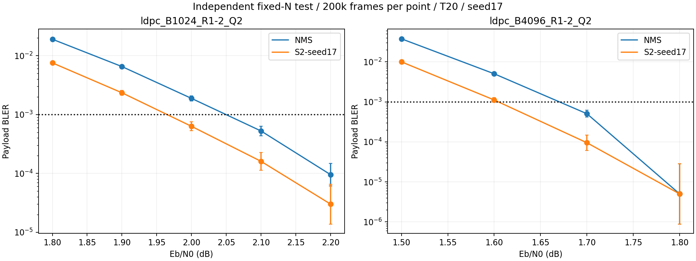

**独立终点测试、多种子与机制对照：20261114-235334-endpoint-multiseed-mechanisms**

更新时间：2026-11-22T08:05:09.887337+08:00。RTX4090：历史GPU0；2026-11-18设备数据损坏后迁移GPU3，FP32，TF32/AMP关闭，T20，early-stop/fallback关闭。原始commit 606439166812f97fb42e30ae3dcfec58ec2b35f9，源码以哈希快照为准。

本轮顺序：已选seed17模型独立细网格pilot→冻结网格与每点200k帧测试→seed29/43同预算复现→静态阻尼、MLP、EMA、GRU机制对照。训练和测试阶段未完成的部分不写成结果。

[预登记与预算](logs/20261114-235334-endpoint-multiseed-mechanisms/preregistration.json) · [后台阶段状态](logs/20261114-235334-endpoint-multiseed-mechanisms/pipeline_status.json) · [采样事件日志](results/20261114-235334-endpoint-multiseed-mechanisms/events.jsonl)

冻结测试网格（由独立pilot确定，正式test不再改点）：

|配置|Eb/N0/dB|每点N|
|---|---|---:|
|ldpc_B1024_R1-2_Q2|[1.8, 1.9, 2.0, 2.1, 2.2]|200000|
|ldpc_B4096_R1-2_Q2|[1.5, 1.6, 1.7, 1.8]|200000|

[冻结网格](results/20261114-235334-endpoint-multiseed-mechanisms/test_grid_frozen.json) · [pilot摘要](results/20261114-235334-endpoint-multiseed-mechanisms/pilot_summary.json)

已完成测试 cohort：ema-seed17。

|配置|方法|1e-3门限/dB|相对NMS收益/dB|配对95%CI/dB|bootstrap有效数|
|---|---|---:|---:|---|---:|
|ldpc_B1024_R1-2_Q2|NMS|2.049487|N/A|None|10000/10000|
|ldpc_B1024_R1-2_Q2|ema-seed17|1.965300|0.084187|[0.0754374223154799, 0.09242184532589122]|10000/10000|
|ldpc_B4096_R1-2_Q2|NMS|1.670291|N/A|None|10000/10000|
|ldpc_B4096_R1-2_Q2|ema-seed17|1.656944|0.013347|[0.007523216219590368, 0.019764331096648383]|10000/10000|

[原始摘要](results/20261114-235334-endpoint-multiseed-mechanisms/test/ema-seed17/summary.json)
[独立审计](results/20261114-235334-endpoint-multiseed-mechanisms/test/ema-seed17/audit_summary.json)

|ldpc_B1024_R1-2_Q2：Eb/N0/dB|方法|错误/N|payload BLER|拒收|service-FER|
|---:|---|---|---:|---:|---:|
|1.8000|NMS|3806/200000|0.01903|7740|0.0387|
|1.8000|ema-seed17|1527/200000|0.007635|3982|0.01991|
|1.9000|NMS|1306/200000|0.00653|3009|0.015045|
|1.9000|ema-seed17|507/200000|0.002535|1479|0.007395|
|2.0000|NMS|376/200000|0.00188|979|0.004895|
|2.0000|ema-seed17|122/200000|0.00061|460|0.0023|
|2.1000|NMS|105/200000|0.000525|292|0.00146|
|2.1000|ema-seed17|37/200000|0.000185|139|0.000695|
|2.2000|NMS|19/200000|9.5e-05|79|0.000395|
|2.2000|ema-seed17|6/200000|3e-05|42|0.00021|

|ldpc_B4096_R1-2_Q2：Eb/N0/dB|方法|错误/N|payload BLER|拒收|service-FER|
|---:|---|---|---:|---:|---:|
|1.5000|NMS|7527/200000|0.037635|31920|0.1596|
|1.5000|ema-seed17|4494/200000|0.02247|30594|0.15297|
|1.6000|NMS|1007/200000|0.005035|8128|0.04064|
|1.6000|ema-seed17|640/200000|0.0032|8781|0.043905|
|1.7000|NMS|101/200000|0.000505|1393|0.006965|
|1.7000|ema-seed17|83/200000|0.000415|1912|0.00956|
|1.8000|NMS|1/200000|5e-06|214|0.00107|
|1.8000|ema-seed17|2/200000|1e-05|369|0.001845|

已完成测试 cohort：ema-seed29。

|配置|方法|1e-3门限/dB|相对NMS收益/dB|配对95%CI/dB|bootstrap有效数|
|---|---|---:|---:|---|---:|
|ldpc_B1024_R1-2_Q2|NMS|2.049487|N/A|None|10000/10000|
|ldpc_B1024_R1-2_Q2|ema-seed29|1.966288|0.083199|[0.07392631323570285, 0.09221040982917945]|10000/10000|
|ldpc_B4096_R1-2_Q2|NMS|1.670291|N/A|None|10000/10000|
|ldpc_B4096_R1-2_Q2|ema-seed29|1.598147|0.072144|[0.06447658720872664, 0.08053291411895852]|10000/10000|

[原始摘要](results/20261114-235334-endpoint-multiseed-mechanisms/test/ema-seed29/summary.json)
[独立审计](results/20261114-235334-endpoint-multiseed-mechanisms/test/ema-seed29/audit_summary.json)

|ldpc_B1024_R1-2_Q2：Eb/N0/dB|方法|错误/N|payload BLER|拒收|service-FER|
|---:|---|---|---:|---:|---:|
|1.8000|NMS|3806/200000|0.01903|7740|0.0387|
|1.8000|ema-seed29|1539/200000|0.007695|3942|0.01971|
|1.9000|NMS|1306/200000|0.00653|3009|0.015045|
|1.9000|ema-seed29|481/200000|0.002405|1467|0.007335|
|2.0000|NMS|376/200000|0.00188|979|0.004895|
|2.0000|ema-seed29|128/200000|0.00064|460|0.0023|
|2.1000|NMS|105/200000|0.000525|292|0.00146|
|2.1000|ema-seed29|34/200000|0.00017|142|0.00071|
|2.2000|NMS|19/200000|9.5e-05|79|0.000395|
|2.2000|ema-seed29|6/200000|3e-05|40|0.0002|

|ldpc_B4096_R1-2_Q2：Eb/N0/dB|方法|错误/N|payload BLER|拒收|service-FER|
|---:|---|---|---:|---:|---:|
|1.5000|NMS|7527/200000|0.037635|31920|0.1596|
|1.5000|ema-seed29|1738/200000|0.00869|13411|0.067055|
|1.6000|NMS|1007/200000|0.005035|8128|0.04064|
|1.6000|ema-seed29|192/200000|0.00096|2812|0.01406|
|1.7000|NMS|101/200000|0.000505|1393|0.006965|
|1.7000|ema-seed29|19/200000|9.5e-05|505|0.002525|
|1.8000|NMS|1/200000|5e-06|214|0.00107|
|1.8000|ema-seed29|0/200000|0|89|0.000445|

已完成测试 cohort：ema-seed43。

|配置|方法|1e-3门限/dB|相对NMS收益/dB|配对95%CI/dB|bootstrap有效数|
|---|---|---:|---:|---|---:|
|ldpc_B1024_R1-2_Q2|NMS|2.049487|N/A|None|10000/10000|
|ldpc_B1024_R1-2_Q2|ema-seed43|1.965106|0.084381|[0.07560505852414756, 0.09281630493846744]|10000/10000|
|ldpc_B4096_R1-2_Q2|NMS|1.670291|N/A|None|10000/10000|
|ldpc_B4096_R1-2_Q2|ema-seed43|1.617181|0.053110|[0.04609275760709217, 0.061077891965605105]|10000/10000|

[原始摘要](results/20261114-235334-endpoint-multiseed-mechanisms/test/ema-seed43/summary.json)
[独立审计](results/20261114-235334-endpoint-multiseed-mechanisms/test/ema-seed43/audit_summary.json)

|ldpc_B1024_R1-2_Q2：Eb/N0/dB|方法|错误/N|payload BLER|拒收|service-FER|
|---:|---|---|---:|---:|---:|
|1.8000|NMS|3806/200000|0.01903|7740|0.0387|
|1.8000|ema-seed43|1509/200000|0.007545|3913|0.019565|
|1.9000|NMS|1306/200000|0.00653|3009|0.015045|
|1.9000|ema-seed43|503/200000|0.002515|1438|0.00719|
|2.0000|NMS|376/200000|0.00188|979|0.004895|
|2.0000|ema-seed43|122/200000|0.00061|460|0.0023|
|2.1000|NMS|105/200000|0.000525|292|0.00146|
|2.1000|ema-seed43|38/200000|0.00019|127|0.000635|
|2.2000|NMS|19/200000|9.5e-05|79|0.000395|
|2.2000|ema-seed43|6/200000|3e-05|39|0.000195|

|ldpc_B4096_R1-2_Q2：Eb/N0/dB|方法|错误/N|payload BLER|拒收|service-FER|
|---:|---|---|---:|---:|---:|
|1.5000|NMS|7527/200000|0.037635|31920|0.1596|
|1.5000|ema-seed43|2584/200000|0.01292|18099|0.090495|
|1.6000|NMS|1007/200000|0.005035|8128|0.04064|
|1.6000|ema-seed43|303/200000|0.001515|4159|0.020795|
|1.7000|NMS|101/200000|0.000505|1393|0.006965|
|1.7000|ema-seed43|27/200000|0.000135|754|0.00377|
|1.8000|NMS|1/200000|5e-06|214|0.00107|
|1.8000|ema-seed43|1/200000|5e-06|146|0.00073|

已完成测试 cohort：gru-seed17。

|配置|方法|1e-3门限/dB|相对NMS收益/dB|配对95%CI/dB|bootstrap有效数|
|---|---|---:|---:|---|---:|
|ldpc_B1024_R1-2_Q2|NMS|2.049487|N/A|None|10000/10000|
|ldpc_B1024_R1-2_Q2|gru-seed17|1.965845|0.083643|[0.07456032996407821, 0.09231408713297164]|10000/10000|
|ldpc_B4096_R1-2_Q2|NMS|1.670291|N/A|None|10000/10000|
|ldpc_B4096_R1-2_Q2|gru-seed17|1.634018|0.036273|[0.030095680838744726, 0.04276035701179336]|10000/10000|

[原始摘要](results/20261114-235334-endpoint-multiseed-mechanisms/test/gru-seed17/summary.json)
[独立审计](results/20261114-235334-endpoint-multiseed-mechanisms/test/gru-seed17/audit_summary.json)

|ldpc_B1024_R1-2_Q2：Eb/N0/dB|方法|错误/N|payload BLER|拒收|service-FER|
|---:|---|---|---:|---:|---:|
|1.8000|NMS|3806/200000|0.01903|7740|0.0387|
|1.8000|gru-seed17|1503/200000|0.007515|3913|0.019565|
|1.9000|NMS|1306/200000|0.00653|3009|0.015045|
|1.9000|gru-seed17|480/200000|0.0024|1457|0.007285|
|2.0000|NMS|376/200000|0.00188|979|0.004895|
|2.0000|gru-seed17|127/200000|0.000635|450|0.00225|
|2.1000|NMS|105/200000|0.000525|292|0.00146|
|2.1000|gru-seed17|34/200000|0.00017|142|0.00071|
|2.2000|NMS|19/200000|9.5e-05|79|0.000395|
|2.2000|gru-seed17|6/200000|3e-05|39|0.000195|

|ldpc_B4096_R1-2_Q2：Eb/N0/dB|方法|错误/N|payload BLER|拒收|service-FER|
|---:|---|---|---:|---:|---:|
|1.5000|NMS|7527/200000|0.037635|31920|0.1596|
|1.5000|gru-seed17|3296/200000|0.01648|22382|0.11191|
|1.6000|NMS|1007/200000|0.005035|8128|0.04064|
|1.6000|gru-seed17|413/200000|0.002065|5552|0.02776|
|1.7000|NMS|101/200000|0.000505|1393|0.006965|
|1.7000|gru-seed17|49/200000|0.000245|1047|0.005235|
|1.8000|NMS|1/200000|5e-06|214|0.00107|
|1.8000|gru-seed17|2/200000|1e-05|202|0.00101|

已完成测试 cohort：gru-seed29。

|配置|方法|1e-3门限/dB|相对NMS收益/dB|配对95%CI/dB|bootstrap有效数|
|---|---|---:|---:|---|---:|
|ldpc_B1024_R1-2_Q2|NMS|2.049487|N/A|None|10000/10000|
|ldpc_B1024_R1-2_Q2|gru-seed29|1.967417|0.082070|[0.07299013482540381, 0.09079573209411125]|10000/10000|
|ldpc_B4096_R1-2_Q2|NMS|1.670291|N/A|None|10000/10000|
|ldpc_B4096_R1-2_Q2|gru-seed29|1.602463|0.067828|[0.06063141924602113, 0.07588155627125463]|10000/10000|

[原始摘要](results/20261114-235334-endpoint-multiseed-mechanisms/test/gru-seed29/summary.json)
[独立审计](results/20261114-235334-endpoint-multiseed-mechanisms/test/gru-seed29/audit_summary.json)

|ldpc_B1024_R1-2_Q2：Eb/N0/dB|方法|错误/N|payload BLER|拒收|service-FER|
|---:|---|---|---:|---:|---:|
|1.8000|NMS|3806/200000|0.01903|7740|0.0387|
|1.8000|gru-seed29|1488/200000|0.00744|3903|0.019515|
|1.9000|NMS|1306/200000|0.00653|3009|0.015045|
|1.9000|gru-seed29|480/200000|0.0024|1442|0.00721|
|2.0000|NMS|376/200000|0.00188|979|0.004895|
|2.0000|gru-seed29|131/200000|0.000655|444|0.00222|
|2.1000|NMS|105/200000|0.000525|292|0.00146|
|2.1000|gru-seed29|30/200000|0.00015|140|0.0007|
|2.2000|NMS|19/200000|9.5e-05|79|0.000395|
|2.2000|gru-seed29|6/200000|3e-05|37|0.000185|

|ldpc_B4096_R1-2_Q2：Eb/N0/dB|方法|错误/N|payload BLER|拒收|service-FER|
|---:|---|---|---:|---:|---:|
|1.5000|NMS|7527/200000|0.037635|31920|0.1596|
|1.5000|gru-seed29|1960/200000|0.0098|14530|0.07265|
|1.6000|NMS|1007/200000|0.005035|8128|0.04064|
|1.6000|gru-seed29|211/200000|0.001055|3142|0.01571|
|1.7000|NMS|101/200000|0.000505|1393|0.006965|
|1.7000|gru-seed29|24/200000|0.00012|564|0.00282|
|1.8000|NMS|1/200000|5e-06|214|0.00107|
|1.8000|gru-seed29|0/200000|0|103|0.000515|

已完成测试 cohort：gru-seed43。

|配置|方法|1e-3门限/dB|相对NMS收益/dB|配对95%CI/dB|bootstrap有效数|
|---|---|---:|---:|---|---:|
|ldpc_B1024_R1-2_Q2|NMS|2.049487|N/A|None|10000/10000|
|ldpc_B1024_R1-2_Q2|gru-seed43|1.968109|0.081378|[0.07254663174150007, 0.08994576342469845]|10000/10000|
|ldpc_B4096_R1-2_Q2|NMS|1.670291|N/A|None|10000/10000|
|ldpc_B4096_R1-2_Q2|gru-seed43|1.660948|0.009342|[0.003545651124039806, 0.01600533318185407]|10000/10000|

[原始摘要](results/20261114-235334-endpoint-multiseed-mechanisms/test/gru-seed43/summary.json)
[独立审计](results/20261114-235334-endpoint-multiseed-mechanisms/test/gru-seed43/audit_summary.json)

|ldpc_B1024_R1-2_Q2：Eb/N0/dB|方法|错误/N|payload BLER|拒收|service-FER|
|---:|---|---|---:|---:|---:|
|1.8000|NMS|3806/200000|0.01903|7740|0.0387|
|1.8000|gru-seed43|1521/200000|0.007605|3877|0.019385|
|1.9000|NMS|1306/200000|0.00653|3009|0.015045|
|1.9000|gru-seed43|478/200000|0.00239|1438|0.00719|
|2.0000|NMS|376/200000|0.00188|979|0.004895|
|2.0000|gru-seed43|133/200000|0.000665|440|0.0022|
|2.1000|NMS|105/200000|0.000525|292|0.00146|
|2.1000|gru-seed43|31/200000|0.000155|136|0.00068|
|2.2000|NMS|19/200000|9.5e-05|79|0.000395|
|2.2000|gru-seed43|5/200000|2.5e-05|38|0.00019|

|ldpc_B4096_R1-2_Q2：Eb/N0/dB|方法|错误/N|payload BLER|拒收|service-FER|
|---:|---|---|---:|---:|---:|
|1.5000|NMS|7527/200000|0.037635|31920|0.1596|
|1.5000|gru-seed43|4668/200000|0.02334|32160|0.1608|
|1.6000|NMS|1007/200000|0.005035|8128|0.04064|
|1.6000|gru-seed43|672/200000|0.00336|9578|0.04789|
|1.7000|NMS|101/200000|0.000505|1393|0.006965|
|1.7000|gru-seed43|92/200000|0.00046|2151|0.010755|
|1.8000|NMS|1/200000|5e-06|214|0.00107|
|1.8000|gru-seed43|5/200000|2.5e-05|442|0.00221|

已完成测试 cohort：mlp-seed17。

|配置|方法|1e-3门限/dB|相对NMS收益/dB|配对95%CI/dB|bootstrap有效数|
|---|---|---:|---:|---|---:|
|ldpc_B1024_R1-2_Q2|NMS|2.049487|N/A|None|10000/10000|
|ldpc_B1024_R1-2_Q2|mlp-seed17|1.968457|0.081031|[0.07186632127284295, 0.08971631869139499]|10000/10000|
|ldpc_B4096_R1-2_Q2|NMS|1.670291|N/A|None|10000/10000|
|ldpc_B4096_R1-2_Q2|mlp-seed17|1.647005|0.023286|[0.016745777501622643, 0.030364620461037415]|10000/10000|

[原始摘要](results/20261114-235334-endpoint-multiseed-mechanisms/test/mlp-seed17/summary.json)
[独立审计](results/20261114-235334-endpoint-multiseed-mechanisms/test/mlp-seed17/audit_summary.json)

|ldpc_B1024_R1-2_Q2：Eb/N0/dB|方法|错误/N|payload BLER|拒收|service-FER|
|---:|---|---|---:|---:|---:|
|1.8000|NMS|3806/200000|0.01903|7740|0.0387|
|1.8000|mlp-seed17|1569/200000|0.007845|3993|0.019965|
|1.9000|NMS|1306/200000|0.00653|3009|0.015045|
|1.9000|mlp-seed17|518/200000|0.00259|1477|0.007385|
|2.0000|NMS|376/200000|0.00188|979|0.004895|
|2.0000|mlp-seed17|129/200000|0.000645|455|0.002275|
|2.1000|NMS|105/200000|0.000525|292|0.00146|
|2.1000|mlp-seed17|38/200000|0.00019|136|0.00068|
|2.2000|NMS|19/200000|9.5e-05|79|0.000395|
|2.2000|mlp-seed17|6/200000|3e-05|41|0.000205|

|ldpc_B4096_R1-2_Q2：Eb/N0/dB|方法|错误/N|payload BLER|拒收|service-FER|
|---:|---|---|---:|---:|---:|
|1.5000|NMS|7527/200000|0.037635|31920|0.1596|
|1.5000|mlp-seed17|3656/200000|0.01828|26748|0.13374|
|1.6000|NMS|1007/200000|0.005035|8128|0.04064|
|1.6000|mlp-seed17|514/200000|0.00257|7507|0.037535|
|1.7000|NMS|101/200000|0.000505|1393|0.006965|
|1.7000|mlp-seed17|69/200000|0.000345|1652|0.00826|
|1.8000|NMS|1/200000|5e-06|214|0.00107|
|1.8000|mlp-seed17|3/200000|1.5e-05|335|0.001675|

已完成测试 cohort：mlp-seed29。

|配置|方法|1e-3门限/dB|相对NMS收益/dB|配对95%CI/dB|bootstrap有效数|
|---|---|---:|---:|---|---:|
|ldpc_B1024_R1-2_Q2|NMS|2.049487|N/A|None|10000/10000|
|ldpc_B1024_R1-2_Q2|mlp-seed29|1.965187|0.084300|[0.07573252503945356, 0.09254120705352872]|10000/10000|
|ldpc_B4096_R1-2_Q2|NMS|1.670291|N/A|None|10000/10000|
|ldpc_B4096_R1-2_Q2|mlp-seed29|1.595570|0.074721|[0.06560490725938892, 0.0841241738525036]|10000/10000|

[原始摘要](results/20261114-235334-endpoint-multiseed-mechanisms/test/mlp-seed29/summary.json)
[独立审计](results/20261114-235334-endpoint-multiseed-mechanisms/test/mlp-seed29/audit_summary.json)

|ldpc_B1024_R1-2_Q2：Eb/N0/dB|方法|错误/N|payload BLER|拒收|service-FER|
|---:|---|---|---:|---:|---:|
|1.8000|NMS|3806/200000|0.01903|7740|0.0387|
|1.8000|mlp-seed29|1532/200000|0.00766|3959|0.019795|
|1.9000|NMS|1306/200000|0.00653|3009|0.015045|
|1.9000|mlp-seed29|497/200000|0.002485|1497|0.007485|
|2.0000|NMS|376/200000|0.00188|979|0.004895|
|2.0000|mlp-seed29|123/200000|0.000615|462|0.00231|
|2.1000|NMS|105/200000|0.000525|292|0.00146|
|2.1000|mlp-seed29|36/200000|0.00018|151|0.000755|
|2.2000|NMS|19/200000|9.5e-05|79|0.000395|
|2.2000|mlp-seed29|6/200000|3e-05|41|0.000205|

|ldpc_B4096_R1-2_Q2：Eb/N0/dB|方法|错误/N|payload BLER|拒收|service-FER|
|---:|---|---|---:|---:|---:|
|1.5000|NMS|7527/200000|0.037635|31920|0.1596|
|1.5000|mlp-seed29|1723/200000|0.008615|12973|0.064865|
|1.6000|NMS|1007/200000|0.005035|8128|0.04064|
|1.6000|mlp-seed29|181/200000|0.000905|2701|0.013505|
|1.7000|NMS|101/200000|0.000505|1393|0.006965|
|1.7000|mlp-seed29|15/200000|7.5e-05|477|0.002385|
|1.8000|NMS|1/200000|5e-06|214|0.00107|
|1.8000|mlp-seed29|0/200000|0|90|0.00045|

已完成测试 cohort：mlp-seed43。

|配置|方法|1e-3门限/dB|相对NMS收益/dB|配对95%CI/dB|bootstrap有效数|
|---|---|---:|---:|---|---:|
|ldpc_B1024_R1-2_Q2|NMS|2.049487|N/A|None|10000/10000|
|ldpc_B1024_R1-2_Q2|mlp-seed43|1.967753|0.081734|[0.07279395608292467, 0.09012773298656693]|10000/10000|
|ldpc_B4096_R1-2_Q2|NMS|1.670291|N/A|None|10000/10000|
|ldpc_B4096_R1-2_Q2|mlp-seed43|1.601185|0.069106|[0.061448610740775636, 0.07751867890907367]|10000/10000|

[原始摘要](results/20261114-235334-endpoint-multiseed-mechanisms/test/mlp-seed43/summary.json)
[独立审计](results/20261114-235334-endpoint-multiseed-mechanisms/test/mlp-seed43/audit_summary.json)

|ldpc_B1024_R1-2_Q2：Eb/N0/dB|方法|错误/N|payload BLER|拒收|service-FER|
|---:|---|---|---:|---:|---:|
|1.8000|NMS|3806/200000|0.01903|7740|0.0387|
|1.8000|mlp-seed43|1596/200000|0.00798|4097|0.020485|
|1.9000|NMS|1306/200000|0.00653|3009|0.015045|
|1.9000|mlp-seed43|528/200000|0.00264|1530|0.00765|
|2.0000|NMS|376/200000|0.00188|979|0.004895|
|2.0000|mlp-seed43|126/200000|0.00063|479|0.002395|
|2.1000|NMS|105/200000|0.000525|292|0.00146|
|2.1000|mlp-seed43|39/200000|0.000195|153|0.000765|
|2.2000|NMS|19/200000|9.5e-05|79|0.000395|
|2.2000|mlp-seed43|6/200000|3e-05|41|0.000205|

|ldpc_B4096_R1-2_Q2：Eb/N0/dB|方法|错误/N|payload BLER|拒收|service-FER|
|---:|---|---|---:|---:|---:|
|1.5000|NMS|7527/200000|0.037635|31920|0.1596|
|1.5000|mlp-seed43|1852/200000|0.00926|14100|0.0705|
|1.6000|NMS|1007/200000|0.005035|8128|0.04064|
|1.6000|mlp-seed43|206/200000|0.00103|2960|0.0148|
|1.7000|NMS|101/200000|0.000505|1393|0.006965|
|1.7000|mlp-seed43|17/200000|8.5e-05|559|0.002795|
|1.8000|NMS|1/200000|5e-06|214|0.00107|
|1.8000|mlp-seed43|0/200000|0|99|0.000495|

已完成测试 cohort：seed17。

|配置|方法|1e-3门限/dB|相对NMS收益/dB|配对95%CI/dB|bootstrap有效数|
|---|---|---:|---:|---|---:|
|ldpc_B1024_R1-2_Q2|NMS|2.049487|N/A|None|10000/10000|
|ldpc_B1024_R1-2_Q2|S2-seed17|1.964789|0.084698|[0.07613107756939577, 0.09304714527006581]|10000/10000|
|ldpc_B4096_R1-2_Q2|NMS|1.670291|N/A|None|10000/10000|
|ldpc_B4096_R1-2_Q2|S2-seed17|1.604420|0.065871|[0.05851613983446358, 0.07399228206310406]|10000/10000|

[原始摘要](results/20261114-235334-endpoint-multiseed-mechanisms/test/seed17/summary.json)
[独立审计](results/20261114-235334-endpoint-multiseed-mechanisms/test/seed17/audit_summary.json)

|ldpc_B1024_R1-2_Q2：Eb/N0/dB|方法|错误/N|payload BLER|拒收|service-FER|
|---:|---|---|---:|---:|---:|
|1.8000|NMS|3806/200000|0.01903|7740|0.0387|
|1.8000|S2-seed17|1508/200000|0.00754|3880|0.0194|
|1.9000|NMS|1306/200000|0.00653|3009|0.015045|
|1.9000|S2-seed17|468/200000|0.00234|1425|0.007125|
|2.0000|NMS|376/200000|0.00188|979|0.004895|
|2.0000|S2-seed17|126/200000|0.00063|445|0.002225|
|2.1000|NMS|105/200000|0.000525|292|0.00146|
|2.1000|S2-seed17|32/200000|0.00016|140|0.0007|
|2.2000|NMS|19/200000|9.5e-05|79|0.000395|
|2.2000|S2-seed17|6/200000|3e-05|40|0.0002|

|ldpc_B4096_R1-2_Q2：Eb/N0/dB|方法|错误/N|payload BLER|拒收|service-FER|
|---:|---|---|---:|---:|---:|
|1.5000|NMS|7527/200000|0.037635|31920|0.1596|
|1.5000|S2-seed17|1996/200000|0.00998|14749|0.073745|
|1.6000|NMS|1007/200000|0.005035|8128|0.04064|
|1.6000|S2-seed17|223/200000|0.001115|3244|0.01622|
|1.7000|NMS|101/200000|0.000505|1393|0.006965|
|1.7000|S2-seed17|19/200000|9.5e-05|558|0.00279|
|1.8000|NMS|1/200000|5e-06|214|0.00107|
|1.8000|S2-seed17|1/200000|5e-06|104|0.00052|

已完成测试 cohort：seed29。

|配置|方法|1e-3门限/dB|相对NMS收益/dB|配对95%CI/dB|bootstrap有效数|
|---|---|---:|---:|---|---:|
|ldpc_B1024_R1-2_Q2|NMS|2.049487|N/A|None|10000/10000|
|ldpc_B1024_R1-2_Q2|ssm-seed29|1.964674|0.084814|[0.07524110481768588, 0.09380439267703325]|10000/10000|
|ldpc_B4096_R1-2_Q2|NMS|1.670291|N/A|None|10000/10000|
|ldpc_B4096_R1-2_Q2|ssm-seed29|1.621256|0.049034|[0.04213159042454107, 0.056341986193404005]|10000/10000|

[原始摘要](results/20261114-235334-endpoint-multiseed-mechanisms/test/seed29/summary.json)
[独立审计](results/20261114-235334-endpoint-multiseed-mechanisms/test/seed29/audit_summary.json)

|ldpc_B1024_R1-2_Q2：Eb/N0/dB|方法|错误/N|payload BLER|拒收|service-FER|
|---:|---|---|---:|---:|---:|
|1.8000|NMS|3806/200000|0.01903|7740|0.0387|
|1.8000|ssm-seed29|1479/200000|0.007395|3857|0.019285|
|1.9000|NMS|1306/200000|0.00653|3009|0.015045|
|1.9000|ssm-seed29|466/200000|0.00233|1455|0.007275|
|2.0000|NMS|376/200000|0.00188|979|0.004895|
|2.0000|ssm-seed29|126/200000|0.00063|448|0.00224|
|2.1000|NMS|105/200000|0.000525|292|0.00146|
|2.1000|ssm-seed29|28/200000|0.00014|148|0.00074|
|2.2000|NMS|19/200000|9.5e-05|79|0.000395|
|2.2000|ssm-seed29|6/200000|3e-05|43|0.000215|

|ldpc_B4096_R1-2_Q2：Eb/N0/dB|方法|错误/N|payload BLER|拒收|service-FER|
|---:|---|---|---:|---:|---:|
|1.5000|NMS|7527/200000|0.037635|31920|0.1596|
|1.5000|ssm-seed29|2878/200000|0.01439|19447|0.097235|
|1.6000|NMS|1007/200000|0.005035|8128|0.04064|
|1.6000|ssm-seed29|328/200000|0.00164|4542|0.02271|
|1.7000|NMS|101/200000|0.000505|1393|0.006965|
|1.7000|ssm-seed29|32/200000|0.00016|828|0.00414|
|1.8000|NMS|1/200000|5e-06|214|0.00107|
|1.8000|ssm-seed29|0/200000|0|155|0.000775|

已完成测试 cohort：seed43。

|配置|方法|1e-3门限/dB|相对NMS收益/dB|配对95%CI/dB|bootstrap有效数|
|---|---|---:|---:|---|---:|
|ldpc_B1024_R1-2_Q2|NMS|2.049487|N/A|None|10000/10000|
|ldpc_B1024_R1-2_Q2|ssm-seed43|1.970835|0.078652|[0.06945300525533939, 0.08780680991722171]|10000/10000|
|ldpc_B4096_R1-2_Q2|NMS|1.670291|N/A|None|10000/10000|
|ldpc_B4096_R1-2_Q2|ssm-seed43|1.597925|0.072366|[0.06353747167888724, 0.08204629438871619]|10000/10000|

[原始摘要](results/20261114-235334-endpoint-multiseed-mechanisms/test/seed43/summary.json)
[独立审计](results/20261114-235334-endpoint-multiseed-mechanisms/test/seed43/audit_summary.json)

|ldpc_B1024_R1-2_Q2：Eb/N0/dB|方法|错误/N|payload BLER|拒收|service-FER|
|---:|---|---|---:|---:|---:|
|1.8000|NMS|3806/200000|0.01903|7740|0.0387|
|1.8000|ssm-seed43|1593/200000|0.007965|4130|0.02065|
|1.9000|NMS|1306/200000|0.00653|3009|0.015045|
|1.9000|ssm-seed43|529/200000|0.002645|1520|0.0076|
|2.0000|NMS|376/200000|0.00188|979|0.004895|
|2.0000|ssm-seed43|134/200000|0.00067|485|0.002425|
|2.1000|NMS|105/200000|0.000525|292|0.00146|
|2.1000|ssm-seed43|35/200000|0.000175|156|0.00078|
|2.2000|NMS|19/200000|9.5e-05|79|0.000395|
|2.2000|ssm-seed43|6/200000|3e-05|41|0.000205|

|ldpc_B4096_R1-2_Q2：Eb/N0/dB|方法|错误/N|payload BLER|拒收|service-FER|
|---:|---|---|---:|---:|---:|
|1.5000|NMS|7527/200000|0.037635|31920|0.1596|
|1.5000|ssm-seed43|1756/200000|0.00878|13451|0.067255|
|1.6000|NMS|1007/200000|0.005035|8128|0.04064|
|1.6000|ssm-seed43|191/200000|0.000955|2862|0.01431|
|1.7000|NMS|101/200000|0.000505|1393|0.006965|
|1.7000|ssm-seed43|21/200000|0.000105|521|0.002605|
|1.8000|NMS|1/200000|5e-06|214|0.00107|
|1.8000|ssm-seed43|0/200000|0|92|0.00046|

已完成测试 cohort：static-controls。

|配置|方法|1e-3门限/dB|相对NMS收益/dB|配对95%CI/dB|bootstrap有效数|
|---|---|---:|---:|---|---:|
|ldpc_B1024_R1-2_Q2|NMS|2.049487|N/A|None|10000/10000|
|ldpc_B1024_R1-2_Q2|static-tuned|2.003155|0.046332|[0.03658280000645714, 0.058945445012808725]|10000/10000|
|ldpc_B1024_R1-2_Q2|static-initial-eta005|2.002301|0.047186|[0.03747441352208255, 0.05856403471268242]|10000/10000|
|ldpc_B4096_R1-2_Q2|NMS|1.670291|N/A|None|10000/10000|
|ldpc_B4096_R1-2_Q2|static-tuned|1.643907|0.026384|[0.020017639555678764, 0.033197835181411055]|10000/10000|
|ldpc_B4096_R1-2_Q2|static-initial-eta005|1.637738|0.032553|[0.027025596038855754, 0.038304168391048415]|10000/10000|

[原始摘要](results/20261114-235334-endpoint-multiseed-mechanisms/test/static-controls/summary.json)
[独立审计](results/20261114-235334-endpoint-multiseed-mechanisms/test/static-controls/audit_summary.json)

|ldpc_B1024_R1-2_Q2：Eb/N0/dB|方法|错误/N|payload BLER|拒收|service-FER|
|---:|---|---|---:|---:|---:|
|1.8000|NMS|3806/200000|0.01903|7740|0.0387|
|1.8000|static-tuned|2139/200000|0.010695|5824|0.02912|
|1.8000|static-initial-eta005|2296/200000|0.01148|5620|0.0281|
|1.9000|NMS|1306/200000|0.00653|3009|0.015045|
|1.9000|static-tuned|712/200000|0.00356|2282|0.01141|
|1.9000|static-initial-eta005|753/200000|0.003765|2147|0.010735|
|2.0000|NMS|376/200000|0.00188|979|0.004895|
|2.0000|static-tuned|208/200000|0.00104|762|0.00381|
|2.0000|static-initial-eta005|206/200000|0.00103|677|0.003385|
|2.1000|NMS|105/200000|0.000525|292|0.00146|
|2.1000|static-tuned|60/200000|0.0003|255|0.001275|
|2.1000|static-initial-eta005|57/200000|0.000285|220|0.0011|
|2.2000|NMS|19/200000|9.5e-05|79|0.000395|
|2.2000|static-tuned|12/200000|6e-05|76|0.00038|
|2.2000|static-initial-eta005|9/200000|4.5e-05|58|0.00029|

|ldpc_B4096_R1-2_Q2：Eb/N0/dB|方法|错误/N|payload BLER|拒收|service-FER|
|---:|---|---|---:|---:|---:|
|1.5000|NMS|7527/200000|0.037635|31920|0.1596|
|1.5000|static-tuned|3716/200000|0.01858|25763|0.128815|
|1.5000|static-initial-eta005|3980/200000|0.0199|24195|0.120975|
|1.6000|NMS|1007/200000|0.005035|8128|0.04064|
|1.6000|static-tuned|494/200000|0.00247|6850|0.03425|
|1.6000|static-initial-eta005|475/200000|0.002375|5989|0.029945|
|1.7000|NMS|101/200000|0.000505|1393|0.006965|
|1.7000|static-tuned|63/200000|0.000315|1404|0.00702|
|1.7000|static-initial-eta005|48/200000|0.00024|1122|0.00561|
|1.8000|NMS|1/200000|5e-06|214|0.00107|
|1.8000|static-tuned|2/200000|1e-05|265|0.001325|
|1.8000|static-initial-eta005|2/200000|1e-05|194|0.00097|

训练完成并独立审计通过：ldpc_B4096_R1-2_Q2 / ema / seed17，50000步，320万观测，选中49000步，裁剪率11.122%。[审计](results/20261114-235334-endpoint-multiseed-mechanisms/training/bg1-ema-seed17/independent_audit.json)
训练完成并独立审计通过：ldpc_B4096_R1-2_Q2 / ema / seed29，50000步，320万观测，选中50000步，裁剪率8.768%。[审计](results/20261114-235334-endpoint-multiseed-mechanisms/training/bg1-ema-seed29/independent_audit.json)
训练完成并独立审计通过：ldpc_B4096_R1-2_Q2 / ema / seed43，50000步，320万观测，选中50000步，裁剪率4.524%。[审计](results/20261114-235334-endpoint-multiseed-mechanisms/training/bg1-ema-seed43/independent_audit.json)
训练完成并独立审计通过：ldpc_B4096_R1-2_Q2 / gru / seed17，50000步，320万观测，选中50000步，裁剪率5.288%。[审计](results/20261114-235334-endpoint-multiseed-mechanisms/training/bg1-gru-seed17/independent_audit.json)
训练完成并独立审计通过：ldpc_B4096_R1-2_Q2 / gru / seed29，50000步，320万观测，选中40000步，裁剪率4.554%。[审计](results/20261114-235334-endpoint-multiseed-mechanisms/training/bg1-gru-seed29/independent_audit.json)
训练完成并独立审计通过：ldpc_B4096_R1-2_Q2 / gru / seed43，50000步，320万观测，选中50000步，裁剪率7.054%。[审计](results/20261114-235334-endpoint-multiseed-mechanisms/training/bg1-gru-seed43/independent_audit.json)
训练完成并独立审计通过：ldpc_B4096_R1-2_Q2 / mlp / seed17，50000步，320万观测，选中43000步，裁剪率5.322%。[审计](results/20261114-235334-endpoint-multiseed-mechanisms/training/bg1-mlp-seed17/independent_audit.json)
训练完成并独立审计通过：ldpc_B4096_R1-2_Q2 / mlp / seed29，50000步，320万观测，选中47000步，裁剪率5.212%。[审计](results/20261114-235334-endpoint-multiseed-mechanisms/training/bg1-mlp-seed29/independent_audit.json)
训练完成并独立审计通过：ldpc_B4096_R1-2_Q2 / mlp / seed43，50000步，320万观测，选中49000步，裁剪率5.822%。[审计](results/20261114-235334-endpoint-multiseed-mechanisms/training/bg1-mlp-seed43/independent_audit.json)
训练完成并独立审计通过：ldpc_B4096_R1-2_Q2 / ssm / seed29，50000步，320万观测，选中49000步，裁剪率9.424%。[审计](results/20261114-235334-endpoint-multiseed-mechanisms/training/bg1-ssm-seed29/independent_audit.json)
训练完成并独立审计通过：ldpc_B4096_R1-2_Q2 / ssm / seed43，50000步，320万观测，选中49000步，裁剪率4.992%。[审计](results/20261114-235334-endpoint-multiseed-mechanisms/training/bg1-ssm-seed43/independent_audit.json)
训练完成并独立审计通过：ldpc_B1024_R1-2_Q2 / ema / seed17，50000步，320万观测，选中47000步，裁剪率0.002%。[审计](results/20261114-235334-endpoint-multiseed-mechanisms/training/bg2-ema-seed17/independent_audit.json)
训练完成并独立审计通过：ldpc_B1024_R1-2_Q2 / ema / seed29，50000步，320万观测，选中45000步，裁剪率0.004%。[审计](results/20261114-235334-endpoint-multiseed-mechanisms/training/bg2-ema-seed29/independent_audit.json)
训练完成并独立审计通过：ldpc_B1024_R1-2_Q2 / ema / seed43，50000步，320万观测，选中47000步，裁剪率0.006%。[审计](results/20261114-235334-endpoint-multiseed-mechanisms/training/bg2-ema-seed43/independent_audit.json)
训练完成并独立审计通过：ldpc_B1024_R1-2_Q2 / gru / seed17，50000步，320万观测，选中45000步，裁剪率0.000%。[审计](results/20261114-235334-endpoint-multiseed-mechanisms/training/bg2-gru-seed17/independent_audit.json)
训练完成并独立审计通过：ldpc_B1024_R1-2_Q2 / gru / seed29，50000步，320万观测，选中29000步，裁剪率0.008%。[审计](results/20261114-235334-endpoint-multiseed-mechanisms/training/bg2-gru-seed29/independent_audit.json)
训练完成并独立审计通过：ldpc_B1024_R1-2_Q2 / gru / seed43，50000步，320万观测，选中48000步，裁剪率0.000%。[审计](results/20261114-235334-endpoint-multiseed-mechanisms/training/bg2-gru-seed43/independent_audit.json)
训练完成并独立审计通过：ldpc_B1024_R1-2_Q2 / mlp / seed17，50000步，320万观测，选中46000步，裁剪率0.000%。[审计](results/20261114-235334-endpoint-multiseed-mechanisms/training/bg2-mlp-seed17/independent_audit.json)
训练完成并独立审计通过：ldpc_B1024_R1-2_Q2 / mlp / seed29，50000步，320万观测，选中41000步，裁剪率0.002%。[审计](results/20261114-235334-endpoint-multiseed-mechanisms/training/bg2-mlp-seed29/independent_audit.json)
训练完成并独立审计通过：ldpc_B1024_R1-2_Q2 / mlp / seed43，50000步，320万观测，选中22000步，裁剪率0.000%。[审计](results/20261114-235334-endpoint-multiseed-mechanisms/training/bg2-mlp-seed43/independent_audit.json)
训练完成并独立审计通过：ldpc_B1024_R1-2_Q2 / ssm / seed29，50000步，320万观测，选中46000步，裁剪率0.002%。[审计](results/20261114-235334-endpoint-multiseed-mechanisms/training/bg2-ssm-seed29/independent_audit.json)
训练完成并独立审计通过：ldpc_B1024_R1-2_Q2 / ssm / seed43，50000步，320万观测，选中48000步，裁剪率0.000%。[审计](results/20261114-235334-endpoint-multiseed-mechanisms/training/bg2-ssm-seed43/independent_audit.json)

所有方法共享固定test观测，重复译码不能累计成独立样本；三种子各自报告，不能合并分母为3N。门限仅在相邻正BLER观测支持的区间内log插值；bootstrap含无效交点时常规区间标N/A，另保留条件区间及无效比例。区间未包含插值模型误差。

机制架构与训练预算在seed17 test前登记，后续按同一规则完成所有对照，不根据已见test结果调参。尚未覆盖全部论文基线、syndrome2×2、结构分组、fallback、泛化和低BLER深测；这些不能由本轮替代。

本轮没有Git提交或推送。

设备故障、隔离分片与迁移验收详见 [GPU0异常定位与GPU3恢复报告](20261118-GPU0显存异常定位与GPU3恢复报告.md)。
