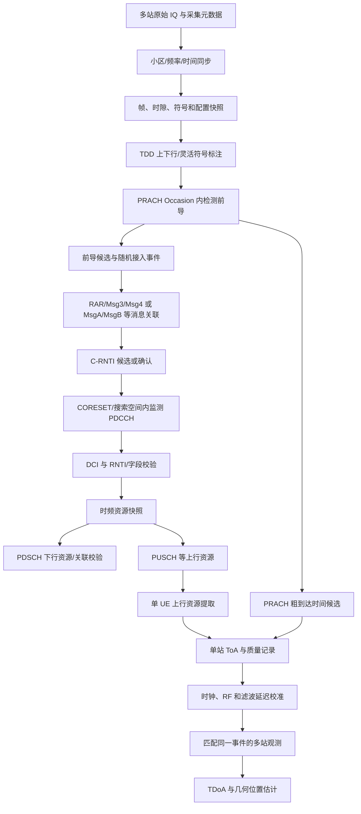

# 5G NR Passive Positioning Pipeline

> [!abstract] 项目主线
> 本项目从第三方接收设备采集的 5G NR TDD IQ 出发，逐步回答三个问题：空口资源在什么时间和频率上、某段信号是否能关联到同一 UE、多个接收站测得的到达时间能否用于位置估计。PRACH 是随机接入的入口，但检测到 PRACH 前导不等于已经识别 UE，更不等于已经完成定位。

## 1. 先理解项目要做什么

这里的“被动”指接收机监听空口信号，不主动接入网络或要求网络配合。接收设备保存的 IQ 是复数采样序列，记录了接收信号的幅度和相位；它本身还没有说明哪个样点属于哪个时隙、哪段信号属于哪个 UE，也没有直接给出距离。

因此，项目不是一个从 IQ 一步输出坐标的单体算法，而是一条逐层增加证据的处理链：

1. **建立坐标**：识别小区和时间基准，把连续样点映射到帧、时隙、符号及频域资源。
2. **建立协议上下文**：从 PRACH 随机接入过程追踪候选 UE，再从控制信道读取资源调度信息。
3. **提取时间观测**：从可解释的 UE 上行片段估计各站到达时间，并记录测量质量和校准状态。
4. **融合为位置约束**：只把同一事件、可比较且通过质量检查的多站时间观测交给 TDoA 解算。

前一步的输出是后一步的输入。若时间坐标或配置不可靠，后续的资源解析、用户关联和定位都可能整体偏移，所以每一层都要保留中间结果和失败原因。

## 2. 端到端数据流

> [!important] 两条相关但不同的支路
> **协议/资源支路**用随机接入和控制信息回答“这段资源可能属于哪个 UE、UE 在哪里发了信号”。**定位测量支路**用参考信号和时间校准回答“同一信号到达各接收站的时间差是多少”。PDSCH 是下行共享信道，可帮助验证资源或关联上下文；本项目的 UE 上行定位观测通常来自 PRACH、PUSCH 参考信号或 SRS，不能把 PDSCH 当作 UE 上行 ToA 的替代品。

## 3. 每个阶段做什么、交给下一阶段什么

| 阶段 | 初学者可以这样理解 | 主要输入 | 主要输出及其作用 |
|---|---|---|---|
| 采集与配置 | 说明“录到了什么、用什么参数录的” | IQ、站点/通道、采样率、频点、时间戳、设备配置 | 可回放的捕获记录和配置快照；后续所有坐标都依赖它 |
| NR 同步与时间坐标 | 给连续样点标上空口的时间刻度 | IQ、小区同步线索、SCS、FFT/CP 等配置 | 小区、帧/时隙/符号和置信度；供 TDD、PRACH、控制信道共用 |
| TDD 方向标注 | 判断某个符号可用于下行、上行还是暂不能确定 | 时间坐标、TDD 配置 | DL/UL/F/unknown 掩码；避免在错误方向搜索信号 |
| PRACH 检测 | 在指定随机接入时机里寻找前导 | PRACH 配置、合法 Occasion、IQ | 前导候选、相关峰、时延和事件键；提供接入入口及粗时间观测 |
| Random Access 关联 | 用后续响应和消息判断接入过程是否连得起来 | PRACH 事件、RAR、后续上/下行消息 | RA 状态、临时标识或 C-RNTI 证据；把“某个前导”升级为更可信的用户上下文 |
| PDCCH/DCI 解析 | 读取网络发出的控制信息和调度指令 | CORESET、搜索空间、RNTI 候选、同步后的资源网格 | 经检查的 DCI 和调度资源；告诉接收机要去哪些时频资源继续观察 |
| UE 资源提取 | 只保留目标 UE 对应的资源和参考信号 | 资源快照、方向、BWP/PRB/符号、参考信号配置 | 单 UE 掩码及上行信号片段；减少其他用户和控制资源的干扰 |
| 时间观测与校准 | 把峰位置变成有参考点、可比较的时间测量 | 单 UE 片段、采样率、峰策略、设备校准 | raw/corrected ToA、质量、不确定度和校准状态 |
| 多站 TDoA | 比较各站对同一发射事件的到达时间 | 同一事件的多站 ToA、站点坐标、同步与延迟校准 | TDoA、残差、几何质量和位置候选；供评估而非自动保证精度 |

常见的交接关系可以概括为：同步结果提供统一坐标；坐标与 TDD 配置限定 PRACH 和 PDCCH 的搜索范围；PRACH 触发随机接入关联；C-RNTI 和控制信息帮助解释后续资源；资源快照指导单 UE 信号提取；时间观测经过校准和跨站配对后才进入 TDoA。

## 4. 初学者需要分清的概念

| 概念 | 简单解释 | 在项目里的作用 |
|---|---|---|
| IQ | In-phase/Quadrature（同相/正交）复数基带样点，不是已经解码的消息 | 整条链路的原始证据 |
| UE | User Equipment（用户设备），例如手机或其他 5G 终端 | 项目希望关联并观测的空口发送端 |
| 帧/时隙/符号 | NR 对空口时间的分层编号 | 说明某个候选发生在什么空口时刻，见 [[5G-NR-Positioning/01-NR基础/NR Frame Slot\|NR Frame Slot]] |
| TDD（Time Division Duplex，时分双工） | 同一载波按配置切换上下行时段，也可能有灵活符号 | 限定在哪些时刻搜索上行 PRACH/PUSCH 或下行 PDCCH/PDSCH，见 [[5G-NR-Positioning/01-NR基础/NR TDD\|NR TDD]] |
| PRACH 前导 | Physical Random Access Channel（物理随机接入信道）上的特定上行序列 | 帮助发现一次接入事件；单独不足以唯一识别 UE，见 [[5G-NR-Positioning/02-PRACH/PRACH Overview\|PRACH Overview]] |
| RA-RNTI（Random Access Radio Network Temporary Identifier） | 随机接入无线网络临时标识，根据随机接入时机等上下文得到 | 帮助寻找对应的随机接入响应，不是 UE 的长期身份 |
| C-RNTI（Cell Radio Network Temporary Identifier） | 小区无线网络临时标识，是网络在连接调度中使用的 UE 上下文标识 | 供后续控制信道监测和资源关联；必须有协议证据支持 |
| CORESET / 搜索空间 | CORESET（Control Resource Set）限定控制信道可用资源区域；搜索空间定义何时、在哪些候选位置监测 | 将 PDCCH 盲搜范围限制在有配置依据的位置 |
| PDCCH / DCI | Physical Downlink Control Channel（物理下行控制信道）承载 Downlink Control Information（下行控制信息） | DCI 告诉接收机后续资源如何安排；承载信道与信息内容不是同一个对象 |
| PDSCH / PUSCH | Physical Downlink/Uplink Shared Channel（物理下行/上行共享信道） | 方向不同。UE 上行定位通常关注 PUSCH 及其参考信号，PDSCH 不能替代它 |
| ToA / TDoA | Time of Arrival（到达时间）是单站时间；Time Difference of Arrival（到达时间差）是站间时间差 | TDoA 把同一事件的多站观测变成几何约束 |

> [!note] 为什么要经过随机接入关联
> PRACH 前导只表明某个配置假设下，在某个 Occasion 检测到了序列。常见四步随机接入中，网络可能发 RAR，UE 再按授权发送 Msg3，之后还可能经历 Msg4/争用解决；两步随机接入则使用 MsgA/MsgB 等消息。实际流程取决于网络配置。只有把适用流程中的消息及时间、资源上下文关联起来，才有依据把候选提升为 C-RNTI 相关的连接上下文。实际哪些消息可被第三方设备看到，仍需现场 IQ 验证。

## 5. ToA 到 TDoA：从信号时间到位置约束

每个接收站先对同一类、可解释的信号形成单站到达时间。测得的时间通常同时包含传播时间、站点时钟偏差、RF/数字链延迟、滤波器群时延和估计误差，因此“相关峰样点”不能不经校准就直接解释为传播距离。

若站点 $i$ 和参考站 $r$ 观测的是**同一发射事件**，时间差为

$$
\Delta t_{i,r}=\tau_i-\tau_r.
$$

在传播速度近似为 $c$ 时，这个时间差对应两站到 UE 距离之差 $c\Delta t_{i,r}$。一个时间差通常只限定一条双曲线形的可能位置集合；多个站点对、已知站点坐标和足够好的几何条件共同约束位置。若事件配错、时钟未对齐或链路延迟未知，求解器仍可能给出坐标，但该坐标不因此就可信。

详细的时间参考、峰策略和校准字段见 [[5G-NR-Positioning/05-定位观测量/Timing Observation\|Timing Observation]]；TDoA 的测量模型和位置解算见 [[5G-NR-Positioning/06-TDOA定位/TDOA\|TDOA]]。

## 6. 阶段边界与证据门槛

| 阶段 | 输入 | 输出 | 当前证据门槛 |
|---|---|---|---|
| 第一阶段：同步与 PRACH/RA | 原始 IQ、NR/TDD/PRACH 配置 | 时间坐标、前导/Occasion、RA-RNTI 候选、适用的 RAR/Msg3/Msg4 或 MsgA/MsgB 关联、C-RNTI 候选 | 单站可回放、配置快照、完整相关轨迹和失败分类 |
| 第二阶段：控制与资源 | 已确认或有限候选 C-RNTI、CORESET、搜索空间 | PDCCH/DCI、PDSCH/PUSCH 资源快照、单 UE 资源掩码 | 正确/错误 RNTI 与资源的对照样本；CRC 通过后仍须字段和资源检查 |
| 第三阶段：时间测量与多站定位 | 单 UE 上行片段、多站时间戳和校准量 | ToA/RToA/TDoA、残差、位置候选 | 同一事件可配对；公共时基、RF/滤波延迟、采样偏差和几何均有检查 |

这些门槛是逐层升级结论的条件，不是说前一阶段必须完全成功后才可保留所有信息。例如，RAR 不可见时仍可保存 PRACH 检测和粗 ToA 候选；只是不能把该候选写成已确认的 UE 身份。

## 7. 关键状态不可混用

| 状态 | 表示什么 | 不能据此直接断言什么 |
|---|---|---|
| `preamble_detected` | PRACH 相关检测在当前配置假设下通过 | 唯一 UE 身份、接入成功或位置已知 |
| `rar_decoded` | RAR 的相关物理/协议字段可解析 | RAPID 一定匹配、争用解决已成功 |
| `c_rnti_confirmed` | 有跨消息、跨时隙的协议关联证据 | 可长期追踪同一自然人或设备 |
| `valid_dci` | CRC/RNTI 检查通过，且字段和资源约束合理 | 数据已正确解码或 UE 已可靠定位 |
| `toa_valid` | 单站时间观测满足本项目定义的峰和质量条件 | 时间已经完成所有站点校准 |
| `tdoa_usable` | 多站观测的事件、时间参考和校准满足融合条件 | 位置精度已达到某个指标；还需几何与实验验证 |

## 8. 各模块之间交接什么

| 交接对象 | 用途 | 初学者可以怎样理解 |
|---|---|---|
| `config_snapshot` / `config_id` | 固定采集和无线配置的版本 | 说明这批 IQ 应按哪套 SCS、CP、TDD、PRACH 等参数解释 |
| `frame/slot/symbol` | 给事件统一的空口时间坐标 | 方便判断“何时发生”并关联后续控制和数据信道 |
| `event_id` | 关联同一次接入/发射事件在不同模块和站点的记录 | 是项目内部的事件关联键，不是从 PRACH 自动得到的真实身份 |
| `candidate` / `state` / `reason` | 保留候选、阶段和未通过原因 | 让失败可解释；不要只输出一个“成功/失败”布尔值 |
| `resource_snapshot` | 保存 DCI 所解释的时频资源、方向和坐标 | 告诉提取模块在哪些资源取样；缺字段时应标记不完整 |
| `observation` | 保存峰、ToA、参考点、质量和校准信息 | 把信号处理结果变成可审计的测量，而非只留下一个时间数字 |

建议每个结果都能回到原始 IQ、配置版本和处理步骤。相同的 `event_id`、`config_id`、站点编号与时间参考，是模块能正确衔接的基础；缺失信息应保留为 `unknown`，不能用默认值或 0 假装已知。

## 9. 建议的入门阅读顺序

1. 先看 [[5G-NR-Positioning/README]] 和 [[Current Learning Path]]，了解目录和当前学习顺序。
2. 再看 [[5G-NR-Positioning/01-NR基础/NR Frame Slot\|NR Frame Slot]]、[[5G-NR-Positioning/01-NR基础/NR TDD\|NR TDD]]，理解“时间坐标”和“上下行方向”。
3. 接着读 [[5G-NR-Positioning/02-PRACH/PRACH Overview\|PRACH Overview]] 与 [[5G-NR-Positioning/02-PRACH/Random Access Procedure\|Random Access Procedure]]，理解检测到前导后还要经过哪些关联步骤。
4. 然后读 [[5G-NR-Positioning/03-PDCCH/PDCCH Overview\|PDCCH Overview]] 和 [[5G-NR-Positioning/04-PDSCH/PDSCH\|PDSCH]]，区分控制信息、下行数据和上行资源。
5. 最后读 [[5G-NR-Positioning/05-定位观测量/Timing Observation\|Timing Observation]] 与 [[5G-NR-Positioning/06-TDOA定位/TDOA\|TDOA]]，从单站时间测量过渡到多站位置约束。

现有 `NR_decode_test.m` 主要覆盖公共下行同步和 SIB1 入口；它可以帮助理解同步与配置背景，但这不等于已经完成 UE 专属随机接入关联、C-RNTI 跟踪或定位链路。代码导读见 [[5G-NR-Positioning/08-MATLAB代码/NR_decode_test 代码学习与协议映射]]。

## 10. 常见误区

- 把 PRACH 相关峰当作 UE 身份。它首先是一个前导候选，身份关联需要后续协议证据。
- 把 PRACH、Random Access、RA-RNTI、RAR 和 C-RNTI 当成同一个对象。它们分别处于物理检测、过程、响应寻址和 UE 上下文等不同层次。
- 把 PDCCH 当成 DCI，或把 DCI 当成 PDSCH。PDCCH 是控制承载，DCI 是控制内容，PDSCH 是按调度使用的数据资源。
- 把 PDSCH 下行信号当作 UE 上行定位信号。方向不同；上行观测应根据项目配置从 PRACH、PUSCH 参考信号、SRS 等来源选择。
- 把同一帧号/时隙号当成多站已经同步。不同捕获设备的时钟、采集起点和链路延迟仍可能不同。
- 把相关峰样点直接换算成距离。必须明确时间参考、传播方向、峰策略、站间时钟和 RF/滤波延迟。
- 只保留最终位置或一个成功标志。应保留候选、配置、快照、质量、残差和失败原因，才能判断错误从哪一步开始。

## 11. 证据状态与当前限制

- `PERSONAL_NOTE`：项目流程和已有 Vault 整理。
- `STANDARD + partial`：标准职责和接口；版本/条款未锁定时不写成合规结论。
- `EXPERIMENT + NEEDS_VERIFICATION`：尚未接入真实设备代码和采集样本的步骤。
- `NEEDS_EXTERNAL_REFERENCE`：需要在本机 MATLAB/5G Toolbox 或指定 3GPP Release 中复核的 API、表格和精确字段。

当前总览说明的是处理关系和证据边界，不证明真实设备已成功解出所有消息，也不代表已经达到某个定位精度。具体网络 Release、配置、采集时间戳语义、工具箱 API、RF/滤波校准和现场数据结果都需要单独核验。

## Related Notes

- [[Current Learning Path]]
- [[项目知识地图]]
- [[01-NR基础/NR Frame Slot]]
- [[01-NR基础/NR TDD]]
- [[02-PRACH/PRACH Overview]]
- [[02-PRACH/Random Access Procedure]]
- [[02-PRACH/C-RNTI]]
- [[03-PDCCH/PDCCH Overview]]
- [[04-PDSCH/PDSCH]]
- [[05-定位观测量/Timing Observation]]
- [[06-TDOA定位/TDOA]]
