# SSB、PBCH 与 MIB

> [!abstract] 一句话定位
> 这条下行链把接收机从“未知时频位置的 IQ”带到“小区身份与公共系统信息入口”：PSS/SSS 提供同步与 PCI，SS/PBCH block 中的 PBCH/BCH 携带 MIB，MIB 再帮助定位 CORESET-0 和 SearchSpace0，从而尝试接收调度 SIB1 的公共 PDCCH。

> [!warning] 能力边界
> 解出 SSB、MIB 或 SIB1 都不等于获得某个 UE 的 C-RNTI，也不等于完成 UE-specific PDCCH、PUSCH 或定位。当前 `NR_decode_test.m` 的目标是公共 SI-RNTI/SIB1 支路；项目目标中的 PRACH 关联、C-RNTI/USS 和上行定位是后续独立链路。

## 1. 端到端知识图

```mermaid
flowchart LR
    IQ["IQ 与采集配置"] --> PSS["PSS：NID2 与粗同步候选"]
    PSS --> SSS["SSS：NID1 与 PCI"]
    SSS --> SSB["SSB：4 个 OFDM 符号"]
    SSB --> PBCH["PBCH-DM-RS / PBCH"]
    PBCH --> BCH["BCH 解扰、Polar/CRC 解码"]
    BCH --> MIB["MIB：公共参数与 PDCCH-ConfigSIB1"]
    MIB --> C0["CORESET-0 + SearchSpace0"]
    C0 --> CSS["CSS PDCCH：SI-RNTI / DCI 1_0"]
    CSS --> PDSCH["PDSCH：DL-SCH"]
    PDSCH --> SIB1["BCCH-DL-SCH：SIB1"]
```



这里横跨五个层次，阅读时不要混在一起：

| 层次 | 对象 | 回答的问题 |
|---|---|---|
| 物理信号 | PSS、SSS、PBCH-DM-RS | 如何获得小区同步线索、PCI 和参考信号观测？ |
| 物理/传输信道 | PBCH/BCH、PDCCH、PDSCH/DL-SCH | 比特经什么物理资源和编码链承载？ |
| 配置与控制 | MIB、CORESET-0、SearchSpace0、DCI | 在哪里、何时尝试解调 SIB1？ |
| RRC 系统信息 | MIB、SIB1 | 哪些公共小区参数已经恢复？ |
| 接收机实现 | 相关搜索、FFT、信道估计、均衡、译码 API | 本程序用什么算法实现接收过程？这些算法不一定是标准唯一实现。 |

## 2. 术语关系

| 名称 | 所属层次 | 作用 | 不能误认为 |
|---|---|---|---|
| `NID2` | 同步信号 | PSS 的 3 种序列索引，取值 0 到 2 | PCI 或 SSB index |
| `NID1` | 同步信号 | SSS 的 336 种序列索引，取值 0 到 335 | C-RNTI |
| PCI / `N_ID^cell` | 小区物理身份 | 由 PSS/SSS 组合得到，计算关系为 `PCI = 3*NID1 + NID2` | UE 身份或运营商身份 |
| SS/PBCH block / SSB | 物理资源结构 | 4 个连续 OFDM 符号、240 个子载波，包含 PSS、SSS、PBCH 和 PBCH-DM-RS | 4 个物理信道或完整系统信息 |
| `ibar_SSB` / SSB index | 同步块候选编号 | 表示检测到哪个 SSB 候选；恢复方式和有效索引范围受 `Lmax` 等上下文影响 | PCI 或 PBCH payload 本身 |
| PBCH | 物理信道 | 在 SSB 固定资源中传送 BCH 相关比特 | MIB 的同义词 |
| BCH | 传输信道 | 经 PBCH 物理承载，编码链由 38.212 定义 | PDSCH 或 DL-SCH |
| MIB | RRC 系统信息 | 提供接入 SIB1 所需的精简公共参数 | SIB1 或完整 RRC 配置 |
| CORESET-0 | 公共控制资源 | MIB 参数映射出的初始 PDCCH 时频区域 | 一个 PDCCH candidate |
| SearchSpace0 / CSS | 控制监测配置 | 决定公共 PDCCH 的监测时机和候选集合 | CORESET 的频域位图 |
| DCI 1_0 + SI-RNTI | 控制信息/CRC 上下文 | 指示公共系统信息 PDSCH 调度 | C-RNTI 专属 DCI |
| SIB1 | RRC 系统信息内容 | 通过 BCCH-DL-SCH、DL-SCH、PDSCH 的下行承载链传输 | PDSCH 或 DL-SCH 的另一种叫法 |

## 3. 接收流程逐步展开

### 3.1 先固定坐标和采集前提

在搜索序列前，接收机至少需要知道或建立采样率、中心频率、FFT 长度、子载波间隔、CP、捕获窗口和频偏范围。它们决定样点、FFT bin 和资源网格之间如何对应。

`NR_decode_test.m` 使用固定的 122.88 Msps、4096 点 FFT 和 `mu=1`，因此 `Fs/Nfft=30 kHz`。它的 `length_frame=122.88e4` 对应 10 ms，不是源码注释写的 1 ms；取两段这样的窗口是 20 ms。以上是脚本假设，不是所有 NR 小区和采集设备的通用配置。窗口中是否含 SSB，应由网络配置、采集长度和检测结果验证，不能只依赖注释。

先阅读 [[01-NR基础/NR Frame Slot]]、[[01-NR基础/Numerology]]、[[01-NR基础/SCS]] 和 [[01-NR基础/PRB RE Resource Grid]]，把这些坐标分开：

1. 样点：IQ 数组中的时间位置。
2. FFT bin：变换后频率数组的行索引。
3. SSB 内相对 RE：0 到 239 的子载波和 0 到 3 的符号。
4. 空口配置坐标：帧、时隙、BWP、Point A、CORESET/PRB。

### 3.2 PSS：得到 `NID2` 与定时/频率候选

PSS 只需比较 3 个序列候选。代码用 `PSS_generate(NID2)` 生成长度 127 的参考序列，将它放到频域模板，再 IFFT 得到时域模板，并与接收 IQ 做相关，寻找候选时间位置和频域起点 `k`。

PSS 阶段输出的是接收机估计，不是已完成的完整同步：

- `NID2` 候选；
- PSS 相关峰位置及峰值/旁瓣等质量信息；
- 频域起点和后续 SSB 提取所需的时间候选。

相关搜索、峰检测和频偏补偿算法属于接收机实现。要检查搜索覆盖、CFO、相关峰是否唯一、窗口边界和 FFT shift。最大相关峰不是 CRC 式的正确性证明。

### 3.3 SSS：得到 `NID1` 和 PCI

在候选 SSB 网格中的 SSS 位置，对 336 个 `NID1` 假设做匹配。选出可信 `NID1` 后，按 `PCI = 3*NID1 + NID2` 得到 PCI，范围是 0 到 1007。

PCI 后续用于小区相关参考信号/扰码上下文，但它不是用户身份。若最大值并列、旁瓣接近主峰或 SSB 网格偏移，应该保留多个候选或标记 `uncertain`，不要把第一个最大值静默当作真值。

### 3.4 SSB：定位 4 符号资源块

SSB 跨 4 个 OFDM 符号、占 240 个连续子载波。以 SSB 内局部、0-based 符号编号表示，PSS 在符号 0、SSS 在符号 2；PBCH 与 PBCH-DM-RS 占用符号 1、2、3 中未被 SSS 占用的相应 RE。精确 RE 映射应回查目标版本 TS 38.211 的 SSB 表格。

接收机要先把 PSS 候选转换为完整 4 符号 SSB 窗口，再按同一 FFT/bin 原点抽取资源网格。保护子载波可以留在工作缓冲区中，但 PBCH API 的资源输入应遵循对应索引接口的有效网格定义；代码中的 256 行窗口和实际使用的 240 行区域不能混为一谈。

SSB 的时域发送位置与频域位置由频段、SSB SCS、SSB pattern/Case 和小区配置共同约束。`Lmax` 也会影响 SSB index 的候选范围及 PBCH payload 的解释。当前脚本把 Case 和 0 到 7 的候选写死，适合静态阅读的实验支路，不能据此宣称支持所有频段或 pattern。

### 3.5 PBCH-DM-RS 与 PBCH/BCH

PBCH-DM-RS 用于检测/辨认 SSB 候选并估计 PBCH 信道。典型接收链按职责可拆成：

```text
SSB RE 提取
  -> PBCH-DM-RS 序列/位置假设
  -> 信道估计与噪声估计
  -> PBCH RE 均衡与软解调
  -> BCH 对应的逆扰码/率恢复/Polar 解码/CRC
  -> BCH payload 与 MIB 字段解释
```

标准定义信号、资源和编码规则；如何搜索候选、插值信道、做 MMSE 均衡或选择列表译码长度属于接收机实现。代码调用 `nrPBCHDMRSIndices`、`nrPBCHDMRS`、`nrChannelEstimate`、`nrEqualizeMMSE`、`nrPBCHDecode`、`nrBCHDecode` 等 Toolbox 接口，但这些函数的参数和返回值必须按实际安装的 5G Toolbox 版本核对。

BCH 解码结果不能直接当成 ASN.1 MIB 字段。PBCH/BCH payload 还涉及 SFN、半帧/SSB 相关比特的重建；应分别检查 BCH CRC 状态、MIB 字段解释和完整帧/SSB 上下文。

### 3.6 MIB：从 PBCH 进入系统信息配置

MIB 中值得优先理解的字段包括：

| MIB 字段 | 对后续流程的作用 |
|---|---|
| `systemFrameNumber` | 提供 SFN 高位；与 BCH payload 中相应位组合恢复帧号 |
| `subCarrierSpacingCommon` | 指示公共下行参数所用的 SCS 语境之一 |
| `ssb-SubcarrierOffset` | 连接 SSB 与 Point A/公共资源网格的频率偏移解释 |
| `dmrs-TypeA-Position` | 影响后续 Type A PDSCH DM-RS 时域上下文 |
| `pdcch-ConfigSIB1` | 含 `controlResourceSetZero` 与 `searchSpaceZero` 的索引入口 |
| `cellBarred`、`intraFreqReselection` | 小区选择/重选相关公共指示，不是 UE 标识 |

应从目标版本 TS 38.331 的 ASN.1/字段定义确认编码，不靠手写 bit offset 猜字段。MIB 给的是找到 SIB1 所需的入口参数，不等于已经获得完整的 RRC、BWP、TDD 或 PRACH 配置。

### 3.7 MIB 到 CORESET-0 / SearchSpace0

用 `pdcch-ConfigSIB1` 两个索引，结合 SSB SCS、公共 SCS、频域偏移及适用条件，查目标版本规定的 CORESET-0 与 SearchSpace0 配置。输出至少要能说明：

- CORESET 的频域范围、符号持续长度和参考坐标；
- SearchSpace0 的监测周期/时机和候选规则；
- PDCCH 网格局部索引如何转换到载波/FFT 坐标；
- 该候选属于 common search space，而不是 UE-specific search space。

CORESET-0 是可用的控制资源集合，SearchSpace0 定义在哪些时机、按什么候选规则监测；两者都不保证空口上一定存在一个有效 DCI。表格和字段适用条件应以 TS 38.213 Clause 13 及目标版本 TS 38.331 为准。

### 3.8 PDCCH/DCI 到 PDSCH/SIB1

对 SIB1 公共调度支路，接收机在 CSS 候选上解调 PDCCH，尝试适用 DCI 格式，并用 SI-RNTI 上下文做 CRC 判决。正确的下一步应检查 DCI 字段、资源边界与时序一致性，而不是只看到一次 CRC 通过就宣布用户已关联。

当前代码将 SI-RNTI 作为 `65535`（`0xFFFF`）假设；这是公共系统信息接收上下文，不是遍历或推断 C-RNTI。PDCCH 数据扰码参数与 CRC 的 RNTI 假设属于不同环节，Toolbox 参数含义按本机版本核验。

若 DCI 解释成立，按它与公共配置确定 PDSCH 时频资源，再对 PDSCH 做 DM-RS 信道估计、均衡、解扰、DL-SCH LDPC/CRC 解码和 SIB1 ASN.1 解析。下面自上而下表示发送承载层级；接收端沿反方向恢复：

```text
MIB: BCCH-BCH-Message -> BCH -> PBCH

SIB1 (RRC 系统信息内容)
  -> BCCH-DL-SCH (逻辑承载语境)
  -> DL-SCH (传输信道)
  -> PDSCH (物理信道)
```

代码中的固定 MCS/层数、手写时域/频域表、DM-RS mask 和 ASN.1 parser 都需要逐项核验。只有当 DCI、PDSCH 资源、TB-CRC 与 RRC 解析结果彼此闭合，才算恢复了一份可接受的 SIB1 候选。

## 4. 3GPP 规范职责映射

| 标准 | 本知识链关注点 | 使用方式 |
|---|---|---|
| TS 38.211 | PSS/SSS、PBCH/DM-RS、SS/PBCH block、PDCCH/PDSCH 的调制与资源映射 | 确认序列、时频资源、参考信号和网格位置 |
| TS 38.212 | BCH/PBCH、DCI、DL-SCH 的 CRC、Polar/LDPC、率恢复/率匹配 | 确认比特级编码与接收端逆处理 |
| TS 38.213 | 小区搜索、PDCCH 监测、CORESET-0/SearchSpace0 与 Type0 CSS 过程 | 确认何时监测、配置表如何用、候选有哪些 |
| TS 38.214 | DCI 指示的 PDSCH 时频资源、MCS/TBS 等数据过程 | 从 DCI 和配置推导 PDSCH 解码参数 |
| TS 38.331 | MIB、SIB1、RRC ASN.1 与配置字段 | 确认字段含义、消息结构和高层配置来源 |

Clause 锚点可从 38.211 的 §7.3.3、§7.4.1.4、§7.4.2.2-§7.4.2.3、§7.4.3.1；38.212 的 §7.1、§7.2、§7.3；38.213 的 §4.1、§13；38.214 的 §5.1 开始查阅。具体子条款、表号与版本差异仍须在锁定 Release 后核实。Vault 导航见 [[10-3GPP规范/3GPP Specification Map]]。

**标准与实现分界**：标准约束输入输出、资源和编码规则；匹配滤波、CFO 搜索、信道估计、均衡器、候选排序、阈值及 MATLAB API 是接收机实现细节。某段代码“能运行”不等于它覆盖标准所有配置；某条标准“允许”也不代表脚本已经实现。

## 5. 从概念落到 `NR_decode_test.m`

| 学习阶段 | 代码入口 | 可检查的中间结果 | 已知边界 |
|---|---|---|---|
| 同步准备 | `NR_decode_test.m` 参数块 | `Fs`、`nfft`、`mu`、CP、输入 IQ 形状 | 采样率、中心频率、SSB pattern 和频点起点有硬编码 |
| PSS/SSS | `PSS_generate.m`、`SSS_generate.m` | 相关峰、`NID1/NID2`、PCI、频域起点 | 阈值、多峰消歧、`xcorr` 索引基准要验证 |
| SSB/PBCH | `nrPBCHDMRS*`、`nrPBCH*`、`nrBCHDecode` | SSB grid、DM-RS 假设得分、CRC、BCH payload | 固定 Case/候选范围；Toolbox API 随版本核验 |
| MIB | `decode_mib.m`、`table_seach.m` | 公共 SCS、SSB offset、CORESET/SS0 派生值 | 静态检查发现函数实参/形参数量不一致，需先处理 |
| PDCCH/DCI | `pdcch_decode*.m`、`decode_dci.m` | candidate/AL、CRC/RNTI、DCI fields | 仅公共 SI-RNTI 路径；不等于 C-RNTI/USS 盲搜 |
| PDSCH/SIB1 | `pdsch_decodehbv1.m`、`decode_sib1_v2.m` | PDSCH resource mask、TB-CRC、SIB1 字段 | `S/L`、DM-RS、TBS 和 parser 覆盖尚待验证 |

详细行号、变量维度和静态风险见 [[08-MATLAB代码/NR_decode_test 代码学习与协议映射]]。目录中的 `NRCellSearchMIBAndSIB1RecoveryExample.m` 是独立的 Toolbox 示例，不是 `NR_decode_test.m` 的调用，也不能作为本地手写映射正确的证据。

## 6. 可执行的学习与验证步骤

### 6.1 采集和运行前记录

先为一个正例捕获写记录：`capture_id`、IQ 变量名、复数/实数、形状、采样率、中心频率、capture 时长、MATLAB 与 5G Toolbox 版本、预期 SCS/频段和已知 PCI（若有）。不确定值标 `unknown`，不要按文件名推断采样率或 PCI。

### 6.2 分阶段验收

1. **坐标验收**：确认 FFT 点数、SCS、CP、frame/sample 换算一致；采样区间不越界。
2. **PSS 验收**：记录三个 NID2 与候选频点的峰值、峰旁比和时间位置；更换窗口后坐标仍可回放。
3. **SSS 验收**：确认 NID1 唯一性及 PCI 合法；与独立已知值或参考实现交叉检查。
4. **SSB/PBCH 验收**：检查四个符号、240 子载波坐标、DM-RS 候选和 BCH CRC 状态；保存所有候选分数，不只保存 winner。
5. **MIB 验收**：逐字段检查 ASN.1/字段解码、SFN 拼接和 `pdcch-ConfigSIB1` 索引；无效配置不得继续用旧变量。
6. **CORESET-0/SS0 验收**：重建时频资源，检查数组边界、候选有效性和 TDD 方向；保存实际 `config_id` 与规范版本。
7. **PDCCH 验收**：按候选记录 AL、CCE、REG/RE、噪声/LLR、DCI format 和 SI-RNTI CRC 状态；分开统计未监测、无信号、译码失败和字段不合法。
8. **SIB1 验收**：DCI 到 PDSCH 的 `K0/S/L/PRB`、DM-RS mask、MCS/TBS、DL-SCH TB-CRC 和 ASN.1 parser 输出逐项闭合。

最小回放账本可采用这些状态：`not_monitored`、`candidate_generated`、`decode_fail`、`crc_fail`、`field_invalid`、`tb_crc_fail`、`decoded`、`NEEDS_VERIFICATION`。状态表达失败发生在哪里，不应只有一个总的“解码失败”。

## 7. 常见失败定位

| 现象 | 优先检查 | 不要直接推断 |
|---|---|---|
| 没有 PSS 峰 | 采样率、中心频率、CFO、FFT/bin 起点、输入中是否有目标带宽 | 不能马上判断该小区没有 SSB |
| PSS 有峰、SSS 不稳定 | 符号边界、FFT shift、SSB 提取频率原点、干扰/多径 | 不要用调用方给的 PCI 强行覆盖结果 |
| PCI 候选稳定、PBCH CRC 失败 | SSB case/index、PBCH-DM-RS、信道估计/噪声、BCH API 参数 | 相关峰正确不代表 PBCH 一定可解 |
| MIB 解码通过、CORESET 越界 | Release 表项、SSB/common SCS、频率偏移、索引基准、函数参数 | 不要用经验 RB 起点覆盖查表结果 |
| PDCCH candidate 全失败 | monitoring occasion、候选 CCE、DM-RS、LLR/CRC/RNTI 语境 | 不要把 SI-RNTI 分支当作 C-RNTI 搜索失败 |
| DCI 通过、SIB1 不通过 | DCI 字段解释、PDSCH `K0/S/L`、PRB/BWP、DM-RS/TBS、CFO | 不要只以 SIB1 parser 的空结果判断无线链路 |
| TB-CRC 通过、SIB1 字段不可信 | ASN.1 版本、字段位序、可选项/扩展、parser 完整性 | 不要把 partial parser 的字段当完整配置 |

## 8. 易混淆边界

- **PCI 不等于 C-RNTI**：PCI 是小区物理身份；C-RNTI 属于 UE 协议上下文。
- **SSB 时间不等于 UE 上行 ToA**：SSB 是下行同步参考；固定站接收其峰不能直接作为 UE 发射时刻。
- **CORESET 不等于 Search Space**：前者给资源，后者给监测时机与候选规则。
- **PDCCH 不等于 DCI**：PDCCH 是物理信道，DCI 是其承载的控制信息。
- **PDSCH 不等于 SIB1**：PDSCH 是物理承载，DL-SCH 是传输信道，SIB1 是 RRC 系统信息内容。
- **MIB 不等于完整小区配置**：它提供 SIB1 入口，不足以替代 SIB1/RRC 配置快照。
- **协议映射不等于代码合规**：表格意图与代码注释必须由目标 Release 的规范原文和测试向量验证。

## 9. 推荐阅读顺序

1. [[01-NR基础/NR Frame Slot]]、[[01-NR基础/Numerology]]、[[01-NR基础/SCS]]：建立样点、符号和子载波间隔坐标。
2. 本页：理解 PSS/SSS、SSB/PBCH/BCH、MIB 和 SIB1 公共入口。
3. [[08-MATLAB代码/NR_decode_test 代码学习与协议映射]]：对照本工程的实际调用、索引和静态风险。
4. [[03-PDCCH/CORESET]]、[[03-PDCCH/Search Space]]、[[03-PDCCH/CCE REG]]：把 MIB 的配置线索展开为候选 RE。
5. [[03-PDCCH/DCI]]、[[03-PDCCH/RNTI]]、[[03-PDCCH/PDCCH Blind Decoding]]：学习公共 SI-RNTI 和 UE-specific C-RNTI 分支的区别。
6. [[04-PDSCH/PDSCH]]、[[04-PDSCH/UE Resource Extraction]]：由 DCI 恢复 PDSCH 资源和 DL-SCH/SIB1 处理。
7. [[02-PRACH/Random Access Procedure]]、[[02-PRACH/C-RNTI]]：转入项目目标中的 UE 关联；这是另一条协议链。

## 10. 资料与证据状态

- 3GPP 规范职责入口：[[10-3GPP规范/3GPP Specification Map]] 及 Vault 内 TS 38.211/38.212/38.213/38.214/38.331 页面。项目现场 Release 未锁定，精确表格、扩展字段和版本差异标为 `NEEDS_EXTERNAL_REFERENCE`。
- ShareTechnote 二级图解：[5G PBCH](https://www.sharetechnote.com/html/5G/5G_PBCH.html)、[5G PDCCH](https://www.sharetechnote.com/html/5G/5G_PDCCH.html)、[5G PDSCH](https://www.sharetechnote.com/html/5G/5G_PDSCH.html)。用于建立直觉，不替代规范条文。
- 本项目静态代码入口：[[08-MATLAB代码/NR_decode_test 代码学习与协议映射]]。
- 当前状态：知识路径已整理；脚本运行、捕获样本解码、Toolbox 版本和标准符合性均未在本页宣称已验证。
