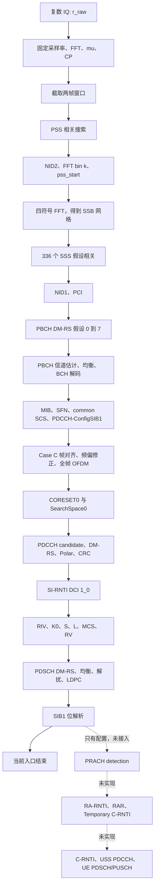

# `NR_decode_test.m` 代码学习与协议映射

> [!abstract] 先记住一句话
> 这份脚本的实际主链是“原始 IQ -> PSS/SSS 同步 -> SSB/PBCH -> MIB -> CORESET-0 公共搜索空间中的 PDCCH -> DCI 1_0 -> SIB1/PDSCH”。它不是“PRACH 解出 C-RNTI”的脚本，也没有完成 UE-specific search space、C-RNTI PDCCH 或 PUSCH 解码。把这条边界记清楚，再看每一行就不会把“能解出小区广播”误认为“已经识别了某个用户”。

> [!tip] 建议怎么读
> 第一次阅读时，先看第 1-3 节，沿着代码执行顺序理解每一步的输入和输出；暂时不必背协议条款，也不必先读后面的风险清单。第 4 节以后是查阅资料和进阶核对用的参考内容。源码入口：[[NR解码代码/NR_decode_test.m]]。

> [!warning] 证据边界
> **PERSONAL_NOTE**：本页是对本地 MATLAB 源码和直接调用函数的代码阅读记录。**STANDARD + partial**：协议对应关系按 NR 物理层概念和现有 Vault 笔记整理，精确 Release、条款、表值和 MATLAB API 签名仍需外部核验。**EXPERIMENT + NEEDS_VERIFICATION**：本次只做静态阅读，当前环境没有运行这套 MATLAB 代码，因此不把任何“解码成功”、维度或波形结果写成实测结论。

## 0. 学习地图：从同步到 SIB1

这份代码最适合用来学习“冷启动接收端如何找到小区公共系统信息”。阅读时把四层分开：**标准定义的信号/编码、标准定义的监测与调度过程、代码/工具箱采用的接收算法、项目尚未验证的实验假设**。


| 阶段 | 本地实现/输出 | 主要规范入口 | 学习检查点 |
|---|---|---|---|
| IQ、FFT 与资源网格 | 固定采样率、FFT、CP、30 kHz SCS；手工 OFDM 解调 | TS 38.211 §4.2、§4.3、§5.3 | 采样率、FFT 点数、SCS、CP 和符号数是否一致；`length_frame` 实际是 10 ms |
| 小区同步 | `PSS_generate` + 时域相关得到 `NID2`、`k`、样点候选 | TS 38.211 §7.4.2.2 | PSS 是序列；相关峰位置是接收机估计，不是标准规定的唯一同步算法 |
| PCI | `SSS_generate` 遍历 `NID1`，计算 `PCI=3*NID1+NID2` | TS 38.211 §7.4.2.1、§7.4.2.3 | 分开记录 `NID1`、`NID2`、PCI，核对 SSS FFT-bin 与符号位置 |
| SSB/PBCH | 4 符号提取；DM-RS 假设、信道估计、均衡；得到 BCH bits | TS 38.211 §7.3.3、§7.4.1.4、§7.4.3.1；TS 38.212 §7.1 | 核对 240 个有效子载波、PSS/SSS/PBCH/DM-RS 的 RE 位置以及 SSB index/Lmax 假设 |
| MIB | `nrBCHDecode` 后由 `decode_mib`/`table_seach` 解析 | TS 38.331 MIB；TS 38.213 §13 | MIB 字段解析、CORESET0/SearchSpace0 查表须使用同一 Release 和正确的 SSB/common SCS |
| PDCCH/DCI | 本地候选与 CCE/REG 映射；Toolbox 估计/均衡/Polar API；输出 DCI | TS 38.211 §7.3.2、§7.4.1.3；TS 38.212 §7.3；TS 38.213 §10.1、§13；TS 38.331 PDCCH 配置 | 这是 CORESET-0 公共搜索空间的 SI-RNTI 路径；候选 CRC 通过不等于 C-RNTI 或 UE 已确认 |
| PDSCH/SIB1 | `decode_dci` 得到资源假设；`pdsch_decodehbv1` 尝试 DL-SCH；`decode_sib1_v2` 解析 | TS 38.211 §7.3.1、§7.4.1.1；TS 38.212 §7.2；TS 38.214 §5.1；TS 38.331 SIB1 | 核对 DCI 的 K0/S/L、PRB、DM-RS、MCS/TBS 与 TB-CRC；SIB1 是小区公共信息，不是 UE 专属负载 |

**标准职责速记**：38.211 管信号、调制和 RE/波形映射；38.212 管 CRC、Polar/LDPC 和率匹配；38.213 管控制监测与物理层过程；38.214 管数据调度、MCS/TBS 等过程；38.331 管 MIB/SIB/RRC 配置。Toolbox API 是实现接口，不是规范条款。目标小区 Release 尚未锁定，以上条款作阅读导航，字段、表值和边界仍须回查对应版本原文。

**代码证据层级**：`PSS_generate`、`SSS_generate`、`decode_mib`、`table_seach`、`decode_dci`、`pdsch_decodehbv1`、`decode_sib1_v2` 是本地 MATLAB 实现；`nrPBCHDecode`、`nrBCHDecode`、`nrChannelEstimate`、`nrEqualizeMMSE`、`nrPDCCHDecode`、`nrPolarDecode`、`nrOFDMDemodulate` 等是 5G Toolbox 调用。接收机如何搜索峰、估计信道或排序候选通常属于实现选择，不能仅由标准条款推出。

## 1. 它在项目总流程中的位置

项目整体希望沿着下面的方向走：

```text
PRACH 检测
  -> RA-RNTI / RAR / Msg3 / Msg4 关联
  -> C-RNTI 候选或已确认的用户上下文
  -> UE-specific PDCCH/USS 盲搜
  -> DCI 解析
  -> PDSCH/PUSCH 资源定位
  -> 单用户时频截取
  -> 多站 ToA/TDoA
```

`NR_decode_test.m` 位于这条链的“下行同步和小区系统信息入口”，大致覆盖：

```text
IQ
 -> PSS/SSS
 -> PCI
 -> PBCH/BCH
 -> MIB
 -> CORESET-0 / SearchSpace0
 -> SI-RNTI-PDCCH
 -> DCI 1_0
 -> SIB1-PDSCH
```

它能帮助新人学会“如何从一个未知时频位置恢复 NR 小区的公共下行上下文”。但它不能单独回答：

- 哪一个 PRACH 前导对应哪个 UE；
- 某个 UE 的 C-RNTI 是多少；
- UE-specific Search Space 在哪里；
- 哪个 PUSCH 资源由哪个 C-RNTI 调度；
- 一个上行峰是否已经可以作为多站定位观测量。

对应的项目入口是 [[00-项目总览/5G NR Passive Positioning Pipeline]]，C-RNTI 生命周期见 [[02-PRACH/C-RNTI]]。

## 2. 输入、输出与运行前提

### 2.1 函数签名

```matlab
function res = NR_decode_test(r_raw, center_frequency, nid2, nid1, f_SSB)
```

| 参数 | 从代码可确认的含义 | 新人要注意的边界 |
|---|---|---|
| `r_raw` | 后续按一维向量切片；代码假定是复数 IQ，通常应为列向量 | 没有显式检查类型、行列方向、NaN、采样率元数据或天线维度 |
| `center_frequency` | 只在 `2565`、`3450`、`3550` 三个精确值下选择 PSS 频域起点 `k` | 这些值看起来按 MHz 传入；代码没有单位转换，也没有其它频点的默认分支 |
| `nid2`、`nid1` | 函数声明中存在 | 在本文件中没有被引用；PSS/SSS 是重新搜索得到的 |
| `f_SSB` | 函数声明中存在 | 在本文件中没有被引用 |
| `res` | 函数输出名 | 本文件没有给 `res` 赋值；脚本主要通过 `disp` 和图形窗口展示结果，要求返回值时可能出现“输出参数未赋值”问题 |

### 2.2 代码默认的采样和 numerology

| 变量 | 代码值 | 由此得到的理解 |
|---|---:|---|
| `nfft` | `4096` | FFT 长度固定 |
| `sampling_rate` | `122.88e6` | 采样率固定为 122.88 Msps；与 4096 点、30 kHz SCS 相容 |
| `u_scs` | `1` | `mu=1`，脚本按 30 kHz SCS 处理 |
| `kee` | `4` | 代码内部用于 CP 样点计算的参数 |
| `cp_length` | `288` | 代码计算出的普通 CP 长度；每 14-symbol 周期的首符号另加 `16*kee=64` |
| `length_frame` | `122.88e4 = 1,228,800` samples | 在 122.88 Msps 下是 10 ms，不是注释写的 1 ms |
| 两帧窗口 | `2*length_frame` | 代码按 20 ms 窗口工作，意图覆盖默认 20 ms SSB 周期 |

这些是脚本的实验假设，不应直接当成现场小区的完整配置。真实采样率、SSB pattern、SCS、带宽、Point A、BWP 和 TDD 配置应来自采集元数据或网络配置快照。

### 2.3 软件和文件前提

至少需要：

1. MATLAB 以及能提供 `nrPBCHDMRSIndices`、`nrPBCHDMRS`、`nrChannelEstimate`、`nrPBCHIndices`、`nrEqualizeMMSE`、`nrPBCHDecode`、`nrBCHDecode`、`nrPRBS`、`nrPDCCHDecode`、`nrRateRecoverPolar`、`nrPolarDecode`、`nrCRCDecode`、`nrOFDMDemodulate` 等函数的 5G Toolbox 版本。
2. 将 Vault 根目录下的 `NR解码代码` 工程目录加入 MATLAB path，或显式 `addpath`。它位于 `5G-NR-Positioning` 项目目录之外；自定义函数至少包括 `fo_test.m`、`PSS_generate.m`、`SSS_generate.m`、`pss_sss_foe.m`、`case_choose.m`、`decode_mib.m`、`table_seach.m`、`pdcch_decode.m`、`pdcch_decode_2sy.m`、`decode_dci.m`、`pdsch_decodehbv1.m` 和 `decode_sib1_v2.m`。
3. `r_raw` 中确实含有目标小区、足够长的连续 IQ，并且信号落在脚本所假设的采样率、频率和 SSB 条件内。
4. MATLAB 的 `xcorr`、FFT、图形窗口等基础能力可用。

工程目录中的 `NRCellSearchMIBAndSIB1RecoveryExample.m` 是独立的 5G Toolbox 示例；`NR_decode_test.m` 没有调用它。它可用于对照 Toolbox 的小区搜索与 SIB1 接收流程，但不能证明本脚本的手写索引、映射或硬编码参数正确。

MAT 文件目录里有多组 `2565`、`3450`、`3550` 命名的样本，但本页不替读者选择或宣称某个样本一定能跑通；需要把样本的变量名、类型、形状和采样率先记录下来。

### 2.4 入口脚本的真实调用方式

`test.m` 的当前可见路径是：按脚本意图加载一个应提供 `r_raw` 的 MAT 文件，再用 MHz 量纲的中心频率调用本函数（`test.m` 第 52-66 行；变量实际形状仍需核验）：

```matlab
center_freq = 3550.0;
load 3550_-1.mat
NR_decode_test(r_raw,center_freq)
```

从射频接收接口得到的交错 `int16` 数据，则在 `test.m` 第 72-78 行按项目约定拆成 I/Q 后组成复数 `r_raw`。这里的 I/Q 顺序、转置、采样率和文件变量名都是项目输入契约，不能当成所有采集卡的通用规则。`test.m` 还保留了 `NR_decode_test_beforejam`、`NR_decode_test_1024` 和 `NR_decode_test_1029` 等对照入口；本页只把 `NR_decode_test.m` 作为主文件。

## 3. 按代码执行顺序读主流程

本节按当前 [[NR解码代码/NR_decode_test.m]] 的执行顺序解释。源码改动后，行号和代码行为都可能变化；这里的目标是先建立流程图，不把代码假设误当成 NR 的通用规则。

### 3.1 先认清输入、坐标和固定参数

函数入口是：

```matlab
function res = NR_decode_test(r_raw, center_frequency, nid2, nid1, f_SSB)
```

- `r_raw` 是接收机采集到的时域 IQ。IQ 是复数采样：实部通常表示 I，虚部通常表示 Q。主程序按连续的一维向量切片，通常应传列向量。
- `center_frequency` 用来从代码写死的几个中心频率中选择 PSS 的频域搜索起点 `k`。代码只判断 `2565`、`3450`、`3550`，看起来约定单位为 MHz；它没有做单位转换。
- `nid2`、`nid1`、`f_SSB` 虽然出现在函数参数里，但活动代码没有使用它们。小区身份和 SSB 相关信息是代码重新搜索出来的。
- 函数声明了输出 `res`，但活动代码没有给 `res` 赋值。当前主要结果通过命令行打印和图窗显示；不要预期能从 `res` 得到结构化结果。

随后代码设置采样和 OFDM 参数：

| 变量 | 代码设置 | 初学者可以怎样理解 |
|---|---:|---|
| `nfft` | `4096` | 每个 OFDM 符号去掉 CP 后，送入 4096 点 FFT。 |
| `sampling_rate` | `122.88e6` | 假设 IQ 采样率为 122.88 Msamples/s。 |
| `u_scs` | `1` | numerology $\mu=1$，对应 30 kHz 子载波间隔。 |
| `cp_length` | `288` | 代码计算出的普通 CP 样点数；每个 14-symbol 周期首符号会再加 64 点。 |
| `length_frame` | `122.88e4` | 1,228,800 个样点；除以采样率是 0.01 秒，即 10 ms。 |

这里有两个简单的数值检查：

```text
采样率 / FFT 点数 = 122.88 MHz / 4096 = 30 kHz
一帧时长 = 1,228,800 / 122.88 MHz = 10 ms
```

因此源码注释中把 `length_frame` 称作 1 ms 与实际数值不符。初学者还要区分：样点是时域数组下标，FFT bin 是频域数组下标，OFDM symbol/slot 则是资源网格中的时间坐标；这些下标不能互相直接替代。

### 3.2 先缩小搜索范围，再取两帧 IQ

代码第 59-65 行根据 `center_frequency` 选择 `k`。可以先把 `k` 理解为“PSS 可能落在 4096 点 FFT 网格哪个位置附近”的数组索引。它不是绝对射频频率、GSCN、Point A，也不是 PRB 编号。

代码接着调用：

```matlab
freq_offset = 0;
raw_data = fo_test(r_raw, freq_offset);
```

`fo_test` 的作用是用复指数旋转 IQ，从而补偿频率偏移；但这里传入的频偏是 0，因此这一步并没有实际频偏校正。还有一个容易忽略的细节：后面 PSS 搜索构造 `all_data` 时直接从 `r_raw` 取数据，而不是从 `raw_data` 取，所以即使这里传入非零值，也没有作用到这段 PSS 搜索。

程序每次从 `r_raw` 截取连续两帧：

```matlab
all_data = r_raw(sign_idx1:sign_idx1 + 2*length_frame - 1);
```

按当前参数，两帧是 20 ms。脚本的意图是让窗口覆盖默认的 SSB 发送周期，但这只是代码使用的搜索假设；真实采集是否含有 SSB，要看小区配置和采集时长，不能只靠注释保证。`freqSearch=-50:2:50` 是后面 PDSCH 解调用的频偏候选，以 kHz 为单位，不是这里的 PSS 初始校正。

### 3.3 用 PSS 找到时间候选和 `NID2`

PSS 是接收端最早能识别的一种已知同步序列。它有三种候选，分别对应 `NID2=0,1,2`。可以把这一步理解为：接收端先生成三把已知“钥匙”，在接收 IQ 中滑动比较，找出最像的一把以及最像的位置。

主程序调用 [[NR解码代码/PSS_generate.m|PSS_generate]](`NID2`) 得到长度为 127 的参考序列，把它放到 FFT 网格的候选位置 `k-5:k+5`，再经过 `ifftshift` 和 IFFT 形成时域模板。`xcorr(all_data,t_pss)` 计算模板与收到的 IQ 的相关度，相关峰越明显，越像检测到了该 PSS。

这段搜索同时比较：

- 11 个频域起点候选：初始 `k` 附近的 `k-5:k+5`；
- 3 个 PSS 序列：`NID2=0,1,2`。

最大相关值对应的候选被记录为新的 `k` 和 `NID2`，相关索引进一步换算成 `pss_start`，供后面截取 SSB 使用。这里的峰值只是本接收算法给出的同步候选；标准规定信号序列和映射，不规定一定要用这段 `xcorr` 实现。

阅读结果时先问三个问题：

1. 峰值来自哪个 `NID2`？
2. `k` 是频域数组下标，还是绝对频率？这里是前者。
3. `pss_start` 是原始文件的绝对样点，还是当前两帧窗口内的样点？它经过代码换算，必须结合 `sign_idx1` 才能解释绝对位置。

### 3.4 从 PSS 位置切出 SSB，并形成频域网格

SSB（同步信号与 PBCH 块）占连续 4 个 OFDM 符号。代码从 `pss_start` 附近截出这 4 个符号，对每个符号去掉 CP，然后做 FFT 和 `fftshift`，得到 `f_ssb`。

- **CP（循环前缀）**：每个 OFDM 符号开头复制的一小段波形。接收端做 FFT 前要跳过它，FFT 才对准有效符号区间。
- **FFT**：把一个符号的时域采样转换成各子载波上的复数值。
- **`fftshift`**：把零频移到数组中央，方便用“中心附近的数组行”表示正、负频率子载波。

`ssb_Grid` 保存 SSB 附近的 256 行、4 列数据。NR SSB 的有效区域是 240 个子载波；代码额外保留周围的保护区，随后 `info_ssb=ssb_Grid(1:240,:)` 才交给 PBCH 相关函数。此处列表示 SSB 内的 OFDM 符号，行表示子载波位置。

这里做的是手工 CP 去除和 FFT，不是调用完整的 Toolbox OFDM 接收器。切片起点、CP 长度、SSB 频率原点只要错一格，后续 SSS、DM-RS 和 PBCH 的资源位置就可能全部错位。

### 3.5 用 SSS 补全小区身份，得到 PCI

PSS 只给出 `NID2` 的三个可能值之一，还不足以唯一标识小区。接下来程序在 SSB 的第三个符号上搜索 SSS。它遍历 `NID1=0:335`，每个候选都由 [[NR解码代码/SSS_generate.m|SSS_generate]] 生成参考序列，再与接收网格做相关，取相关值最大的 `NID1`。

然后用公式得到物理小区 ID（PCI）：

```text
PCI = 3 * NID1 + NID2
```

因此可以把两步记为：

- PSS 找 `NID2`，快速缩小范围；
- SSS 找 `NID1`，与 `NID2` 合成 PCI。

代码变量 `cellid` 和后面的 `NCELL` 在这条主链上都表示这个 PCI。PCI 会用于生成 PBCH/PDCCH 等小区相关参考序列，但它不是 UE 身份，也不是 C-RNTI。若多个 SSS 候选同分，当前代码没有明确的并列消歧逻辑。

### 3.6 用 PBCH DM-RS 选择 SSB 序号候选

PBCH 解码除了需要 PCI，还需要正确的 PBCH DM-RS 和 SSB 序号假设。DM-RS 是接收端已知的参考信号，可用来估计无线信道；可以把它理解为数据旁边的一组“已知探针”，接收端借此估计信号经过无线信道后被怎样改变。

代码先用 `nrPBCHDMRSIndices(cellid)` 找出 DM-RS 在 SSB 网格中的位置，然后对 `ibar_SSB=0:7` 逐个生成参考网格，用 `nrChannelEstimate` 得到信道估计和噪声估计。它比较各候选的信道能量与噪声之比，把分数最高的候选作为 `ibar_SSB`。

这不是对所有 NR 配置的通用搜索：源码注释写明固定按 Case C 处理，只试 0 到 7。教学上先记住它的用途即可：**选出与当前接收信号最匹配的 SSB/DM-RS 假设，为 PBCH 解码准备参数**。

### 3.7 解 PBCH/BCH，取出 MIB 比特

找到 PCI、SSB 序号和参考信号后，程序进入 PBCH 解码。主链可以读成：

```text
SSS + PBCH DM-RS
  -> 信道估计
  -> 提取 PBCH 资源元素（RE）
  -> MMSE 均衡
  -> PBCH 解调/解扰
  -> BCH/Polar 解码
  -> trblk（交给 MIB 解析的比特）
```

这里几个名词的分工是：

- `nrChannelEstimate`：利用已知参考信号估计信道；
- `nrEqualizeMMSE`：根据接收信号、信道估计和噪声估计，减轻信道对数据符号的影响；
- `nrPBCHDecode`：完成 PBCH 相关的解调和解扰处理；
- `nrBCHDecode`：继续做 BCH 的译码，并返回 `trblk`、帧号相关比特等结果。

`err==0` 时，主程序把译码结果交给 `decode_mib`。若失败，代码只打印“MIB 解码失败”，没有可靠地终止后续流程；因此不能把后面变量仍有值当成当前窗口成功解码的证据。

### 3.8 解析 MIB，确定公共 PDCCH 从哪里找

MIB 是小区广播的最基本系统信息之一。它本身不是 SIB1，也不是 UE 专属调度；它提供后续恢复公共控制资源所需的少量参数。

本地 [[NR解码代码/decode_mib.m|decode_mib]] 把 `trblk` 的比特切片解释成 MIB 字段，并调用 [[NR解码代码/table_seach.m|table_seach]]，把 `PDCCH-ConfigSIB1` 的索引转换成类似下面的信息：

- CORESET-0 占多少 RB、多少个 OFDM 符号；
- CORESET-0 相对 SSB 的频域偏移；
- SearchSpace0 的监测符号/时机相关参数；
- 公共 SCS 等后续解码会用到的设置。

可以把 CORESET 想成资源网格中的一块控制信道区域；Search Space 则说明接收端应该在这块区域的哪些时机和候选位置尝试解码。这里 `table_seach` 是项目里的手写查表函数，不是 MATLAB 或 3GPP 自动完成的步骤。静态阅读还发现 `decode_mib` 调用它时少传一个参数，见后面的风险参考。

### 3.9 估计帧起点，再生成连续 OFDM 网格

在知道 `ibar_SSB` 和 Case 假设后，程序调用 [[NR解码代码/case_choose.m|case_choose]] 估计 SSB 对应的 OFDM 符号偏移，再调用 [[NR解码代码/pss_sss_foe.m|pss_sss_foe]] 根据 PSS/SSS 参考估计细频偏，并试图把整段 IQ 做频偏旋转校正。之后通过 `sign_idx2` 推算两帧窗口的起点，手动逐符号去 CP、做 FFT，生成 `frame_f`。

到这里，数据由一长串时域样点变成二维资源网格：

- 行：4096 个 FFT 频率 bin；
- 列：OFDM 符号；
- 当前参数下两帧约为 4096 x 560。

这一段是连接“检测到一个 SSB”与“在整帧其他位置找 PDCCH”的桥梁。代码固定 `case_set=3`，并手写 CP 与边界计算；因此帧起点是算法估计值，需要用已知样本验证。帧边界如果偏移，后面按 symbol、slot 截资源也会跟着偏移。

### 3.10 按 MIB 参数截取 CORESET-0，尝试解 PDCCH

有了 `frame_f`，程序根据 `infor_mib` 计算 PDCCH 的符号范围 `pdcch_sy` 和子载波范围 `pdcch_scs`，然后从资源网格中取出对应的小块 `pdcch`。主程序只处理 `num_sy=1` 或 `num_sy=2` 两种情况，并且循环写成 `for i=0`，所以这里只尝试一个监测时机。

[[NR解码代码/pdcch_decode.m|pdcch_decode]] / [[NR解码代码/pdcch_decode_2sy.m|pdcch_decode_2sy]] 会在这块资源里尝试候选位置。读这些函数时可以按下面顺序理解：

1. 把 CORESET 中的 REG 组合成 CCE；一个 REG 对应一个 RB 在一个 OFDM 符号上的 12 个 RE，一个 CCE 由 6 个 REG 组成。
2. 按聚合等级（Aggregation Level，AL）选择若干 CCE 组成候选。AL 越大，一个候选占用的控制资源越多。
3. 在候选 RE 上生成/提取 PDCCH DM-RS，估计信道并均衡。
4. 把均衡后的软信息送入 Polar 译码和 CRC 检查。
5. CRC 假设成立时，把候选比特交给 `decode_dci` 解析。

这条代码路径固定尝试 `SI-RNTI=65535`，目标是找公共系统信息调度，不是在搜索任意 C-RNTI。Toolbox 的 `nrPDCCHDecode` 参数还涉及小区 ID 与物理解扰配置；这些参数和 CRC 使用的 RNTI 处于不同处理步骤，需结合本机 API 版本核对，不能只因为数值不同就判错。

### 3.11 读 DCI：从控制比特得到 PDSCH 调度信息

DCI 是 PDCCH 携带的控制信息。初学者可以先把它当作“接收端去哪里取数据、用什么方式解码”的说明。`decode_dci` 从比特中解析本地结构 `infor_dci`，主程序后续关注的字段包括：

| 字段 | 可以先这样理解 |
|---|---|
| `K0` | PDSCH 相对 PDCCH 所在时隙的时间偏移。 |
| `rb_start`、`rb_num` | PDSCH 占用的起始 RB 和 RB 数量。 |
| `S`、`L` | PDSCH 在时隙中的起始 OFDM 符号和符号长度。 |
| `MCS` / `R` / `mcs` | 调制与编码相关参数；变量名与原始 MCS 索引不一定一一对应。 |
| `rv` | 冗余版本，影响 LDPC 速率恢复时从哪里取比特。 |
| `map` | 本地结构中被复用的映射标志；解释时要对照 `decode_dci.m`，不能只看字段名。 |

这一步很关键：PDCCH 解出 DCI 只得到调度信息，不代表 PDSCH 数据已经正确解出。还要确认 DCI 格式、CRC/RNTI 假设和字段取值都合理，再按这些字段提取 PDSCH。字段解析代码见 [[NR解码代码/decode_dci.m|decode_dci]]。

### 3.12 按 DCI 取 PDSCH，继续解出 SIB1

主程序先用 `K0` 计算 PDSCH 时隙，用 `rb_start/rb_num` 计算频域范围，再对 `-50:2:50 kHz` 的候选频偏调用 `nrOFDMDemodulate`。随后 `pdsch_decodehbv1` 处理数据资源：

```text
PDSCH DM-RS
  -> 信道估计与均衡
  -> 取出数据 RE
  -> QPSK 解调/解扰
  -> LDPC 速率恢复与译码
  -> TB CRC 检查
  -> decode_sib1_v2 解析 SIB1 比特
```

[[NR解码代码/pdsch_decodehbv1.m|pdsch_decodehbv1]] 在 TB CRC 检查得到 `err_fin==0` 时调用 [[NR解码代码/decode_sib1_v2.m|decode_sib1_v2]]；返回主程序后，主程序再检查 `err_fin`，继续转换比特并尝试提取字段。SIB1 是小区公共系统信息，包含接入和小区配置等内容，不是某个 UE 的用户面数据。

这里有一个必须记住的实现差异：代码先算出 `S`，但真正设置 `pdsch_sy` 时使用了整个 14-symbol slot，而不是 DCI 的 `S/L` 范围。解码 helper 还固定使用 QPSK、单层和 `65535`，且异常处理有待核验。因此这段只能说明源码“尝试解 SIB1”的流程，不能据此认定资源切片和通用 PDSCH 解码都正确。

### 3.13 输出结果和流程边界

如果 `infor_sib1` 非空，活动代码打印 PCI、MCC 和 MNC，并绘制时频资源网格，在图上标出 PSS、SSS、PBCH-DM-RS、CORESET-0 和 PDSCH-SIB1 的候选位置。图主要帮助人工检查，不是经过校准的功率测量，也不是定位测量值。

读完主流程后，应能分别回答：

- **脚本尝试得到什么？** 小区 PCI、PBCH/MIB、公共 PDCCH 上的 SI-RNTI DCI，以及 SIB1 公共配置。
- **脚本没有得到什么？** PRACH 前导与 UE 的关联、最终 C-RNTI、UE-specific Search Space、C-RNTI PDCCH、PUSCH 或定位观测量。
- **目前结果是什么性质？** 这是静态代码阅读得出的实现意图和假设；本页没有运行 MATLAB，因此不代表任何 IQ 样本已成功解码。

推荐用一句话复述代码：

```text
IQ -> PSS/SSS 找同步和 PCI -> PBCH 得到 MIB -> MIB 定位 CORESET-0
   -> SI-RNTI PDCCH 解出 DCI -> DCI 指向 PDSCH -> 尝试解析 SIB1
```

### 3.14 读源码时逐步检查的中间结果

第一次跟读代码时，不要求立刻判断每个结果对不对；先记下每一步的输入输出，确认数据怎样传递：

| 步骤 | 建议记录的变量 | 到下一步的作用 |
|---|---|---|
| 输入与参数 | `size(r_raw)`、`class(r_raw)`、`nfft`、`sampling_rate`、`u_scs` | 确认样点数据和时频坐标的基本假设。 |
| PSS | `pss_value`、`k`、`NID2`、`pss_start` | 确认搜索峰、频域位置和时间候选。 |
| SSB/SSS | `ssb_Grid`、`NID1`、`cellid` | 形成 PCI，并提供后续小区相关参考信号参数。 |
| PBCH/MIB | `ibar_SSB`、`err`、`trblk`、`infor_mib` | 确认 MIB 是否成功，并确定公共控制资源。 |
| PDCCH/DCI | `pdcch_sy`、`pdcch_scs`、`get_dci`、`infor_dci` | 确认候选位置和调度字段。 |
| PDSCH/SIB1 | `pdsch_sy`、`pdsch_scs`、`err_fin`、`infor_sib1` | 确认数据译码状态及解析到的小区公共配置。 |

若要进一步对照标准，可按第 4 节的物理信道顺序查阅 38.211、38.212、38.213、38.214 和 38.331；先理解每个变量处于哪个坐标系，再追具体条款会更容易。

## 4. 三个重点物理对象与协议对应

| 对象 | 代码位置 | 规范层面的对应 | 当前代码的实际范围 |
|---|---|---|---|
| PSS/SSS 与 PCI | 90-148；`PSS_generate.m`、`SSS_generate.m` | 序列与映射：TS 38.211 §7.4.2.1-§7.4.2.3；小区搜索过程入口：TS 38.213 §4.1 | 自定义相关搜索；候选频点、窗口和 FFT 坐标为实验实现 |
| SSB / PBCH | 116-203 | SSB/DM-RS 映射：TS 38.211 §7.4.1.4、§7.4.3.1；PBCH：§7.3.3；BCH 编码：TS 38.212 §7.1 | 4 符号切片 + Toolbox PBCH/BCH API；SSB pattern/Lmax/CP 假设较窄 |
| MIB / CORESET-0 | 204-233；`decode_mib.m`、`table_seach.m` | MIB ASN.1：TS 38.331；CORESET0/SearchSpace0：TS 38.213 §13 | 手写位段和表值解析；需检查代码输入参数、Release 和表格覆盖 |
| PDCCH / DCI | 282-342；`pdcch_decode*.m`、`decode_dci.m` | 物理映射：TS 38.211 §7.3.2、§7.4.1.3；编码：TS 38.212 §7.3；监测：TS 38.213 §10.1、§13；配置：TS 38.331 | 仅尝试 CORESET-0 CSS 的有限候选与 SI-RNTI；不是 UE-specific USS/C-RNTI 盲搜 |
| PDSCH / SIB1 | 344-427；`pdsch_decodehbv1.m`、`decode_sib1_v2.m` | 物理映射/DM-RS：TS 38.211 §7.3.1、§7.4.1.1；DL-SCH 编码：TS 38.212 §7.2；调度/MCS/TBS：TS 38.214 §5.1；SIB1 ASN.1：TS 38.331 | 目标是广播 SIB1；固定假设和自定义位解析限制了覆盖面，尚未证明通用 UE PDSCH 解码 |

### 4.1 规范链和代码链如何对读

| 观察到的步骤 | 应先看什么 | 再回到代码核对什么 |
|---|---|---|
| PSS/SSS 获取 PCI | 序列定义、SSB 中相对符号/子载波位置 | 相关峰是否有门限；`k`、FFT shift、SSB 起点是否采用同一坐标基准 |
| PBCH 解出 MIB | PBCH RE/DM-RS 映射、BCH Polar/CRC、MIB 字段定义 | 解调出的 `trblk` 位序、`sfn4lsb` 拼接、SSB index 和 `k_SSB` 的来源 |
| MIB 定位 SIB1 控制入口 | MIB 中 `pdcch-ConfigSIB1` 与 38.213 CORESET0/SearchSpace0 过程 | 手写表输入、common SCS、CORESET RB/符号和 monitoring occasion |
| PDCCH 得到 DCI | CCE/REG/RE、DM-RS、DCI Polar/CRC、候选监测 | 候选是否来自正确 SearchSpace；CRC-RNTI 与数据扰码参数是否分开；DCI 格式和长度是否匹配 |
| DCI 定位 PDSCH | DCI 1_0 字段及 38.214 的时频分配/MCS/TBS | `K0/S/L`、PRB、DM-RS/数据 RE mask 是否完整闭合 |
| DL-SCH 得到 SIB1 | 38.212 LDPC/CRC 和 38.331 ASN.1 | TB-CRC 通过后才交给 SIB1 parser；记录未知/扩展字段而不猜值 |

ShareTechnote 页面适合先看资源图和处理链，再逐项回到规范：[SSB/PBCH](https://www.sharetechnote.com/html/5G/5G_PBCH.html)、[PDCCH](https://www.sharetechnote.com/html/5G/5G_PDCCH.html)、[PDSCH](https://www.sharetechnote.com/html/5G/5G_PDSCH.html)（访问日期：2026-09-29）。它是二级教学资料，可能简化版本差异；最终以锁定版本的 3GPP 原文为准。

**STANDARD + partial**：上述是协议边界映射，不代表本地脚本已经满足某一 Release 的全部合规实现。精确条款和版本应回查 [[10-3GPP规范/3GPP Specification Map]] 以及目标 Release 的 38.211/38.212/38.213/38.214/38.331。

ShareTechnote 页面内容已在 2026-09-29 抽查，适合概念图解；`NEEDS_EXTERNAL_REFERENCE` 在此表示规范 Release、条款/表值和本机 Toolbox 行为仍未完成目标版本核验。

## 5. 关键变量、维度和坐标域

| 变量 | 代码中的典型维度/值 | 解释和风险 |
|---|---|---|
| `r_raw` | `N x 1`（代码假定） | 时域复数 IQ；没有显式的站点、天线、时间戳或采样率字段 |
| `pssGrid` | `4096 x 1` | FFT 网格中的 PSS 模板；`k:k+126` 是 127 个子载波 |
| `pss_value` / `pss_index` | `11 x 3` | 11 个候选频域起点 x 3 个 NID2；`xcorr` 的 index 还需明确参考窗口坐标 |
| `ssb` / `f_ssb` | `4096 x 4` | 4 个 SSB OFDM 符号的时域/频域容器 |
| `ssb_Grid` / `foe_Grid` | `256 x 4` | 240 个 SSB 有效子载波外加保护区；`info_ssb=ssb_Grid(1:240,:)` |
| `sss_value` | `1 x 336` | 对 `NID1=0:335` 的相关度；最大值可能并列，代码没有显式打破并列 |
| `dmrsEst` | `1 x 8` | 8 个 `ibar_SSB=0:7` 候选；代码按 Case C 处理 |
| `frame_t` / `frame_f` | `4096 x 560` | 两个 10 ms frame 的 560 个 OFDM symbols；后面的 PDCCH 代码只重新填入前 280 列 |
| `power_of_re` | `4096 x 560` 或局部列 | 频域幅度的 dB-like 图形数据，不是校准功率测量 |
| `infor_mib` | MATLAB struct | `n0`、`sy_ind`、`num_rb`、`num_sy`、`offset`、`ssboffset`、`pattern`、`dmrs`、`sfn` 等 |
| `pdcch` | `12*num_rb x num_sy` | 主函数从 `frame_f` 取出的 CORESET 区域；候选函数再按 CCE/REG 取子集 |
| `pdcchbits` | 与候选聚合等级和 RE 数相关 | 软比特；必须保存候选的 AL、CCE、REG、噪声和 LLR 约定，不能只保存 CRC 结果 |
| `infor_dci` | MATLAB struct | `K0`、`S`、`L`、`rb_start`、`rb_num`、`map`、`R`、`rv`、`tbs` 等手写解析字段 |
| `pdsch` | `12*rb_num x symbol_count` | PDSCH 子网格；实际主函数传入的是重新 OFDM 解调后的局部网格 |
| `cb` / `infor_sib1` / `err_fin` | 局部输出 | PDSCH helper 的结果；主函数没有将其整理进 `res` |

坐标至少要分清四层：

1. **样点坐标**：`r_raw`、`pss_start`、`sign_idx2`。
2. **FFT bin 坐标**：`k`、`pdcch_scs`、`pdsch_scs`；它们是数组下标，不自动等于绝对 CRB/PRB。
3. **资源网格坐标**：OFDM symbol、slot、RB、RE、CCE、REG。
4. **协议坐标**：PCI、SFN、SI-RNTI、DCI 字段、SIB1 字段。

参考 [[01-NR基础/NR Frame Slot]]、[[01-NR基础/PRB RE Resource Grid]] 和 [[03-PDCCH/CCE REG]]，不要用一个数组下标代替四种坐标。

## 6. 代码实际行为与规范理想流程的差异

| 主题 | 理想的 NR 接收流程 | 当前脚本的实际行为 | 影响 |
|---|---|---|---|
| 同步频点 | 在同步栅格/配置约束下搜索，建立可解释的频率坐标 | 用中心频率的三个硬编码值给 `k`，只在 `k±5` 搜索 | 换频点或频偏较大时可能直接失效 |
| SSB pattern | 根据频段、SSB SCS、Case A-E 和配置选择候选位置 | `dmrsEst` 固定 8 个候选，`case_set=3` 固定 Case C | 不能据此声称支持所有频段/SSB pattern |
| PSS/SSS | 使用干净的模板、统一窗口坐标和明确的 FFT 归一化 | PSS 模板缓冲区在内层循环中复用；检测窗口、数组下标和 CP 假设混合 | 需要用已知正例和负例验证峰值与位置 |
| PBCH/MIB | 用版本一致的 PBCH DM-RS、Polar/BCH 流程和字段解释 | 大部分调用 Toolbox，MIB 位域和 CORESET 表由自定义代码解释 | API、Release、位序和表值都需要核验 |
| 帧边界 | 从 OFDM/SSB 位置得到统一 frame/slot/symbol 锚点 | 手工用 `sym_star`、CP 常数和样点公式推回 `sign_idx2` | 边界误差会传递到所有 PDCCH/PDSCH 资源 |
| PDCCH 监测 | 对配置的每个 Search Space 和 monitoring occasion 遍历候选 | 只走 MIB 推出的 CORESET-0 CSS，并且 `for i=0` 只检查一个时机 | 不能覆盖 UE-specific USS 或完整监测周期 |
| RNTI | 先有协议上下文，再用相应 RNTI 做 CRC/关联 | 代码尝试 SI-RNTI `65535`；未从 PRACH/RAR/Msg4 得到 C-RNTI | 不能将 SI-RNTI PDCCH 结果当成某个 UE |
| DCI 判决 | CRC、格式、字段合法性、SearchSpace、RNTI、资源一致性共同判决 | `errFlag==0` 就 `get_dci=true`，随后手写解析 | CRC 通过不是完整 `valid_dci` 或用户关联证明 |
| PDSCH 时间资源 | 严格按 DCI 的 `K0`、`S`、`L`、mapping type 和 DM-RS 配置 | 主函数第 367 行把 `pdsch_sy` 设为整个 14-symbol slot | 可能读入控制/DM-RS/非数据符号，必须单独验证 |
| PDSCH 编码 | 由 DCI/MCS/TBS/层/DM-RS/RV/HARQ 等闭合 | helper 固定 QPSK、单层、`rnti=65535`，手写 LDPC/TBS 路径 | 不适合直接迁移到未知 UE 数据 |
| 输出契约 | 保存候选、索引、LLR、CRC、DCI、资源和失败原因 | 主要 `disp`、局部 struct 和图形，`res` 未赋值 | 无法直接给后续定位阶段作为可审计接口 |

## 7. 观察到的硬编码和潜在错误清单

下面只记录静态阅读观察，不在本页擅自修复源码。

### 7.1 高优先级：可能直接阻断运行或使输出不可信

- **输出未赋值**：第 1 行声明 `res`，全文没有 `res=...`。函数若要求输出结果，不具备结构化返回契约。
- **`center_frequency` 无兜底分支**：第 59-65 行只覆盖 `2565/3450/3550`；其他输入会使 `k` 未定义。
- **频偏修正没有进入 PSS 搜索**：第 70 行生成 `raw_data`，但第 84 行实际用 `r_raw` 构造 `all_data`；初始 `fo_test` 结果没有用于这一段检测。
- **PSS 模板缓存未在每个候选重置**：第 90-106 行的 `pssGrid` 只初始化一次，内层候选持续写入；并且每次循环都对同一缓存做 `ifftshift`。需要检查旧候选残留是否污染相关模板。
- **PSS 相关索引的窗口基准可疑**：第 118 行用固定的 `part_data_length` 去修正当前 `all_data` 的相关索引；当 `sign_idx1` 滑动后，局部窗口与固定首窗口的坐标关系需要验证。
- **MIB 失败后没有明确退出**：第 229-233 行只打印“解码失败”，随后第 236 行开始继续使用 `ibar_SSB`、`infor_mib` 等变量；首个窗口失败时可能使用未定义或旧状态。
- **MIB 表函数调用参数不匹配**：`decode_mib.m` 调用 `table_seach` 时传 4 个参数，而函数定义需要 5 个；`table_seach.m` 后续分支会读取第 5 个 `i`。按静态源码这是优先级很高的运行风险，需确认 `i` 应由哪个 MIB/SSB 字段提供。
- **两输出/三输出不匹配**：第 339 行调用 `[get_dci,infor_dci,dciblk] = pdcch_decode_2sy(...)`，而当前 `pdcch_decode_2sy.m` 第 1 行只声明两个输出。这是确定的接口不一致。
- **未覆盖 `num_sy=3`**：第 306-342 行只有 `case 1` 和 `case 2`；其他值不执行 PDCCH 解码，但后面仍可能引用未定义的 `pdcch_sy`、`pdcch_scs` 或 `get_dci` 状态。
- **PDSCH 符号范围被覆盖**：第 364-367 行先得到 `pdsch_sy_ind`，随后直接把 `pdsch_sy` 设成一个完整 14-symbol slot，忽略 `infor_dci.S` 和 `infor_dci.L`；这与 DCI 时域分配的理想流程不一致。
- **PDCCH 扰码与 CRC 的 RNTI 参数不能混为一谈**：公共搜索空间中 `nrPDCCHDecode` 的 `0` 与 CRC 检查使用的 SI-RNTI `65535` 可能分别对应数据扰码和 CRC mask，不构成已证实的错误。应核对本机 API 签名及已知 SI-RNTI 正例，而不是只依据变量名判断。
- **CRC 前置 24 个 `1` 需做向量核验**：`pdcch_decode*.m` 在 CRC API 前拼接 `tt=ones(24,1)`，输出后又跳过 24 位。它可能与 CRC 初始化/校验约定有关；没有对照 TS 38.212 §7.3.2 和本机 `nrCRCDecode` 行为前，不将其定性为标准错误。

### 7.2 中优先级：配置覆盖面或坐标闭合不足

- `nfft=4096`、`sampling_rate=122.88e6`、`u_scs=1`、普通 CP、`case_set=3`、30 kHz SCS 和 `dmrsEst` 的 8 个候选全部写死；不能自动适配采集配置。
- 变体脚本的硬编码还不一致：主文件对 `center_frequency=3550` 使用 `k=596`，而 `_1024`/`_1029` 变体使用 `k=645`；不能把不同变体的中间结果直接混用。
- `length_frame` 的注释写“1 ms”，但数值在当前采样率下是 10 ms；阅读时不能照抄注释。
- 第 120-125 行的 `ssb_len` 边界判断和 MATLAB 闭区间切片存在 `+1` 关系，需确认是否多取一个样点。
- SSB 四个符号的提取假定统一 `nfft+cp_length` 分块，未在此处显式验证首符号 CP、符号边界、FFT 归一化和实际 Case。
- `pss_symbol`、`sss_symbol`、`dmrsRx`、`dmrsRxIndices`、`v`、`DCI_info`、`get_mib` 等变量被计算或赋值后没有成为可靠输出，增加了“看起来有处理、实际未消费”的误读风险。
- `NID1=find(max)`、`ibar_SSB=find(max)` 可能返回多个索引；后续代码按标量使用，未定义并列处理。
- `pss_sss_foe.m` 用 `PSS_generate(cellid)` 生成 PSS；由于函数内部取 `mod(NID2,3)`，数值上可能落回 `NID2`，但参数语义混用，需用单元测试确认。
- `case_choose` 仅有三个 Case 分支；`sym_star` 到帧起点的映射和 `sign_idx2` 的负边界需要用已知 SSB index 逐项验证。
- 第 251 行使用固定上界 `7372800` 做样点边界处理，与输入 `r_raw` 的实际长度没有绑定。
- 第 389-397 行的频偏搜索固定为 `-50:2:50 kHz`，并用固定 273 PRB、30 kHz、4096 FFT、122.88 Msps 调用 `nrOFDMDemodulate`。
- 第 306-340 行只执行 `for i=0`，与注释中“连续两个时隙监听”不等价；完整 CSS monitoring occasion 尚未实现。
- PDCCH 候选函数使用固定的 AL、候选个数、交织参数和 `Yp/nCI` 初值；应将其与实际 SearchSpace 配置绑定。

### 7.3 PDSCH/helper 内部的待核验问题

- `pdsch_decodehbv1.m` 第 57-58 行只尝试 `rnti=65535`，且第 63 行固定 `nlayers=1`、第 58 行固定 QPSK；这适合它当前的 SIB1 目标假设，不是通用 PDSCH 解码器。
- `pdsch_decodehbv1.m` 第 23 行用 `infor_dci.l_sum+1` 构造 DM-RS 符号；若 `l_sum` 是向量，第 39 行 `if i ~= infor_dci.l_sum+1` 需要检查 MATLAB 的标量逻辑要求。
- `pdsch_decodehbv1.m` 第 108 行之后清理变量时出现 `CBS1`/`CSB1` 大小写拼写不一致；不一定阻断主流程，但应在运行时记录。
- `try/catch` 覆盖了 PDSCH 大段流程，却没有记录异常对象；失败时无法区分资源越界、API 签名、维度、CRC 失败或 SIB1 解析失败。
- `decode_dci.m`、`table_seach.m` 和 `decode_sib1_v2.m` 包含手写表和位域解析；它们需要固定 Release、位序、表索引并用标准/已知向量核验。
- SIB1 的 `offsetToPointA` 计算使用 `bits` 的固定切片和 `k`，第 408 行还明确写着 SIB1 信息从 `inforSCC` 开始存在问题；因此不能把 `pointA` 当成已确认的频率参考。
- 末尾绘图使用 `frame_plot` 作为 `powGrid`，横坐标却取 `size(frame_f,2)`；而第 392 行可能已经把 `frame_f` 替换为 Toolbox OFDM 输出，图形维度和标记坐标要实际检查。

## 8. SSB、PDCCH、PDSCH 和 USS/PUSCH 的关系

### 8.1 SSB 是下行同步锚点

SSB 的作用是让接收端获得粗同步、PCI 和 PBCH/MIB 入口。它能帮助我们恢复：

- 小区身份候选（PCI）；
- SSB index 和部分帧信息；
- 公共下行 SCS、CORESET-0 入口等系统上下文。

SSB 本身不携带某一个 UE 的 C-RNTI，也不能把 SSB 的到达时间直接写成 UE 上行 ToA。定位语义见 [[05-定位观测量/Standard Positioning Observables]]。

### 8.2 CORESET-0/PDCCH 是公共控制入口

由 MIB 找到 CORESET-0 和 SearchSpace0 后，可以解出承载 SIB1 的公共 DCI。这个公共 PDCCH 常用 SI-RNTI 语境，作用是调度系统信息。代码当前正是这条路。

将来要盲搜某个 UE 的 PDCCH，至少还要有：

1. C-RNTI 候选或协议关联证据；
2. UE-specific Search Space/CORESET 的配置来源；
3. DCI 格式、payload 长度、RNTI 去扰和 CRC 的候选集合；
4. 候选级的 CCE/REG/RE、LLR、CRC、字段合法性和资源一致性记录。

参考 [[03-PDCCH/PDCCH Blind Decoding]]、[[03-PDCCH/RNTI]] 和 [[03-PDCCH/PDCCH Implementation Contract]]。CRC 通过只能是候选证据，不能单独提升为“用户已确认”。

### 8.3 PDSCH 是下行数据，不等于 PUSCH

本脚本的 PDSCH 目标是 SIB1，它是小区广播/系统信息。PUSCH 是 UE 上行物理共享信道，未来定位链路中才可能承载需要跨站观测的 UE 上行资源。

```text
公共 PDCCH(SI-RNTI) -> SIB1 PDSCH

UE-specific PDCCH(C-RNTI)
  -> DCI 0_0/0_1 等上行调度
  -> PUSCH
  -> 单用户上行资源/DM-RS/时延观测
```

`NR_decode_test.m` 没有把第一条支路延伸到第二条支路。虽然代码目录另有 `decode_pusch.m`、`equ_pusch.m`、`pusch_parameter_cal.m` 等文件，但它们不在本函数的直接调用链里，不能算本脚本已经支持 PUSCH。

更宽的历史流程可在 `NR_decode.m` 中看到：它在公共 SIB1 解码之后调用 `pdcch_blind_decode`（约第 240 行），再把候选 DCI 交给 `decode_pusch`（约第 336 行）。这是一条独立的 USS/PUSCH 实验支路，仍需补齐 C-RNTI 来源、UE-specific 配置和结构化输出，不能把它倒灌成 `NR_decode_test.m` 已完成的能力。

## 9. 新人推荐阅读顺序

按“先懂坐标，再懂公共下行，再看代码缺口”的顺序：

1. 先看 [[00-项目总览/5G NR Passive Positioning Pipeline]]，知道这份脚本只覆盖哪一段。
2. 看 [[01-NR基础/NR Frame Slot]]，把 frame、slot、symbol 和样点坐标分开。
3. 看 [[01-NR基础/SCS]]、[[01-NR基础/Numerology]] 和 [[01-NR基础/PRB RE Resource Grid]]，理解 `u_scs=1`、4096 点 FFT、RB/RE 关系。
4. 回到本页第 3 节，只读 `NR_decode_test.m` 的 1-148 行：先不看 PDCCH，确认 PSS/SSS 如何得到 PCI。
5. 再读 156-233 行和 `decode_mib.m`，建立“PBCH -> MIB -> CORESET-0”链。
6. 看 [[03-PDCCH/CORESET]]、[[03-PDCCH/CCE REG]]、[[03-PDCCH/Search Space]]，再读 `pdcch_decode.m` 的候选循环。
7. 看 [[03-PDCCH/DCI]]，对照 `decode_dci.m` 的 `A/K1/RIV/S/L/MCS/RV` 字段，不要先背代码变量名。
8. 看 [[04-PDSCH/PDSCH]]，再读 `pdsch_decodehbv1.m` 的 DM-RS、均衡、LDPC 和 TB-CRC。
9. 看 [[04-PDSCH/UE Resource Extraction]]，理解“资源快照”和“编码快照”为什么要分开保存。
10. 最后看 [[02-PRACH/C-RNTI]]、[[03-PDCCH/RNTI]]，明确本脚本还没有完成用户关联。
11. 只有在上述流程稳定后，才进入 [[05-定位观测量/Timing Observation]] 和 [[06-TDOA定位/TDOA Measurement Model]]。

## 10. 最小验证清单

当前清单是实验入口，不是本次已经执行的结果；全部标记 **EXPERIMENT + NEEDS_VERIFICATION**。

### 10.1 环境和静态检查

- [ ] 在 MATLAB 中记录 `version`、`ver`、5G Toolbox 版本，以及 `which nrPBCHDecode`、`which nrOFDMDemodulate`。
- [ ] 将 Vault 根目录下的 `NR解码代码` 工程目录加入 path，并对所有直接调用的自定义函数执行 `which`。
- [ ] 确认是否存在 `nr5g.internal.polar.getN`；这是内部 API，版本变化风险高。
- [ ] 对目标 MAT 文件记录变量名、`size`、`class`、是否复数、行列方向、采样率和采集时间戳。
- [ ] 先不请求 `res`，检查函数是否能走到结束；再单独验证输出未赋值问题。

### 10.2 同步和 SSB/PBCH

- [ ] 用已知正例保存 `pss_value`、`pss_index`、`k`、`NID2`、`pss_start`，确认峰值位于窗口内且坐标可回放。
- [ ] 用已知 PCI 的正例验证 `NID1`、`NID2` 和 `cellid`，并测试并列最大值行为。
- [ ] 验证四个 SSB 符号的 CP/FFT 起点，确认 `ssb_Grid` 的 240 RE 坐标与 `nrPBCHIndices` 对齐。
- [ ] 记录 8 个 `dmrsEst` 候选的全部数值，而不是只记录最大 `ibar_SSB`。
- [ ] 检查 PBCH BCH `err`、SFN 低位、MIB 位域，并将 `infor_mib` 保存为可审计快照。

### 10.3 CORESET-0/PDCCH

- [ ] 对照同一小区的配置快照核对 `num_rb`、`num_sy`、`offset`、`n0`、`sy_ind` 和 `pdcch_scs/pdcch_sy`。
- [ ] 用已知 SIB1 正例逐个记录 AL、candidate index、CCE、REG、DM-RS、噪声和 LLR 维度。
- [ ] 修复前先复现第 339 行的输出参数错误，并单独确认 `pdcch_decode_2sy` 的真实接口。
- [ ] 检查 `nrPDCCHDecode` 的第三参数在本机版本的确切语义，确认 `0` 与 `nrnti=65535` 的不一致。
- [ ] 加入随机噪声/错误 RNTI 负例，确认 CRC 通过不会被误报为有效 DCI。
- [ ] 检查 `num_sy=3`、多个 monitoring occasion 和多个 SearchSpace 的失败分类。

### 10.4 DCI/PDSCH/SIB1

- [ ] 将 DCI 原始 bits、payload 长度、CRC 状态、格式假设和 `infor_dci` 字段一起保存。
- [ ] 检查 `K0/S/L/rb_start/rb_num` 能否重建唯一的 `resource_snapshot`；重点核对第 367 行的完整 slot 取法。
- [ ] 逐个记录 PDSCH DM-RS mask、数据 RE mask、层数、调制、RV、TBS、LDPC base graph 和 CRC。
- [ ] 对异常不要只接受空数组；改为记录 `try/catch` 的异常类型和失败阶段，再决定是否修改源码。
- [ ] 用已知 SIB1 正例核对 MCC/MNC、SIB1 结构和 Point A 字段；Point A 在当前脚本中仍应标记待验证。

### 10.5 为后续 C-RNTI/USS/PUSCH 铺路

- [ ] 用已知 PRACH/RAR/Msg3/Msg4 事件建立 C-RNTI 关联样本，不从本脚本的 SI-RNTI 结果倒推 C-RNTI。
- [ ] 为每个候选保存 `event_id`、`config_id`、RNTI 假设、SearchSpace、CCE/REG/RE、LLR、DCI 和资源快照。
- [ ] 用已知 C-RNTI 和 UE-specific 配置验证 USS-PDCCH，再验证 DCI 0_0/0_1 到 PUSCH 的资源映射。
- [ ] 只有 PUSCH/DM-RS 的单用户资源、站间时间基准和校准状态闭合后，才把它送入定位观测链。

## 11. 相关 Vault 笔记

### 项目和学习入口

- [[5G-NR-Positioning/README]]
- [[00-项目总览/项目知识地图]]
- [[00-项目总览/Current Learning Path]]
- [[00-项目总览/5G NR Passive Positioning Pipeline]]
- [[08-MATLAB代码/MATLAB 5G Toolbox API Map]]

### NR 基础和同步

- [[01-NR基础/SSB PBCH MIB]]
- [[01-NR基础/NR Frame Slot]]
- [[01-NR基础/SCS]]
- [[01-NR基础/Numerology]]
- [[01-NR基础/PRB RE Resource Grid]]

### PDCCH、RNTI 和资源调度

- [[03-PDCCH/PDCCH Overview]]
- [[03-PDCCH/CORESET]]
- [[03-PDCCH/Search Space]]
- [[03-PDCCH/CCE REG]]
- [[03-PDCCH/PDCCH Blind Decoding]]
- [[03-PDCCH/PDCCH Implementation Contract]]
- [[03-PDCCH/DCI]]
- [[03-PDCCH/RNTI]]
- [[02-PRACH/C-RNTI]]

### PDSCH、资源提取和定位边界

- [[04-PDSCH/PDSCH]]
- [[04-PDSCH/UE Resource Extraction]]
- [[05-定位观测量/Standard Positioning Observables]]
- [[05-定位观测量/Timing Observation]]
- [[06-TDOA定位/TDOA Measurement Model]]
- [[09-采数实验/Capture Experiment Checklist]]

## 12. 当前状态和下一步

- **PERSONAL_NOTE**：本页完成了对 `NR_decode_test.m` 和直接调用链的新人导读，保留源码行为，不替源码修复。
- **STANDARD + partial**：SSB、PBCH/MIB、CORESET-0/PDCCH、DCI、PDSCH/SIB1 的协议职责已建立映射，但目标 Release 和 API 细节未闭合。
- **EXPERIMENT + NEEDS_VERIFICATION**：尚未运行 MATLAB、尚未对任何 IQ 样本给出成功/失败结果、尚未得到可用于定位的 C-RNTI 或 PUSCH 观测量。
- **NEEDS_EXTERNAL_REFERENCE**：ShareTechnote 页面已作为二级教学资料查阅；MathWorks API 的本机版本签名、目标 Release 的 3GPP 条款/表值、目标小区实际配置和脚本中的手写表值仍需核验。

下一次与师姐采点或调代码时，优先带回一个可复现的正例包：原始 IQ、采样率/中心频率、已知 PCI、MIB/PDCCH/SIB1 中间结果、MATLAB/Toolbox 版本和失败阶段。这样才能把“代码阅读”推进到“可回放的协议解码”，再接到 C-RNTI、PUSCH 和定位观测。

## 13. 精确代码考古补充

本节记录 2026-09-08 对 Vault 根目录下 `NR解码代码` 目录的递归静态阅读结果。没有运行 MATLAB 解码，没有修改源码，也没有把任何 IQ 样本的成功或失败写成实测结论。

### A. `NR_decode_test.m` 总体流程图



### B. 主程序真实执行顺序和代码到协议映射

| 顺序 | 代码位置 | MATLAB 实际动作，输入和输出 | 协议对应、后续依赖和删除影响 |
|---|---|---|---|
| 1 | `NR_decode_test.m:4-9` | 设置 `nfft=4096`、`sampling_rate=122.88e6`、`u_scs=1`、`cp_length=288`。输入是复数 `r_raw`。 | `[协议事实]` numerology 和 frame/grid：TS 38.211 4.2-4.4。`[代码实现]` `length_frame=122.88e4` 实际为 10 ms，不是注释写的 1 ms。删除后没有样点、CP 和 FFT 坐标。 |
| 2 | `NR_decode_test.m:60-86` | 按 `center_frequency` 选择 `k`，调用 `fo_test(r_raw,0)`，取 20 ms 窗口。 | `[工程假设]` 只支持三个中心频率、Case C 倾向和 20 ms 内有 SSB。算法不是标准强制。删除后无法缩小 PSS 搜索范围和确定窗口。 |
| 3 | `NR_decode_test.m:90-118` | 生成三个 PSS，遍历 `k-5:k+5`，时域 `xcorr`，得到 `k`、`NID2`、`pss_start`。 | `[协议事实]` PSS：TS 38.211 7.4.2.2、7.4.3.1.1；小区搜索：TS 38.213 4.1。删除后没有粗定时和 NID2。 |
| 4 | `NR_decode_test.m:119-135` | 从 PSS 起点取四个 OFDM 符号，去掉中间 CP 的近似位置并 FFT，形成 `f_ssb`、`ssb_Grid`、`foe_Grid`。 | `[协议事实]` SS/PBCH block：TS 38.211 7.4.3.1。`ssb_Grid` 保留 256 行，`info_ssb` 后取 240 行。删除后无法搜索 SSS/PBCH。 |
| 5 | `NR_decode_test.m:136-151` | 遍历 `NID1=0:335`，调用 `SSS_generate`，在第三个 SSB 符号上相关，得到 `cellid`。 | `[协议事实]` `N_ID_cell=3*N_ID1+N_ID2`，见 TS 38.211 7.4.2.1 和 7.4.2.3。删除后 PBCH DM-RS、PBCH 和 PDCCH 的小区相关序列无法生成。 |
| 6 | `NR_decode_test.m:157-175` | 枚举 `ibar_SSB=0:7`，利用 PBCH DM-RS 参考和 `nrChannelEstimate` 选择最大 SNR 类指标。 | `[协议事实]` PBCH DM-RS：TS 38.211 7.4.1.4；SSB index/Lmax：TS 38.213 4.1。`[工程假设]` 固定 8 个候选。删除后 PBCH scrambling 和帧位置不确定。 |
| 7 | `NR_decode_test.m:177-203` | 用 SSS 和 PBCH DM-RS 估计信道，提取 432 个 PBCH RE，MMSE 均衡，调用 `nrPBCHDecode` 和 `nrBCHDecode`。 | `[协议事实]` PBCH：TS 38.211 7.3.3；BCH/Polar/CRC/rate matching：TS 38.212 7.1。输出 `trblk`、`sfn4lsb`、`nHalfFrame`、`msbidxoffset`。删除后不能得到 MIB。 |
| 8 | `NR_decode_test.m:204-233`、`decode_mib.m` | 把 `trblk` 位段解释为 MIB，再由 `table_seach` 生成 `infor_mib`。 | `[协议事实]` MIB：TS 38.331 6.2.2；CORESET0/SearchSpace0：TS 38.213 13。输出为公共 PDCCH 的 RB 数、符号数、偏移和 `n0`。删除后不能定位公共控制资源。 |
| 9 | `NR_decode_test.m:234-281` | `case_choose(3,ibar_SSB)` 估计 SSB 起始符号，`pss_sss_foe` 做细频偏修正，再手动去 CP/FFT，生成 `frame_f`。 | `[协议事实]` frame/slot/OFDM：TS 38.211 4.3、5.3.1。`[代码实现]` 固定 Case C、normal CP、30 kHz。删除后没有全带宽网格。 |
| 10 | `NR_decode_test.m:282-342`、`pdcch_decode*.m` | 根据 MIB 计算 `pdcch_sy`/`pdcch_scs`，枚举部分 AL/candidate，做 PDCCH DM-RS、信道估计、均衡、Polar 和 CRC。 | `[协议事实]` CORESET/CCE/REG/PDCCH：TS 38.211 7.3.2、7.4.1.3；监测和候选：TS 38.213 10.1、13；DCI 编码：TS 38.212 7.3。删除后没有 DCI。 |
| 11 | `NR_decode_test.m:344-415`、`pdsch_decodehbv1.m` | 根据 `infor_dci` 选择 PDSCH，扫描残余频偏，生成 PDSCH DM-RS，均衡，QPSK/LDPC/TB-CRC，解析 SIB1。 | `[协议事实]` PDSCH：TS 38.211 7.3.1、7.4.1.1；资源/MCS/TBS：TS 38.214 5.1；DL-SCH：TS 38.212 7.2。删除后不能得到 SIB1/RACH 配置。 |
| 12 | `NR_decode_test.m:422-504` | 打印 MCC/MNC 并画时频图。 | `[代码实现]` 这是调试显示，不是定位观测或新的协议解码。删除后不影响前面的比特处理。 |

### B.1 数据和变量血缘

```text
r_raw
  -> all_data（两帧时域 IQ）
  -> f_ssb（4096 x 4）
  -> ssb_Grid（256 x 4）/ info_ssb（240 x 4）
  -> cellid / ibar_SSB / trblk
  -> mib / infor_mib
  -> frame_f（mu=1 时两帧约 4096 x 560）
  -> pdcch（12*num_rb x num_sy）
  -> infor_dci
  -> pdsch / cb / infor_sib1
```

删除模块后的直接后果：

- 删除 PSS：没有粗定时和 `NID2`，SSB 提取位置失去依据。
- 删除 SSS：没有 `NID1` 和 PCI，后续本地参考序列不可信。
- 删除 PBCH/MIB：没有 CORESET0、SearchSpace0、common SCS 和 DMRS Type-A 信息。
- 删除 PDCCH：没有 PDSCH 的动态资源分配。
- 删除 PDSCH/DL-SCH：没有 SIB1，也就没有后续可用的 TDD/RACH 公共配置。
- 删除 DM-RS/信道估计：均衡和软比特质量通常不足以通过 CRC。

### C. SSB 详细结论

#### C.1 SSB 资源网格

`TS 38.211 §7.4.3.1` 的相对坐标从 0 起：

| 信号 | 相对 symbol | 相对子载波 |
|---|---:|---:|
| PSS | 0 | 56 到 182 |
| SSS | 2 | 56 到 182 |
| PBCH | 1、3，以及 symbol 2 的两侧 | 未被 PBCH DM-RS 占用的 RE |
| PBCH DM-RS | 1、2、3 | 由 `N_ID_cell mod 4` 和 PBCH 规则决定 |

`NR_decode_test.m` 用 `k-56` 作为 SSB 起始 FFT 行，说明代码中的 `k` 实际是 PSS 在 `fftshift` 后 4096 点数组中的 MATLAB 下标。它不是 GSCN、不是 `k_SSB`、也不是 Point A。

#### C.2 名称必须分开

| 记号 | 含义 | 当前代码 |
|---|---|---|
| `N_ID^2` | PSS 的三个序列索引，取 0、1、2 | `NID2=mInd-1` |
| `N_ID^1` | SSS 的 336 个序列索引，取 0 到 335 | `NID1=find(sss_value==max(...))-1` |
| `N_ID^cell` | 物理层小区 ID，`3*N_ID^1+N_ID^2` | `cellid`/`NCELL` |
| `ibar_SSB` | PBCH DM-RS 识别出的 SSB index 低位候选 | 只枚举 0 到 7 |
| `L_max` | 一个 half-frame 内候选 SSB 的最大数量 | `nrBCHDecode` 固定传 8 |
| SSB Case | 候选 SSB 的时域 pattern 和 SSB SCS | `case_set=3` 固定 Case C |
| Point A | common RB grid 的频率参考 | 只在后面尝试计算，未用于完整坐标闭合 |
| common numerology | SIB1、Msg2/4、paging、common SI 使用的 numerology | `mib.scs` 被保存，但全帧仍基本固定 30 kHz |
| SCS | 子载波间隔，`15*2^mu kHz` | `u_scs=1` 对应 30 kHz |

#### C.3 MIB 位段

`decode_mib.m` 当前按以下位段解释 `nrBCHDecode` 返回的 24 bit `trblk`：

```text
trblk(1)     : BCCH-BCH-Message 的消息类型前导位
trblk(2:7)   : SFN 的 6 个 MSB
trblk(8)     : subCarrierSpacingCommon
trblk(9:12)  : ssb-SubcarrierOffset 的基本位段
trblk(13)    : dmrs-TypeA-Position
trblk(14:21) : pdcch-ConfigSIB1
trblk(22)    : cellBarred
trblk(23)    : intraFreqReselection
trblk(24)    : spare
```

MIB 对后续的直接影响：

- `systemFrameNumber` 加上 BCH 返回的 `sfn4lsb`，才能得到 10 bit SFN。
- `subCarrierSpacingCommon` 决定 common PDCCH/PDSCH/SIB1 的 SCS。
- `ssb-SubcarrierOffset` 连接 SSB、CRB 和 Point A；可能还需要 BCH 的额外 MSB。
- `dmrs-TypeA-Position` 决定 PDSCH Type A 的首个 DM-RS symbol。
- `pdcch-ConfigSIB1` 的 4 个 MSB 选 CORESET0 表，4 个 LSB 选 SearchSpace0 表。
- `cellBarred` 和 `intraFreqReselection` 主要影响小区选择，不直接决定 PDSCH RE。

`nHalfFrame` 和 `msbidxoffset` 在主程序中被返回但没有参与完整 SSB index、half-frame 或 `k_SSB` 重建。这是代码实现缺口，不是协议上可以忽略这些信息。

### D. PDCCH 详细结论

#### D.1 为什么必须先解 PDCCH

PDSCH 的动态传输不会在数据本身携带完整的资源说明。接收端至少需要从 DCI 得到频域资源、时域资源、MCS、RV、层数或 HARQ 上下文。因而：

```text
Resource Grid
  -> CORESET
  -> Search Space
  -> candidate
  -> PDCCH DM-RS
  -> channel estimate / equalization
  -> PDCCH soft bits
  -> DCI Polar decode
  -> CRC with RNTI
  -> DCI field validation
  -> PDSCH/PUSCH resource snapshot
```

#### D.2 CORESET、REG、CCE、AL

`TS 38.211 §7.3.2.1-7.3.2.2` 的基本关系：

```text
REG = 1 PRB x 1 OFDM symbol = 12 RE
CCE = 6 REG
N_CCE = num_rb * num_sy / 6
AL = 一个 candidate 占用的 CCE 数，通常为 1、2、4、8、16
```

Type0 CSS 的典型候选数量是 `AL=4 -> 4`、`AL=8 -> 2`、`AL=16 -> 1`。`pdcch_decode.m` 使用 `[16,8,4]` 和 `[1,2,4]`，只是把搜索顺序倒置为高 AL 优先。

#### D.3 candidate 计算

`pdcch_decode.m` 和 `pdcch_decode_2sy.m` 的局部 `getAllCCEIndexes` 实现了 CSS 情况的简化公式：

```text
nCCE = L * ((Y + floor(m*N_CCE/(L*M)) + nCI) mod floor(N_CCE/L)) + i
```

其中 CSS 使用 `Y=0`、`nCI=0`。USS 的 `Y` 要由 slot 和 C-RNTI 递推，不能沿用 CSS 的 `Y=0`。

#### D.4 PDCCH DM-RS、物理解扰和 CRC

- PDCCH DM-RS 每个 REG 有 3 个 RE；代码的 `rs_ind1=2:4:12*B2` 是 MATLAB 一基下的每四个 RE 取一个。
- `nrChannelEstimate` 和 `nrEqualizeMMSE` 负责接收机侧信道估计/均衡；具体估计器不是 3GPP 唯一规定的实现。
- PDCCH QPSK、scrambling 和 RE 映射对应 TS 38.211 §7.3.2、§7.4.1.3。
- DCI 的 CRC24C、Polar 和 rate matching 对应 TS 38.212 §7.3。
- RNTI 不在 DCI payload 中明文发送，而是用于 CRC parity mask；正确的 RNTI 假设使 CRC 检查为零。

目标代码中的 `nrPDCCHDecode(pdcchEq,NCELL,0,nest_pdcch)` 是 Type0 CSS 语境：`NCELL` 作为物理小区/DM-RS identity，第三个参数 `0` 对应 common PDCCH scrambling 条件；随后 `nrPolarDecode` 和 `nrCRCDecode` 再使用 `65535` 进行 SI-RNTI 语境的 DCI 判决。这个拆分必须以本机 Toolbox 版本的函数签名和已知向量验证。

#### D.5 当前代码不是 C-RNTI USS 盲搜

`NR_decode_test.m` 只走 MIB 导出的 CORESET0 公共搜索空间，并在 `pdcch_decode*.m` 中使用：

```matlab
for nrnti = 65535
```

这在 MATLAB 中只循环一次，含义是固定尝试 SI-RNTI，不是 RNTI 搜索。

真正针对已知 C-RNTI 的盲搜应当：

1. 遍历每个合法 USS monitoring occasion。
2. 按 RRC 配置生成每个 AL/candidate 的 CCE/REG/RE 索引。
3. 用正确的 PDCCH DM-RS 参数估计信道并均衡。
4. 用目标 C-RNTI 做物理解扰条件和 DCI CRC mask。
5. 用格式、字段范围、资源边界、跨时隙重复和后续 TB CRC 做二次确认。

未知 C-RNTI 时，必须同时搜索 RNTI 假设和 candidate；一次 CRC 通过只能说明当前假设相容，不能单独证明它是某个 UE 的最终 C-RNTI。

`pdcch_blind_decode.m` 的 `nrnti=NCELL-cellid` 是仿真启发式。`matlab_waveform_gen.m` 中 UE1 的 `DMRSScramblingID=1234`、`NCellID=123`、`RNTI=1111`，UE2 也有相似构造，因此该关系在仿真中看起来成立；3GPP 没有规定 `DMRS ID = PCI + C-RNTI`。

### E. PDSCH 详细结论

#### E.1 DCI 字段和代码字段

| DCI/调度字段 | 协议含义 | 当前代码 |
|---|---|---|
| Frequency domain resource assignment | RIV 或 RBG bitmap，给出频域 PRB | `decode_dci.m` 反解 `RIV` 为 `rb_start/rb_num` |
| Time domain resource assignment | 查表得到 `K0/S/L` 和 mapping type | `decode_dci.m` 通过 `pattern`、`m` 手写表 |
| VRB-to-PRB mapping | 虚拟 RB 到物理 RB 的映射 | 原始 bit 被读出，但输出字段后续被覆盖 |
| MCS | `Qm` 和 target code rate `R` | 手写 TS 38.214 table 1，输出 `ModulationCoding` 和 `R` |
| RV | LDPC circular buffer 的冗余版本 | `infor_dci.rv` 传给 `nrRateRecoverLDPC` |
| NDI/HARQ process | 新传还是重传，以及软合并上下文 | SI-RNTI DCI 分支没有完整处理，USS 尚未实现 |
| TPC | 通常控制 PUCCH/PUSCH 功率 | 当前 SIB1 DCI 分支没有该字段 |
| BWP/PRB | 定义资源编号、SCS 和带宽 | 主程序固定 273 PRB/30 kHz，未完成动态 BWP |

#### E.2 当前 DCI 解析的两个易错点

1. `decode_dci.m` 第 14 行的 `dci.map` 起初是 VRB-to-PRB bit，但第 473 行把 `infor_dci.map` 重写成 PDSCH mapping type，`0=Type A`、`1=Type B`。
2. 主程序第 359-362 行依据 `infor_dci.map` 跳过 Type B，只处理 Type A；这不是“只选择 VRB non-interleaved”，也不是 SIB1/其他 SI 的判断。
3. `dci.si` 在第 17 行读出后没有保存到 `infor_dci`，主程序不能显式验证 DCI 的 system information indicator。

#### E.3 PDSCH 处理链

```text
DCI
  -> PDSCH slot = PDCCH slot + K0
  -> PRB range from RIV
  -> symbol range from S and L
  -> PDSCH DM-RS
  -> channel estimate / MMSE
  -> data RE extraction
  -> nrPDSCHDecode
  -> LDPC rate recovery / decoding
  -> TB CRC
  -> SIB1 ASN.1
```

`pdsch_decodehbv1.m` 当前固定：

- QPSK。
- 单层。
- `rnti=65535`。
- PCI 作为主要 scrambling identity。
- Type-1-like DM-RS，每隔一个 RE 放置参考。
- 由 MIB DMRS Type-A position 和 `l_sum` 选择 DM-RS symbol。

这足以作为 SIB1 原型的阅读入口，但不能直接迁移为未知 C-RNTI 的通用 PDSCH 解码器。一般 UE PDSCH 还需要正确的 RRC PDSCH 配置、BWP、DM-RS ports、调制、层数、NDI/HARQ、RV、TBS、reserved RE 和 scrambling identity。

#### E.4 静态发现的实现风险

- `pdsch_decodehbv1.m` 先按 `12*rb_num` 分配临时数组，又按 `rb_start` 二次切片；`rb_start>0` 时存在越界风险。
- 主程序将 `pdsch_sy` 设为整个 14-symbol slot，而不是直接使用 `S:L` 的严格范围；helper 再用 mask 排除部分 symbol，需用已知向量验证。
- `pdsch_scs` 在 helper 内没有真正参与坐标计算；频域基准依赖调用方已经切好的局部网格。
- DL-SCH 的 TB CRC 在 `A<=3824` 时应为 CRC16，`A>3824` 时应为 CRC24A；当前 helper 的 `24C`/`len+24` 路径不是通用 DL-SCH 标准实现。
- 空 `catch` 会隐藏资源越界、LLR 维度、LDPC、CRC 和 SIB1 位解析错误。

### F. PRACH 当前代码审计

#### F.1 递归搜索结论

搜索 `nrPRACH`、`PRACH`、`RA-RNTI`、`RAR`、`Msg3`、`Temporary C-RNTI` 和 `contention resolution` 后，没有发现实际 PRACH 波形生成、检测或随机接入状态机。

当前命中主要来自：

- `decode_sib1.m` 和 `decode_sib1_v2.m` 对 `RACH-ConfigCommon` 的位字段解析。
- `si_RequestConfig_unpack` 对 on-demand SI request RACH 参数的解析。
- `hPDCCH0MonitoringOccasions.m` 中的 PDCCH monitoring occasion；这里的 occasion 不是 PRACH occasion。
- Windows MATLAB path 文件和注释，不属于 PRACH 算法。

#### F.2 协议链

```text
PRACH preamble detection
  -> PRACH occasion identification
  -> RA-RNTI
  -> RA-RNTI addressed PDCCH/PDSCH
  -> RAR: RAPID + TA + UL grant + Temporary C-RNTI
  -> Msg3 PUSCH
  -> Msg4 contention resolution
  -> confirmed C-RNTI
```

`TS 38.211 §6.3.3` 定义 PRACH sequence/mapping；`TS 38.213 §8` 定义物理随机接入过程；`TS 38.321 §5.1`、§6.2.2-6.2.3 定义 MAC RA、RAR 和临时标识。

#### F.3 根序列、循环移位和 occasion

- root sequence 是 PRACH 的基础 Zadoff-Chu sequence；长度和格式取决于 PRACH format。
- cyclic shift 从同一个 root 产生多个可区分 preamble；`zeroCorrelationZoneConfig` 影响可分辨时延范围。
- preamble index 通常是 0 到 63 的序列索引，不是 UE 身份。
- PRACH occasion 是时间、频率、格式和 SCS 联合确定的资源；`prach-ConfigurationIndex`、`msg1-FDM`、`msg1-FrequencyStart`、TDD 方向和 SSB-to-RO mapping 都会参与确定。

#### F.4 RA-RNTI

`TS 38.321 §5.1.3` 给出的基础关系为：

```text
RA-RNTI = 1 + s_id
             + 14* t_id
             + 14*80* f_id
             + 14*80*8* ul_carrier_id
```

它由 PRACH occasion 决定，不由 preamble index 决定。同一 occasion 的多个 preamble 可能共享 RA-RNTI，RAR 中的 RAPID 才用于匹配具体 preamble。

#### F.5 四步和两步 RA

| 类型 | 空口过程 | 关键标识 |
|---|---|---|
| 四步 Type-1 | Msg1 PRACH -> Msg2 RAR -> Msg3 PUSCH -> Msg4 contention resolution | RA-RNTI -> Temporary C-RNTI/TC-RNTI -> C-RNTI |
| 两步 Type-2 | MsgA，PRACH + PUSCH -> MsgB；必要时 fallback RAR/Msg3 | MsgB-RNTI，之后完成竞争解决 |

不能把“PRACH 检测成功”写成“已经得到最终 C-RNTI”。

#### F.6 当前 SIB1 parser 到了哪一步

`decode_sib1_v2.m` 大致读出：

- `prach-ConfigurationIndex`。
- `msg1-FDM`、`msg1-FrequencyStart`。
- `zeroCorrelationZoneConfig`。
- `preambleReceivedTargetPower`、`preambleTransMax`、`powerRampingStep`。
- `ra-ResponseWindow`。
- 可选的 total preambles 和部分 SSB 关联参数。
- 部分 TDD、Point A、PDCCH/PDSCH common 配置。

但它没有：

- 枚举每个实际 PRACH occasion。
- 生成 root/cyclic-shift reference。
- 对 IQ 做 PRACH correlation。
- 输出 preamble index、timing offset、RA-RNTI。
- 搜索 RA-RNTI PDCCH 或解 RAR PDSCH。
- 提取 Temporary C-RNTI 和 RAR UL grant。
- 用 RAR grant 解 Msg3 或用 Msg4 完成 contention resolution。

`decode_pusch.m` 虽然接收一个外部 `RNTI` 参数，但它不是 Msg3 decoder，也不负责从 RAR 建立 RNTI；`NR_decode.m` 中的 `pdcch_blind_decode` 记录 `tmp.C_RNTI` 同样只是启发式变量命名。

### G. RNTI/C-RNTI 关系图

```mermaid
flowchart LR
    M1["Msg1 PRACH: preamble + occasion"] --> RA["RA-RNTI: occasion-derived"]
    RA --> RADC["Type1 CSS PDCCH: CRC by RA-RNTI"]
    RADC --> RAR["RAR PDSCH: RAPID + TA + UL grant + Temporary C-RNTI"]
    RAR --> TC["Temporary C-RNTI / TC-RNTI"]
    TC --> M3["Msg3 PUSCH"]
    M3 --> M4["Msg4 contention resolution"]
    M4 --> CR["Confirmed C-RNTI"]
    CR --> USS["USS PDCCH: CRC by C-RNTI"]
    USS --> DATA["UE-specific PDSCH/PUSCH"]
```



| 标识 | 来源 | 用途 | 当前项目状态 |
|---|---|---|---|
| SI-RNTI `0xFFFF` | 固定值 | 广播 SIB1/系统信息 | `NR_decode_test.m` 已固定使用 |
| RA-RNTI | PRACH occasion | 寻找 RAR | 未实现 |
| Temporary C-RNTI/TC-RNTI | RAR 16 bit 字段 | Msg3、Msg4 竞争阶段 | 未实现 |
| C-RNTI | RA contention resolution 或已有连接状态 | UE-specific PDCCH/PDSCH/PUSCH | 主入口未实现 |
| P-RNTI `0xFFFE` | 固定值 | paging | 未实现 |

### H. 当前完成度和后续缺口

```text
[已有原型]
IQ -> PSS -> SSS -> PCI -> PBCH -> MIB -> CORESET0 -> SI-RNTI PDCCH -> SIB1

[尚未形成标准闭环]
TDD validity -> PRACH -> RA-RNTI -> RAR -> Temporary C-RNTI
-> Msg3 -> Msg4 -> confirmed C-RNTI -> USS PDCCH -> UE PDSCH/PUSCH
-> positioning observables -> multi-station TDOA
```

当前代码不是以下能力的证明：

- 不证明已经区分多个 UE。
- 不证明已经从 PRACH 得到 C-RNTI。
- 不证明 `pdcch_blind_decode.m` 中的 `C_RNTI` 是标准确认的 C-RNTI。
- 不证明已经完成 UE-specific PDSCH 解码。
- 不证明 `power_of_re` 是 TS 38.215 定义的校准 RSRP/RSRQ/SINR。
- 不证明已经有 PRS、ToA、RSTD 或 TDOA 观测量。

定位相关的 PRS/测量应另行对照 TS 38.211 的 positioning reference signal、TS 38.215 的测量定义及项目的站间时钟/RF 延迟校准笔记；当前 `NR_decode_test.m` 只提供下行公共同步和系统信息入口。

### I. 新人必须掌握的 30 个知识点

1. 复数 IQ、I/Q 交织顺序和列向量方向。
2. 采样率、中心频率、FFT 点数和 FFT bin。
3. OFDM 有用符号、normal CP 和长 CP。
4. frame、subframe、slot、OFDM symbol 的层级。
5. numerology `mu` 和 SCS。
6. Resource Grid 和 RE。
7. RB、PRB、CRB 的区别。
8. Point A 和 BWP 坐标系。
9. SSB burst 和 SSB periodicity。
10. SSB Case A/B/C/D/E 与 SSB SCS。
11. `L_max` 和候选 SSB 数量。
12. PSS 与 `N_ID^2`。
13. SSS 与 `N_ID^1`。
14. PCI 计算和 PCI 的后续用途。
15. PBCH、PBCH DM-RS 和 PBCH scrambling。
16. SSB index、`ibar_SSB`、half-frame 和 BCH 额外 bits。
17. BCH 的 CRC、Polar 和 rate matching。
18. MIB 位域及其对 PDCCH/PDSCH 的影响。
19. CORESET 的时频资源定义。
20. Search Space、CSS、USS 和 monitoring occasion。
21. REG、CCE、REG bundle 和 CCE-to-REG mapping。
22. Aggregation Level 和 PDCCH candidate。
23. PDCCH DM-RS、信道估计和 MMSE 均衡。
24. PDCCH physical scrambling 与 DCI CRC mask 的区别。
25. SI-RNTI、RA-RNTI、Temporary C-RNTI 和 C-RNTI。
26. DCI format 0_0、1_0、1_1 的适用场景。
27. RIV、TDRA、`K0`、`S`、`L` 和 VRB-to-PRB mapping。
28. MCS、`Qm`、target code rate、RV、NDI、HARQ 和 TBS。
29. PDSCH DM-RS、LLR、LDPC、DL-SCH、TB CRC 和 SIB1 ASN.1。
30. PRACH preamble/occasion、root、cyclic shift、RAR、Msg3、Msg4 和 contention resolution。

### J. 按项目代码执行顺序的学习路线

1. 先读 `test.m` 和 `NR_decode.m` 的数据入口，确认 `r_raw` 的变量名、类型、长度、I/Q 顺序和采样率。
2. 手算 `NR_decode_test.m:4-9` 的数值，确认 4096 FFT、30 kHz、normal CP、14 symbols/slot 和 10 ms frame。
3. 读 `fo_test.m`，确认当前入口的 `freq_offset=0` 实际不做初始频偏补偿。
4. 读 `PSS_generate.m` 和主程序 90-118 行，记录 `NID2`、`k`、`pss_start` 的坐标域。
5. 读主程序 119-135 行，对照 38.211 的 240 x 4 SSB 资源网格画出 PSS/SSS/PBCH/DM-RS 位置。
6. 读 `SSS_generate.m` 和主程序 136-151 行，独立复述 `NID1`、`NID2`、PCI 的关系。
7. 读 PBCH DM-RS 搜索和 `nrBCHDecode` 输出，区分 `ibar_SSB`、`nHalfFrame`、`msbidxoffset`。
8. 读 `decode_mib.m`、`MIB.m`、`PDCCH_ConfigSIB1.m`，逐 bit 对照 MIB。
9. 读 `table_seach.m`，再与 `hCORESET0Resources.m`、`hPDCCH0MonitoringOccasions.m` 比较，不先接受手写表。
10. 读 `case_choose.m` 和 `pss_sss_foe.m`，把 SSB symbol 位置、帧起点和细频偏联系起来。
11. 读 `pdcch_decode.m` 的 `getAllCCEIndexes`、`getCCEMapping`、DM-RS、候选和 CRC 段，先只理解 Type0 CSS。
12. 读 `DCIFormat1_0_SIRNTI.m` 和 `decode_dci.m`，逐 bit 核对 SI-RNTI DCI 1_0。
13. 从主程序 344-415 行追踪 `K0/RIV/S/L/MCS/RV` 如何变成 PDSCH 的时频切片。
14. 读 `pdsch_decodehbv1.m`，画出 DM-RS mask、data mask、LLR、LDPC 和 TB CRC 的边界。
15. 读 `decode_sib1_v2.m` 的 `offsetToPointA`、TDD、PDCCH/PDSCH common 和 RACH 配置解析。
16. 再读 `pdcch_blind_decode.m`、`NR_decode.m`、`decode_pusch.m`，标出启发式、固定配置和真正标准流程的差别。
17. 用 `matlab_waveform_gen.m` 的已知 PCI、DMRS ID 和 RNTI 做受控验证，最后才进入 PRACH -> RAR -> C-RNTI -> USS -> UE data 的实现阶段。

### 13.1 本次代码审计的结论性风险清单

以下均为静态发现，尚未修改：

- `res` 声明但没有赋值。
- `decode_mib` 调用 `table_seach` 时漏传 `i`。
- Type0 CSS 的 `n0` 模数写法与标准 slot/frame 关系存在偏差风险。
- MIB 失败后仍继续访问后续状态变量。
- PSS 搜索缓存没有在每个候选重新初始化。
- SSS 的零基/一基索引可能存在一格偏移。
- `pdcch_decode_2sy` 调用和定义的输出数量不一致。
- `pdcch_decode` 的单符号 CCE 长度写法不是通用 `72 RE/CCE`。
- `for nrnti=65535` 是单次 SI-RNTI 尝试，不是 blind RNTI search。
- `infor_dci.map` 的语义被重写，`dci.si` 没有传递到输出。
- `pdsch_decodehbv1` 固定 QPSK、单层、SI-RNTI，且存在频域二次切片风险。
- PDSCH 的 CRC polynomial/长度路径不适用于通用 DL-SCH。
- 空 `catch` 使解码失败原因不可追溯。

这些风险记录在笔记中是为了指导后续验证，不等于本次已经修复源码。
